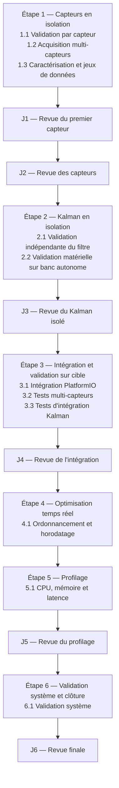

# ANNEXE — Variantes et historique du référentiel technique global

> ## AVERTISSEMENT — DOCUMENT NON NORMATIF
> ## NE PAS UTILISER COMME SUPPORT DE PROGRAMMATION
>
> Ce fichier conserve les **variantes écartées**, les **décisions documentaires** et
> l'**historique** du référentiel technique global. Il n'est **jamais** une spécification :
> aucune de ses lignes ne doit être implémentée.
>
> Documents de programmation : [`Suivi_Avancement.md`](../Suivi_Avancement.md) (point
> d'entrée), [`Planification_Etapes_Paquets_Jalons.md`](../Planification_Etapes_Paquets_Jalons.md)
> (normatif de pilotage), [`Reference_Technique_Globale.md`](../Reference_Technique_Globale.md)
> (référentiel technique) et `Reference_Technique_Etape_<n>_*.md` (détail par étape).
>
> En cas de contradiction avec un document normatif, **le document normatif fait foi**.

---

## 1. Objet de cette annexe

Le référentiel technique global ne doit contenir que des décisions retenues et des renvois
vers les documents d'étape. Tout le reste — idées écartées, structures documentaires
abandonnées, contenu dédupliqué — est conservé ici pour éviter de perdre la trace des
raisonnements et pour éviter qu'un futur agent ne « redécouvre » une piste déjà tranchée.

---

## 2. Variantes documentaires écartées

| Variante | Statut | Motif | Suite |
|---|---|---|---|
| **Fusion en un seul document** de la planification, du référentiel global et des contrats | **Rejeté** | Document unique d'environ 800 lignes mêlant des règles stables et un contenu évolutif, avec un seul point de conflit ; la chaîne à trois niveaux (planification → référentiel → étape) reflète les trois rythmes de mise à jour | Séparation maintenue |
| **Renvoi direct du référentiel global vers les contrats** (`Contrats_Interfaces_Estimation.md` conservé) | **Rejeté** | Le fichier de contrats ne servait qu'à alléger l'étape 1 ; il créait une troisième source pour les structures d'estimation et un risque de dérive avec l'étape 2 | Contrats réintégrés dans `Reference_Technique_Etape_1_Capteurs.md` §7 et Annexe C |
| **Diagramme de séquencement dupliqué** dans le référentiel global | **Rejeté** | Copie mot pour mot du diagramme de la planification ; deux sources divergentes possibles pour un même séquencement | Diagramme conservé uniquement dans la planification §3 (copie gelée au §4 ci-dessous) |
| **Table des jalons dupliquée** dans le référentiel global | **Rejeté** | Même contenu reformulé ; risque d'incohérence sur les positions `C2.1`/`C2.2` | Table conservée uniquement dans la planification §5 (copie gelée au §4 ci-dessous) |
| **Document séparé pour l'organisation du dépôt** (`Organisation_FromTo_Github.md`) | **Abandonné** (fusionné) | Second document normatif structuré par paquet : double maintenance et risque de divergence avec les paquets du référentiel, préséance autodéclarée contraire à la règle de préséance unique. Cela ne contredit pas le rejet de la « fusion en un seul document » : l'organisation du dépôt suit le même rythme technique que les paquets du référentiel, contrairement à la planification qui en a un distinct | Contenu intégré au référentiel §10 (organisation transversale) et aux blocs « Organisation du dépôt » des paquets (§3 à §8) ; préséance sur les emplacements ajoutée à la planification §1 ; fichier supprimé (l'original reste dans l'historique Git du dépôt de documentation) |
| **Renommage avec préfixes numériques** (`00_`, `10_`, `20_`, `90_`) pour imposer l'ordre de lecture | **Différé** | Renommage plus lourd, liens à maintenir à chaque nouvelle étape ; l'ordre de lecture est déjà imposé par `Suivi_Avancement.md` §2 | Réévaluable si le nombre de fichiers augmente |
| **Suppression pure et simple** de l'ancien fichier de contrats, sans archive | **Rejeté** | Perte de la trace des décisions ; une copie gelée ne coûte rien | `Annexe_Archive_Contrats_Interfaces.md` — copie gelée d'abord conservée, puis **allégée le 2026-10-30** (bandeau + table de correspondance) ; le contenu intégral reste dans l'historique Git du dépôt de documentation (`Programmation/`, commit initial du 2026-10-30) |

---

## 3. Journal des décisions documentaires

| Date | Décision | Document concerné |
|---|---|---|
| 2026-10-29 | `FilterType` aligné sur les **quatre** valeurs de `Implementation` §1.2.1 (`INERTIEL_EULER` inclus) | `Reference_Technique_Etape_1_Capteurs.md` §7.2.2 |
| 2026-10-29 | `FilterState` / `ControlState` / `FilterDiagnostics` extraits dans un fichier de contrats dédié | historique — voir §4 |
| 2026-10-30 | Contrats d'interface réintégrés dans le document de l'étape 1 ; fichier de contrats supprimé et archivé | `Reference_Technique_Etape_1_Capteurs.md` §7 et Annexe C |
| 2026-10-30 | Le référentiel technique global devient le point de renvoi vers un document par étape (§2.1) et porte les règles de cohérence (§2.2) | `Reference_Technique_Globale.md` §2 |
| 2026-10-30 | Diagramme et table des jalons retirés du référentiel global : la planification en est la source unique | `Planification_Etapes_Paquets_Jalons.md` §3, §5 |
| 2026-10-30 | `Jalon associé : J3` retiré du paquet `2.1` : `J3` est évalué après `C2.2` uniquement | `Reference_Technique_Globale.md` §4 |
| 2026-10-30 | `Suivi_Avancement.md` créé comme point d'entrée unique des sessions | `Suivi_Avancement.md` |
| 2026-10-30 | Convention de nommage : `Planification_*` (normatif), `Reference_Technique_*` (technique), `Annexe_*` (non normatif) | tous les documents du dossier |
| 2026-10-30 | Dossier renommé `Pilotage/` ; annexes regroupées dans `Annexes/` ; annexe archive allégée, sa copie intégrale conservée dans l'historique Git du dépôt de documentation | `Annexe_Archive_Contrats_Interfaces.md` |
| 2026-10-30 | Fusion de `Organisation_FromTo_Github.md` dans le référentiel : organisation transversale du dépôt en §10, conséquences par paquet en blocs « Organisation du dépôt » (§3 à §8) ; préséance sur les emplacements ajoutée à la planification §1 ; la dette de révision du document (vocabulaire « feuille de route », préséance propre) est soldée par la fusion ; fichier supprimé | `Reference_Technique_Globale.md` §3 à §10 ; `Planification_Etapes_Paquets_Jalons.md` §1 |
| 2026-10-30 | Checklist de création d'un document d'étape étendue : les blocs « Organisation du dépôt » migrent vers le document d'étape à sa création (§2.2, règle 7) | `Reference_Technique_Globale.md` §2.1.1, §2.2 |
| 2026-10-30 | `bench/kalman_replay/` renommé `bench/test_kalman/` (alignement sur la règle `bench/test_*` de §10.1 et sur les environnements `[env:test_*]` du dépôt) ; contenu réparti entre `2.1` (environnement natif, environnement cible en compilation seule, `reference/` des références hôte) et `2.2` (environnement cible exécutable, `scripts/` de comparaison hôte/cible) | `Reference_Technique_Globale.md` §4, §10.2, §10.3, §10.5 |

---

## 4. Contenu dédupliqué — copie gelée (2026-10-29)

> Sections retirées du référentiel technique global le 2026-10-30 parce qu'elles
> dupliquaient la planification. **Conservées ici à titre historique uniquement.** En cas de
> divergence, `Planification_Etapes_Paquets_Jalons.md` §3 et §5 fait foi.

### 4.1 Diagramme de séquencement (ancienne section « Vue d'ensemble »)

### 4.2 Table des jalons (ancienne section « Jalons de revue »)

| Jalon | Position | Objet |
|---|---|---|
| `J1` | après `C1.1` | Valider la méthode de banc et le premier capteur. |
| `J2` | après `C1.3` | Valider les capteurs, l'acquisition multi-capteurs et les données. |
| `J3` | après `C2.2` | Valider le filtre en isolation (hôte et banc autonome) et stabiliser son API. |
| `J4` | après `C3.3` | Valider l'intégration sur cible et la non-régression. |
| `J5` | après `C5.1` | Valider les performances et les budgets. |
| `J6` | après `C6.1` | Valider le système et clôturer le projet. |

### 4.3 Historique de l'extraction puis de la réintégration des contrats

1. **2026-10-29** — §7 et Annexe C de l'ancienne `Feuille_de_Route_Etape_1.md` extraits vers
   `Contrats_Interfaces_Estimation.md`, afin d'alléger le document d'étape.
2. **2026-10-30** — extraction annulée : les contrats reviennent dans le document de
   l'étape 1 (§7 et Annexe C), le fichier de contrats est supprimé et archivé
   (`Annexe_Archive_Contrats_Interfaces.md`). Motif : une seule source par type de contenu,
   et un document d'étape qui reste autosuffisant pour la programmation.

### 4.4 Critères globaux de l'ancien `Organisation_FromTo_Github.md` (non repris à la fusion)

> À la fusion de l'ancien document d'organisation dans le référentiel (§10), ses critères
> globaux de réussite ont été **dédupliqués** plutôt que repris : ils répétaient les
> règles permanentes de la planification (§7, règles 5 à 7) et les critères de paquet du
> référentiel. Conservés ici à titre historique uniquement.

- il n'existe qu'un seul dépôt Git pour le firmware, les capteurs et le filtre ;
- `lib/sensors/` et `lib/kalman/` sont les sources uniques de vérité ;
- chaque bench est un projet PlatformIO autonome, constructible et exécutable ;
- `test/` contient des assertions, pas des programmes interactifs ;
- le firmware consomme les bibliothèques sans en copier le code ;
- les données volumineuses et les documents confidentiels restent hors du dépôt ;
- les étapes de la feuille de route sont traçables dans l'historique Git et dans les revues, sans duplication d'arborescence.

---

## 5. Variantes techniques

Les variantes techniques du contenu (idées écartées sur la configuration, les structures,
les capteurs) ne sont **pas** dans ce fichier : elles sont consignées dans
[`Annexe_Variantes_Et_Historique_Etape_1.md`](./Annexe_Variantes_Et_Historique_Etape_1.md).
Chaque future étape disposera de son annexe `Annexe_Variantes_Et_Historique_Etape_<n>.md`.
