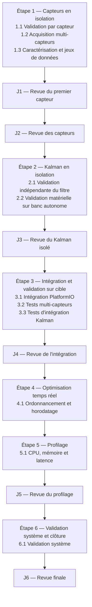

# Planification — étapes, paquets de travail et jalons

> **Statut :** normatif de pilotage. Les identifiants, les paquets et les jalons peuvent
> être précisés sans changer le modèle à trois niveaux.

## 1. Objet

> **Rôle du document.** Document **normatif de pilotage**. Il définit les niveaux de
> planification, les identifiants, les jalons, les règles de progression et la table
> d'autorité entre documents — et **rien d'autre**. Il ne contient aucun contenu technique. Pour savoir où en est le projet et
> dans quel ordre lire les documents, voir
> [`Suivi_Avancement.md`](./Suivi_Avancement.md).

Ce document définit la structure de planification du développement des capteurs, du filtre de Kalman et de leur intégration dans `FromTo Github`.

Il fixe :

- les niveaux de planification ;
- les identifiants utilisés dans les documents ;
- les règles de progression et d'arrêt ;
- les points de reprise et les notes de passation ;
- les jalons de revue ;
- la table d'autorité entre documents, par type de question.

Il ne remplace pas les documents techniques détaillés. Il sert de référence commune pour savoir **où en est le projet**, **ce qui doit être produit**, **où un agent doit s'arrêter** et **ce qui doit être transmis au suivant**.

**Table d'autorité entre documents, par type de question.**

La préséance documentaire n'est **pas un ordre total** : un même document fait foi sur un
sujet et reste subordonné sur un autre. Cette table est donc indexée par **type de
question**, et elle est la **source unique** de la préséance : les autres documents y
renvoient et ne la reformulent pas — le `Référentiel` §2.2 et le document de l'étape 1 §0
n'en sont que des spécialisations. La colonne « Qui tranche » sépare l'**autorité** (quel
texte gagne) de la **gouvernance** (qui peut modifier ou figer). Cette table ne fixe pas
l'**ordre de lecture**, qui reste celui de `Suivi_Avancement.md` §2.

| Type de question | Fait foi | Détaillent sans contredire | Non normatif — jamais support | Juge de paix (si valeur) | En cas d'écart | Qui tranche |
|---|---|---|---|---|---|---|
| Identifiants, niveaux, jalons, règles de progression, gabarit de passation | **ce document** | `Suivi_Avancement.md` §4 (rappel), `Reference_Technique_Globale.md` | — | — | corriger le document de détail, jamais la planification | humain (modèle), agent (application) |
| Objectifs, périmètres, livrables et critères d'acceptation de paquet | [`Reference_Technique_Globale.md`](./Reference_Technique_Globale.md) §3 à §8 | `Reference_Technique_Etape_<n>_*.md` | — | — | corriger le document de détail ; consigner en passation | humain |
| Détail d'implémentation d'une étape (types, configuration, contrats, squelettes) | `Reference_Technique_Etape_<n>_*.md` | — | sketches `NvCapteurs/`, code existant : **précédents non normatifs** | build et tests | corriger le document d'étape | agent |
| Emplacements, frontières de responsabilité et règles de dépendance dans le dépôt `FromTo Github` | [`Reference_Technique_Globale.md`](./Reference_Technique_Globale.md) §10 (et blocs « Organisation du dépôt » des paquets tant que le document d'étape n'existe pas) | `Reference_Technique_Etape_<n>_*.md` après transfert (`Reference_Technique_Globale.md` §2.2, règle 7) | — | décision documentée (pas de notion de fiabilité) | corriger le document compétent | humain |
| Sources et valeurs techniques (bus, broches, registres, échelles, constantes) | documents d'ingénierie : `Materiel.pdf`, `Implementation.pdf`, `Formulations_Kalman.pdf`, `Materiel/Datasheets/`, `Elec/Schéma électrique capteurs.pdf` | `Reference_Technique_Etape_<n>_*.md` §0, **s'il est cohérent ou signale l'écart** | `FromTo Github`, sketches : **précédents non normatifs** | `Reference_Technique_Globale.md` §2.3.6 | la mesure bat le document ; valeur provisoire marquée `PROVISOIRE V-nn` | agent (clôt `vérifiée`), humain (`figée`) |
| Fiabilité d'une valeur (niveau `A` à `D`, impact) | [`Reference_Technique_Globale.md`](./Reference_Technique_Globale.md) §2.3.3 à §2.3.5 | — | [`Suivi_Valeurs_Et_Sources.md`](./Suivi_Valeurs_Et_Sources.md) : état, jamais spécification | `Reference_Technique_Globale.md` §2.3.6 | registre corrigé | agent |
| État d'avancement, prochain paquet, ordre de lecture, carte des documents | [`Suivi_Avancement.md`](./Suivi_Avancement.md) §1 à §3 (état) | §4 de ce document (index de pilotage) | — | — | corriger `Suivi_Avancement.md` | agent |
| Décision prise en session | **aucun** : elle ne fait foi qu'une fois écrite dans le document désigné par la présente table | note de passation | note de passation : **trace seule** | — | propager au document qui fait foi, puis journaliser | agent (implémentation), humain (doctrine) |
| Historique, variantes, arbitrages écartés | `Annexe_Variantes_Et_Historique_*.md` | — | `Annexe_*` : **jamais support de programmation** | — | ne peut pas contredire un document normatif | humain |
| Versions, dates, diffs | Git (dépôt de documentation et dépôt de code) | — | — | — | — | agent |

**Méta-règles pour les cas non listés.** Elles évitent d'allonger la table indéfiniment et
s'appliquent dans cet ordre :

1. **Normatif > non normatif** : une annexe, un registre d'état, une note de passation ou un
   précédent de code ne peut jamais contredire un document normatif.
2. **Spécifique > général** : le critère de paquet prime la synthèse de critères d'étape
   (§4) ; le document d'étape prime le référentiel pour le détail d'implémentation ; le §10
   prime pour les emplacements.
3. **Pour une valeur technique** : la mesure ou l'essai prime le document, et le document
   normatif prime le registre.
4. **Une décision n'est normative qu'une fois écrite** dans le document que la table désigne ;
   une note de passation ne fait que la tracer.
5. **Écart non couvert** : corriger le document de détail ou le référentiel, jamais la
   planification, et consigner la correction dans la note de passation
   (`Reference_Technique_Globale.md` §2.2, dernier alinéa).

---

## 2. Modèle à trois niveaux

### 2.1 Niveau 1 — Étape

Une **étape** est une grande phase technique. Elle regroupe plusieurs paquets de travail et se termine par un ou plusieurs jalons de revue.

Les étapes sont numérotées de `1` à `6` :

| Étape | Intitulé |
|---|---|
| `1` | Capteurs en isolation |
| `2` | Kalman en isolation |
| `3` | Intégration et validation sur cible |
| `4` | Optimisation temps réel |
| `5` | Profilage |
| `6` | Validation système et clôture |

Une étape n'est pas une unité d'arrêt pour un agent. Elle sert à organiser le travail et à regrouper les revues.

### 2.2 Niveau 2 — Paquet de travail

Un **paquet de travail** est une unité d'exécution bornée. C'est le niveau auquel un agent reçoit une mission.

Un paquet possède :

- un objectif ;
- des entrées ;
- des livrables ;
- des critères d'acceptation ;
- un périmètre explicitement exclu ;
- un point de reprise.

Les paquets sont identifiés par `<étape>.<numéro>` : `1.1`, `1.2`, `2.1`, `3.1`, etc.

Un paquet doit pouvoir être terminé sans dépendre d'un travail non encore validé.

### 2.3 Niveau 3 — Point de reprise

Un **point de reprise** est la fin d'un paquet de travail. C'est le moment où l'agent :

- s'arrête ;
- laisse le dépôt dans un état cohérent ;
- vérifie les critères d'acceptation ;
- rédige une note de passation ;
- indique ce qui reste à faire.

Les points de reprise sont identifiés par `C<étape>.<numéro>` : `C1.1`, `C1.2`, `C2.1`, etc.

Un point de reprise n'est pas un jalon de revue. C'est un **arrêt de travail** avec transfert de contexte.

### 2.4 Jalons de revue

Un **jalon** est une porte de décision. Il ne s'agit pas d'une étape technique ni d'une unité d'exécution.

Un jalon sert à :

- vérifier qu'un ensemble de paquets est cohérent ;
- décider de continuer, corriger ou réorienter ;
- valider les livrables avant de passer à l'étape suivante ;
- consigner les décisions et les risques.

Les jalons sont identifiés `J1` à `J6`.

| Niveau | Identifiant | Rôle | Unité d'arrêt ? |
|---|---|---|---|
| Étape | `1` à `6` | Grande phase technique | Non |
| Paquet de travail | `1.1`, `1.2`, … | Mission bornée confiée à un agent | Oui, à la fin |
| Point de reprise | `C1.1`, `C1.2`, … | Arrêt, vérification et passation | Oui |
| Jalon de revue | `J1` à `J6` | Décision et validation | Non |

---

## 3. Vue d'ensemble



---

## 4. Étapes et paquets de travail

> **Index de pilotage.** Les tableaux ci-dessous ne donnent que l'**objet** de chaque paquet,
> son point de reprise et son jalon. Les objectifs détaillés, périmètres, livrables et
> critères d'acceptation de paquet font référence dans
> [`Reference_Technique_Globale.md`](./Reference_Technique_Globale.md) ; les critères de
> sortie d'étape ci-dessous n'en sont qu'un **agrégat** (étapes multi-paquets) ou un
> **renvoi** (étape à paquet unique).

### Étape 1 — Capteurs en isolation

| Paquet | Objet | Point de reprise | Jalon |
|---|---|---|---|
| `1.1` | Validation indépendante par capteur | `C1.1` | `J1` |
| `1.2` | Acquisition multi-capteurs | `C1.2` | — |
| `1.3` | Caractérisation métrologique et jeux de données | `C1.3` | `J2` |

**Critères de sortie de l'étape (agrégat des critères de paquet —
[`Reference_Technique_Globale.md`](./Reference_Technique_Globale.md) §3 ; en cas d'écart,
le critère de paquet fait foi) :**

- chaque capteur possède un banc autonome et reproductible ;
- l'acquisition multi-capteurs fonctionne avec une base de temps commune ;
- les bruits et les défauts sont caractérisés ;
- les jeux de données sont produits, documentés et rejouables ;
- aucun code du firmware n'a été dupliqué dans les bancs.

### Étape 2 — Kalman en isolation

| Paquet | Objet | Point de reprise | Jalon |
|---|---|---|---|
| `2.1` | Validation indépendante du filtre | `C2.1` | — |
| `2.2` | Validation matérielle du filtre sur banc autonome | `C2.2` | `J3` |

**Critères de sortie de l'étape (agrégat des critères de paquet —
[`Reference_Technique_Globale.md`](./Reference_Technique_Globale.md) §4 ; en cas d'écart,
le critère de paquet fait foi) :**

- le filtre se compile et s'exécute sur hôte ;
- le filtre s'exécute sur cible via le banc autonome, avec des résultats conformes aux références hôte ;
- les tests unitaires et les scénarios de validation passent ;
- les invariants numériques sont vérifiés ;
- les jeux de données et les simulations sont rejouables ;
- l'API publique est stable et documentée ;
- la bibliothèque du filtre ne dépend ni d'Arduino, ni du firmware, ni d'un pilote matériel ; la couche matérielle reste confinée au banc autonome.

### Étape 3 — Intégration et validation sur cible

| Paquet | Objet | Point de reprise | Jalon |
|---|---|---|---|
| `3.1` | Intégration dans le PlatformIO global | `C3.1` | — |
| `3.2` | Tests multi-capteurs sur cible | `C3.2` | — |
| `3.3` | Tests d'intégration Kalman sur cible | `C3.3` | `J4` |

**Critères de sortie de l'étape (agrégat des critères de paquet —
[`Reference_Technique_Globale.md`](./Reference_Technique_Globale.md) §5 ; en cas d'écart,
le critère de paquet fait foi) :**

- tous les environnements firmware se compilent ;
- l'acquisition multi-capteurs fonctionne sur cible ;
- le filtre fonctionne sur cible avec des données rejouées puis avec les capteurs réels ;
- les modes dégradés sont testés ;
- aucune duplication de pilote ou de filtre n'existe dans le firmware.

### Étape 4 — Optimisation temps réel

| Paquet | Objet | Point de reprise | Jalon |
|---|---|---|---|
| `4.1` | Ordonnancement et horodatage | `C4.1` | — |

**Critères de sortie de l'étape :** ceux du paquet `4.1` —
[`Reference_Technique_Globale.md`](./Reference_Technique_Globale.md) §6.

### Étape 5 — Profilage

| Paquet | Objet | Point de reprise | Jalon |
|---|---|---|---|
| `5.1` | Profilage CPU, mémoire et latence | `C5.1` | `J5` |

**Critères de sortie de l'étape :** ceux du paquet `5.1` —
[`Reference_Technique_Globale.md`](./Reference_Technique_Globale.md) §7.

### Étape 6 — Validation système et clôture

| Paquet | Objet | Point de reprise | Jalon |
|---|---|---|---|
| `6.1` | Validation système | `C6.1` | `J6` |

**Critères de sortie de l'étape :** ceux du paquet `6.1` —
[`Reference_Technique_Globale.md`](./Reference_Technique_Globale.md) §8.

---

## 5. Jalons de revue

| Jalon | Position | Paquets concernés | Décision attendue |
|---|---|---|---|
| `J1` | après `C1.1` | `1.1` | La méthode de banc et le premier capteur sont-ils validés ? |
| `J2` | après `C1.3` | `1.1`, `1.2`, `1.3` | Les capteurs, l'acquisition multi-capteurs et les données sont-ils prêts pour le filtre ? |
| `J3` | après `C2.2` | `2.1`, `2.2` | Le filtre est-il validé en isolation — sur hôte et sur banc autonome — et son API est-elle stable ? |
| `J4` | après `C3.3` | `3.1`, `3.2`, `3.3` | L'intégration sur cible est-elle fonctionnelle et non régressive ? |
| `J5` | après `C5.1` | `4.1`, `5.1` | Les performances et les budgets sont-ils acceptables ? |
| `J6` | après `C6.1` | `6.1` | Le système est-il validé et le projet peut-il être clôturé ? |

Un jalon peut être déplacé ou regroupé si le contexte l'exige, mais il ne devient jamais une unité d'exécution. Un jalon est évalué **après** le point de reprise indiqué, jamais après un paquet intermédiaire.

---

## 6. Note de passation

À chaque point de reprise, l'agent produit une note de passation, déposée dans
`Programmation/Passations/` (convention :
[`../Passations/README.md`](../Passations/README.md)) sous le nom `C<identifiant>.md` ;
elle doit contenir au minimum :

```text
# Point de reprise C<identifiant>

## Paquet de travail
## Objectif
## Livrables produits
## Ce qui fonctionne
## Ce qui ne fonctionne pas ou reste incomplet
## Fichiers créés ou modifiés
## Décisions prises
## Écarts et contradictions détectés
## État des builds et des tests
## Prochain paquet de travail
## Zones à ne pas modifier
```

La note doit être compréhensible de manière autonome.

---

## 7. Règles de progression

1. Un agent travaille sur **un seul paquet de travail à la fois**.
2. Un paquet se termine à son **point de reprise**.
3. L'agent ne commence pas le paquet suivant sans note de passation.
4. Un paquet n'est terminé que si ses critères d'acceptation sont vérifiés **et** que sa
   note de passation est rédigée (§6).
5. Les éléments hors périmètre sont explicitement listés et ne sont pas implémentés.
6. Les bibliothèques sont les sources uniques de vérité ; aucun code n'est dupliqué dans les bancs ou le firmware.
7. Les données volumineuses, les documents confidentiels et les artefacts générés restent hors du dépôt.
8. Les jalons sont des revues, pas des étapes de code.
9. Les identifiants de ce document sont les seuls utilisés dans les documents de planification et techniques.
10. Un document technique **détaille** ; il ne redéfinit ni identifiant, ni jalon, ni critère de sortie d'étape. En cas de divergence, la table d'autorité du §1 s'applique.

---

## 8. Documents associés

> La carte complète des documents (normatifs et non normatifs) et l'ordre de lecture sont
> tenus à jour dans [`Suivi_Avancement.md`](./Suivi_Avancement.md) §3, qui fait foi.
> Ce document s'appuie directement sur [`Suivi_Avancement.md`](./Suivi_Avancement.md)
> (point d'entrée) et [`Reference_Technique_Globale.md`](./Reference_Technique_Globale.md)
> (référentiel technique).
