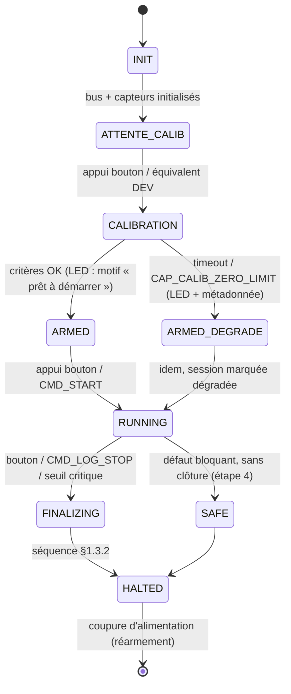

# Référence technique — Étape 1 : capteurs en isolation

> **Rôle du document.** Spécification d'implémentation de l'**Étape 1**, détaillée depuis le
> référentiel technique global [`Reference_Technique_Globale.md`](./Reference_Technique_Globale.md).
> Elle couvre principalement les paquets `1.1` (validation indépendante par capteur) et `1.2`
> (acquisition multi-capteurs), fournit les contrats, les mesures et le format de log
> nécessaires au paquet `1.3` (caractérisation métrologique et jeux de données), et
> **abrite les contrats d'interface d'estimation** (§7 et Annexe C), qui lient l'acquisition,
> le filtre et l'asservissement. La structure de planification est définie dans
> [`Planification_Etapes_Paquets_Jalons.md`](./Planification_Etapes_Paquets_Jalons.md) ;
> l'état d'avancement et l'ordre de lecture des documents sont dans
> [`Suivi_Avancement.md`](./Suivi_Avancement.md).

Il s'appuie sur les documents d'ingénierie du dépôt : [`Materiel.pdf`](../../Materiel/Materiel.pdf)
(§2 centrales inertielles, §3 altimétrie, §5 calculateur, broches et mémoire),
[`Implementation.pdf`](../../Implementation/Implementation.pdf) (§1 architecture logicielle,
§2 traitement des mesures, §3 géométrie et calibration, §6 sûreté de fonctionnement),
[`Formulations_Kalman.pdf`](../../Formulations_Kalman/Formulations_Kalman.pdf)
(§1.3.4 à §1.3.6 métrologie et protocole, §2.2 conventions et conversions), les fiches
de [`Materiel/Datasheets/`](../../Materiel/Datasheets/) et le schéma
`Elec/Schéma électrique capteurs.pdf`. Les références complètes figurent au **§8**.

> **Principe directeur :** le paquet `1.1` est un **sous-ensemble strict du paquet `1.2`**.
> Tout ce qui est produit ici (fichier de configuration commun, classes capteurs,
> algorithmes unitaires) doit être réutilisable *tel quel* dans l'acquisition multi-capteurs,
> en changeant uniquement des drapeaux de compilation (mécanisme du §1.2).

> **Configuration de référence.** La topologie retenue est celle décrite par
> `Implementation.pdf` §2.1.2 (« Fusion hybride redondante BNO085 + CMPS12 —
> *configuration de référence* ») et §1.4 : **BNO085 primaire + CMPS12 secondaire +
> BMP581**. Les tables d'instances conservent la **capacité** d'accueillir une seconde
> CMPS12 et des MPL3115A2 (`MAX_IMU = 3`, `MAX_ALTI = 3`), mais ces lignes restent
> `actif = false` : aucun document d'ingénierie ne décrit une deuxième centrale ni un
> second altimètre installé (`Materiel` §2 et §3 en décrivent un de chaque ;
> `Formulations_Kalman` §1.3.4 présente le MPL3115A2 comme l'**option 2** de baromètre
> et son protocole §1.3.6 n'enregistre que le BMP581). Le MPL3115A2 est donc un
> **repli comparatif documenté**, pas un capteur installé. Retenir une topologie plus
> large exigerait de mettre à jour `Materiel.tex` et `Implementation.tex` au préalable.
> Le GPS PA1010D reste hors périmètre (la procédure d'extension §1.5 permettrait de le
> réintégrer) et les **ultrasons** présents dans l'ancien code sont hors périmètre (§4.1).
> L'Étape 1 sert l'objectif final — le filtre de Kalman d'estimation de pose — dont les
> compromis dimensionnants sont la précision, le temps processeur alloué au filtrage,
> l'empreinte mémoire, la robustesse (perte de capteur, mesures aberrantes) et la
> testabilité hors cible (étape 2.1).

> **Interruptions hors périmètre :** règle normative unique au **§0** (aucune broche
> d'interruption avant la soutenance finale ; étude intégralement en polling non bloquant).
>
> **Identifiants.** Ce document ne crée aucun identifiant de planification : il reprend
> ceux de [`Planification_Etapes_Paquets_Jalons.md`](./Planification_Etapes_Paquets_Jalons.md)
> (paquets `1.1` à `1.3`, points de reprise `C1.1` à `C1.3`, jalons `J1` et `J2`). Les
> repères `M0a` à `M4` sont internes à ce document et ne remplacent ni un point de
> reprise, ni un jalon ; aucun identifiant de planification n'est redéfini ici.

---

> **Terminologie.** *Mode* : axe de compilation (`CAP_MODE_RUNTIME`, trois valeurs).
> *Capability* : faculté réservée à un mode (journalisation, diagnostic, simulation).
> *Bloc* : section numérotée de `CapteursConfig.h`. *Instance* : ligne d'une table
> `CFG_*` (un capteur physique ou simulé). *Puits* : destination de la trame canonique
> (série, SD, fichier simulé). *Nœud* : calculateur — l'architecture n'en comporte
> qu'un (§1.2). La graphie `DEV` est la seule employée pour le mode de développement.

---

<a id="ordre-de-lecture"></a>

## Ordre de lecture et sommaire

> Le document est organisé par contrat, pas par ordre de travail. Le sommaire donne la
> structure d'ensemble ; la table ci-dessous permet de se limiter aux sections utiles au
> point de contrôle considéré.

**Sommaire :**

| Section | Contenu |
| :--- | :--- |
| [§0](#sec-0) | Constat préalable sur l'existant (hiérarchie des sources, broches, adresses) |
| [§1](#sec-1) | Fichier de configuration commun `CapteursConfig.h` (contrats, tables, trame, tampon) |
| [§2](#sec-2) | Capteur BNO085 |
| [§3](#sec-3) | Capteur BMP581 |
| [§4](#sec-4) | Consolidation CMPS12, MPL3115 & UWB (conformité, paquet 1.2) |
| [§5](#sec-5) | Intégration, mémorisation, calibration (préparation du paquet 1.2) |
| [§6](#sec-6) | Points de contrôle internes, livrables, risques |
| [§7](#sec-7) | Contrats d'interface des structures d'estimation (lus à l'étape 1, portés par l'étape 2) |
| [§8](#sec-8) | Références |
| [Annexe A](#annexe-a) | Squelette `CapteursConfig.h` |
| [Annexe B](#annexe-b) | Squelettes de classes |
| [Annexe C](#annexe-c) | Squelettes `CapteursState`, `FilterState`, `ControlState` |

**Ordre de lecture par point de contrôle** (les repères `M0a` à `M4` sont internes à la
présente référence ; ils ne remplacent ni les points de reprise `C1.1`–`C1.3`, ni les
jalons `J1`/`J2`) :

| Point de contrôle | Sections utiles |
| :--- | :--- |
| M0a / M0b (audit, squelette, config) | §0, §1.1, §1.2, §1.3 blocs **1 à 10**, Annexe A |
| M1 (BNO085) | §2, §5.3, Annexe A blocs 5 et 11 |
| M2 (BMP581) | §3, §5.3, Annexe A blocs 6 et 11 |
| M3 (consolidation) | §4 |
| M4 (journalisation, session, LED, clôture) | §1.3.1 à §1.3.3, Annexe A blocs **11 à 13** |
| Bilan | §5, §6, §8 |

Les blocs 11 à 13 et les trois sous-sections de trame ne conditionnent **aucun** travail
de M1/M2 : ils sont lus au point de contrôle M4 (livrable 7).

---

<a id="sec-0"></a>
## 0. Constat préalable sur l'existant

**Hiérarchie des sources.** Font autorité, dans cet ordre : (1) `Materiel.pdf`,
`Implementation.pdf`, `Formulations_Kalman.pdf`, les fiches de `Materiel/Datasheets/` et
le schéma `Elec/Schéma électrique capteurs.pdf` ; (2) la présente feuille, qui doit être
cohérente avec (1) ou signaler explicitement l'écart ; (3) les sketches de `NvCapteurs/`
et le dépôt `FromTo Github`, qui ne sont que des **précédents non normatifs** : ils
servent à repérer des idées, jamais à établir une exigence. Une idée issue du code n'est
retenue qu'après évaluation de sa pertinence au regard de (1) et (2) (les idées écartées
sont consignées dans l'annexe
[`Annexe_Variantes_Et_Historique_Etape_1.md`](./Annexes/Annexe_Variantes_Et_Historique_Etape_1.md), §7).

**Broches non encore spécifiées.** Les broches physiques (I2C, UART, LED, interruptions)
ne sont pas toutes arbitrées. Pour le matériel **existant**, le code fait foi (bus I2C,
ports série effectivement utilisés) ; pour le matériel **non encore défini**, la mention
est **`À définir`** — aucune valeur n'est inventée (cf. §1.3 bloc 4 et §8).

| Élément | État | Conséquence pour l'Étape 1 |
| :--- | :--- | :--- |
| `FromTo Github/lib/sensors/` et `FromTo Github/bench/` | **À créer** | Créer l'arborescence PlatformIO (§1.7) |
| `Programmation/NvCapteurs/` | 3 sketches Arduino (.ino) : `scanI2C`, `TestAll`, `TestBaroBMP581` | Migrer vers PlatformIO ; réutiliser comme base des sketches de test. **Précédents non normatifs** |
| Adresses I2C | Trois versions coexistent : `Materiel` §3 (`0x47` si SDO=0, `0x46/0x4A` si SDO=1) ; §3.1 (`0x46`/`0x47` Bosch, `0x47` DFRobot) ; `TestAll.ino` (BNO085 à `0x47`, BMP58X à `0x4A`) et `TestBaroBMP581.ino` (`0x47`). `0x47` **n'est pas une adresse SH-2** (`0x4A`/`0x4B`, §2.1) : `TestAll.ino` ne peut donc pas initialiser le BNO085 à cette adresse et **ne doit pas servir de preuve** | **Aucune adresse n'est affirmée ici.** Audit M0 : `scanI2C` capteur par capteur seul, lecture du schéma `Elec`, puis fiche constructeur. Les valeurs sont figées ensuite en **un seul endroit** (table d'instances) |
| Interruptions | `H_INTN` (BNO085) et `INT` (BMP581) **non routées** sur le PCB ; à noter que `Materiel` §5.4 affecte pourtant `IMU_INT` à la broche 2 et `BARO_INT` à la broche 3, en contradiction avec ses propres §2.4 et §3.4 | **Règle normative unique :** aucune broche d'interruption n'est implémentée avant le jour de la soutenance finale ; l'Étape 1 reste **intégralement en polling non-bloquant**. Le routage réel est tranché au M0 sur le schéma `Elec` ; les broches restent à `-1` (non routé) en attendant |
| Configuration matérielle | `Implementation` §1.3.1 documente un fichier `HardwareConfig.h` (`ENABLE_IMU_PRIMARY`, `ENABLE_IMU_SECONDARY`, `ENABLE_BAROMETER`, `ENABLE_GNSS`, `ENABLE_UWB_BEACONS`, `ENABLE_SD_LOGGING`) que la présente feuille ne mentionne pas | `CapteursConfig.h` **absorbe** ce contrat ; la correspondance est donnée en §1.1.1. Sans cette note, deux contrats de configuration coexisteraient dans la documentation |
| Signalisation LED | `Implementation` §6.5 définit une machine à états complète sur la **seule LED 13** (P1 IMU primaire 5 Hz ; salves 2/3/4/5 flashs ; heartbeat 1 Hz) ; `Materiel` §5.4 ne documente qu'une « LED de Statut — broche 13 ». Les broches 41/39/40 ne figurent dans aucun document d'ingénierie | L'Étape 1 **adopte les motifs d'`Implementation` §6.5 sur la LED 13** (§1.3.3). La sortie RGB est déclarée **réservée**, non implémentée, en attente du schéma `Elec` |
| Classes historiques | `IMUCMPS12`, `AltiMPL3115`, `UWB` dans `FromTo Github` (bases `IMU`/`Alti`, `read(ts, vals, change)`) | Précédent de moule utile, **non normatif** : le moule retenu est celui de §2.6/§3.6, aligné sur `Implementation` §1.4 |
| Sélection de compilation | Précédent `config.h` : `#define KALMAN_KINEMATIC` | Même mécanisme pour `CapteursConfig.h`, avec des macros **surchargeables** par `build_flags` (§1.2) |

---

<a id="sec-1"></a>
## 1. Section fichier de configuration commun : `CapteursConfig.h`

### 1.1 Rôle
* **Source unique de vérité** pour : l'activation des capteurs (par famille **et par
  instance** — plusieurs capteurs de même fonction coexistent ; indépendante du mode,
  §1.2.1), le bus/brochage, les réglages internes de chaque capteur (fréquence, OSR,
  filtre, rapports), les périodes de polling, ainsi que l'enregistrement/affichage et
  les fonctions de diagnostic, réglés **par mode d'exécution**.
* **Compilation conditionnelle** : le code des capteurs non actifs n'est pas compilé
  (ni son objet ni ses dépendances de bibliothèque), conformément à l'objectif
  « compiler uniquement les fonctions des capteurs utilisés ».
* **L'Étape 1 n'active qu'un seul capteur à la fois** (un par projet de test) ;
  le paquet 1.2 activera l'ensemble sur le bus I2C partagé. Cette contrainte est
  obtenue par le sélecteur de projet `CAP_TEST_CIBLE` et vérifiée à la compilation par
  le drapeau optionnel `CAP_REQUIRE_SINGLE_SENSOR`, posés par chaque projet de test
  (§1.2.1), quel que soit le mode d'exécution.

#### 1.1.1 Rapport avec `HardwareConfig.h`

`Implementation.pdf` §1.3.1 documente un fichier de masquage `HardwareConfig.h`. Les
deux fichiers ne coexistent pas : **`CapteursConfig.h` remplace et étend ce contrat**.
Correspondance, à reporter dans l'en-tête du fichier :

| `Implementation` §1.3.1 | `CapteursConfig.h` | Remarque |
| :--- | :--- | :--- |
| `ENABLE_IMU_PRIMARY` | `CAP_BNO085_ACTIF` + ligne `CFG_IMU[]` | le drapeau global ne suffit pas : la ligne porte bus, adresse, `id`, période |
| `ENABLE_IMU_SECONDARY` | `CAP_CMPS12_ACTIF` + ligne `CFG_IMU[]` | idem |
| `ENABLE_BAROMETER` | `CAP_BMP581_ACTIF` + ligne `CFG_ALTI[]` | idem |
| `ENABLE_UWB_BEACONS` | `CAP_UWB_ACTIF` + `CFG_UWB` (structure, §1.3 bloc 3) | UWB sur liaison série, hors I2C |
| `ENABLE_GNSS` | *aucun* | le GPS PA1010D est hors périmètre (§1.5 pour une extension) |
| `ENABLE_SD_LOGGING` | `CAP_LOG_VERS_SD` (bloc 11) | même sémantique : 0 en vol nominal, 1 en campagne |
| « deux binaires » (vol / instrumentation) | `CAP_MODE_RUNTIME` ∈ {`USAGE`, `VALIDATION`} | le profil d'instrumentation correspond à `VALIDATION` |

### 1.2 Mécanisme de sélection statique (modèle `config.h` / futur `FilterConfig.h`)
1. **Un axe de compilation :** le **mode d'exécution** `CAP_MODE_RUNTIME` ∈
   {`USAGE`, `VALIDATION`, `DEV`}. Le périmètre de capteurs (un capteur à l'Étape 1,
   l'ensemble au paquet 1.2) n'est **pas** un axe de compilation : il découle des
   tables d'instances (bloc 3), qui servent telles quelles aux deux étapes. Le mode ne
   choisit pas *quels* capteurs existent, il choisit *quelles fonctions* sont compilées
   (journalisation, diagnostic, simulation — §1.2.1).
   Deux drapeaux optionnels, posés par les projets de test de l'Étape 1 via
   `build_flags`, restreignent le périmètre **sans** toucher au mode :
   `CAP_TEST_CIBLE` (une seule instance sous test, §1.2.1) et
   `CAP_REQUIRE_SINGLE_SENSOR` (vérifie qu'exactement une instance est active après
   filtrage).
   * **Un seul calculateur.** L'architecture retenue est **une** Teensy 4.1 qui
     centralise acquisition, filtrage, asservissement et télémétrie
     (`Implementation` §5.1 ; `Materiel` §5). Les tables par nœud de l'ancien code
     (`NODE_DIRIGEABLE`/`NODE_NACELLE`/`NODE_ORDINATEUR`) ne sont **pas** reprises :
     ce serait un second axe de compilation non documenté (§4.1).
   * **Macros surchargeables.** Toute macro destinée à être posée par un projet via
     `build_flags` (`CAP_MODE_RUNTIME`, `CAP_*_ACTIF`, `CAP_TEST_CIBLE`,
     `CAP_REQUIRE_SINGLE_SENSOR`, `CAP_LOG_*`, `CAP_DEV_*`) est définie sous `#ifndef`
     (Annexe A). Sans cela, un `-D` en ligne de commande est écrasé par le header et
     le projet compile la mauvaise configuration — cas concret du projet `test_bmp581`
     décrit en §1.4.
2. **Un drapeau par famille** de capteurs : `#define CAP_<NOM>_ACTIF 0|1` — il exclut de
   la compilation le code de bibliothèque d'une famille entière. Les familles réelles
   (BNO085, BMP581, CMPS12, UWB) sont dans le socle ; la famille **simulée** n'a pas de
   drapeau dans le socle : `CAP_SIM_ACTIF` est défini dans le bloc DEV (bloc 12) et
   n'existe que là — hors DEV, le code de simulation n'est pas compilé.
3. **Une table d'instances par fonction** : `CFG_IMU[]`, `CFG_ALTI[]` — une ligne par
   capteur physique `{actif, marque, bus, adresse, id, source, periode_us}`. Deux
   capteurs identiques sont deux lignes de la même table (une seule classe, paramétrée
   par bus/adresse via son constructeur) ; le bus y est représenté par un **enum**
   (`BUS_WIRE`, `BUS_WIRE1`) dérivé en `TwoWire*` par une fonction, ce qui rend la table
   `constexpr`. `source` est la **seule** colonne dont l'admissibilité dépend du mode :
   `SOURCE_REEL` est admis partout, `SOURCE_SIMULE` est réservé à DEV (§1.2.1).
   `periode_us` (nouvelle colonne) fixe la cadence d'interrogation **par instance** :
   les marques n'ont pas les mêmes cadences utiles (CMPS12 jusqu'à ~100 Hz ; MPL3115A2
   de 100 Hz à 1,95 Hz selon l'OSR, `Formulations_Kalman` §1.3.4) et le délai de perte
   en dérive (§5.3). `CFG_UWB` est une **structure** (`actif`, port, baud, timeouts)
   et non un booléen. `CFG_US` (ultrasons, présent dans l'ancien code) est **hors
   périmètre** et n'apparaît pas ici (§4.1).
4. Le code de chaque capteur est enveloppé dans `#if CAP_XXX_ACTIF ... #endif`
   (déclarations) et les points d'appel utilisent `if constexpr` (C++17) quand la
   sélection reste dans une même unité de compilation.
5. **Sous-configs par mode :** les paramètres utiles à un seul mode d'exécution sont
   regroupés dans des blocs délimités, enveloppés dans `#if CAP_MODE_RUNTIME == …` — un
   paramètre de DEV référencé par du code USAGE ne compile pas. La simulation (rejeu de
   jeux de données) appartient à ce bloc DEV : ses drapeaux, son include et sa branche
   de fabrique n'existent que sous `#if CAP_MODE_RUNTIME == CAP_MODE_DEV`.
6. Des `static_assert` **garantissent la validité de la combinaison** à la compilation :
   au moins 1 instance active, exactement 1 si `CAP_REQUIRE_SINGLE_SENSOR` est posé
   (drapeau optionnel des projets de test de l'Étape 1, indépendant du mode
   d'exécution), **aucune instance `SOURCE_SIMULE` active hors DEV**, et
   **aucun doublon (bus, adresse)** dans les tables (fonction `constexpr` de parcours) —
   deux capteurs identiques ne peuvent pas partager le même bus à la même adresse :
   sinon bus différents, ou adresse modifiable par broche/commande (cf. §1.7). Les
   garanties portent sur le **périmètre effectif** après filtrage par `CAP_TEST_CIBLE`.

### 1.2.1 Tables d'instances et mode : décision de conception

**Décision : le mode ne modifie pas la table d'instances.** Le mode est un axe de
**compilation de fonctions** (journalisation, diagnostic, simulation) ; la topologie
capteurs est décrite par les tables d'instances. Une instance physique conserve la même
`id`, la même adresse et le même bus dans tous les modes : c'est ce qui permet de
rapprocher un log `VALIDATION`, une session `DEV` et un rejeu de l'étape 2.1, et de
réutiliser `CapteursState` sans remappage.

La seule propriété d'instance dont l'admissibilité dépend du mode est la **source** :

| Source | Modes admis | Mise en œuvre |
| :--- | :--- | :--- |
| `SOURCE_REEL` | `USAGE`, `VALIDATION`, `DEV` | ligne de table ordinaire |
| `SOURCE_SIMULE` | `DEV` **uniquement** | ligne + `CapSimule<T>`, compilés sous `#if CAP_MODE_RUNTIME == CAP_MODE_DEV` |

La règle est vérifiée par `static_assert` (`sourceAutorisee()` sur chaque ligne active),
pas seulement documentée. En `USAGE`/`VALIDATION`, une ligne `SOURCE_SIMULE` active
**ne compile pas** ; la fabrique ne contient pas la branche `SOURCE_SIMULE`.

**Sélecteur de projet `CAP_TEST_CIBLE`.** La table partagée de l'Annexe A décrit une
**capacité** de 3 IMU et 3 altimètres, dont **deux IMU et un altimètre actifs**
(configuration de référence, §0) ; un projet de test doit restreindre le périmètre à son
instance. `CAP_TEST_CIBLE` remplit ce rôle : posé par `build_flags`, il filtre
l'activation effective sans changer le mode ni dupliquer la table.

```cpp
// build_flags du projet test_bno085 :
//   -D CAP_TEST_CIBLE=TEST_IMU_1
//   -D CAP_BMP581_ACTIF=0 -D CAP_CMPS12_ACTIF=0   // seule la famille testée est compilée
// CAP_REQUIRE_SINGLE_SENSOR vaut 1 automatiquement dès qu'une cible de test est posée.
enum CapTestCible : uint8_t { TEST_TOUS = 0, TEST_IMU_1, TEST_IMU_2, TEST_IMU_3,
                              TEST_ALTI_1, TEST_ALTI_2, TEST_ALTI_3, TEST_UWB };
#ifndef CAP_TEST_CIBLE
#define CAP_TEST_CIBLE TEST_TOUS   // 0 = toutes les instances configurées (1.2)
#endif
```

Le prédicat d'activation effectif (`imuActive`, `altiActive`) combine **trois**
conditions — `actif`, le **drapeau de famille** (`CAP_*_ACTIF` correspondant à la marque
de la ligne) et `CAP_TEST_CIBLE`. Sans le drapeau de famille, une instance dont le
pilote n'est pas compilé serait comptée active et le `static_assert` validerait une
propriété fausse (cas du projet `test_bmp581` avec `CAP_BMP581_ACTIF = 0`).
`CAP_REQUIRE_SINGLE_SENSOR`, l'anti-doublon et la fabrique portent sur ce périmètre
filtré.

**Convention d'identité (figée).** `id` est l'identité logique **stable**, unique au
sein d'une famille (`CFG_IMU` : 1..3 ; `CFG_ALTI` : 1..3) ; la clé d'une mesure dans les
logs est donc le couple (`type`, `id`). L'index de tableau `i` reste la **position de la
ligne** (utilisé par `CapteursState`) ; un `static_assert` garantit que
`CFG_*[i].id == i + 1`, de sorte que `id` et `i` ne peuvent pas diverger. Le sélecteur
`CAP_TEST_CIBLE` ne renumérote ni l'un ni l'autre. Une instance conserve son `id` dans
tous les modes et toutes les sessions : c'est la clé de rapprochement entre un log
`VALIDATION`, une session `DEV` et un rejeu de l'étape 2.1.

**Valeur par défaut de `CAP_REQUIRE_SINGLE_SENSOR`.** Le drapeau vaut `1` dès qu'un
`CAP_TEST_CIBLE` autre que `TEST_TOUS` est posé, et `0` sinon (`#ifndef`, Annexe A) :
un projet de test ne peut plus oublier de vérifier son périmètre.

Le mode reste libre : un test BNO085 peut être
compilé en `VALIDATION` (pour produire les logs canoniques) ou en `DEV` (pour le
diagnostic), sans changer la table.

**Simulation en DEV.** La simulation est une fonction de DEV. Un rejeu se fait en DEV
avec `CAP_DEV_SERIAL_LIBRE = 0` (trame canonique sur la série) ou avec le puits SD ; le
contrat d'octets de §1.3.1 est inchangé.

### 1.3 Contenu du fichier (socle commun + sous-configs par mode)

> **Ordre de lecture.** La table de lecture par point de contrôle et le sommaire des
> sections figurent en tête de document
> ([« Ordre de lecture et sommaire »](#ordre-de-lecture)).

**Socle commun** — compilé dans tous les modes :

| Bloc | Contenu |
| :--- | :--- |
| 1. Mode d'exécution | `CAP_MODE_RUNTIME` ∈ {`USAGE`, `VALIDATION`, `DEV`} ; drapeaux optionnels `CAP_TEST_CIBLE` et `CAP_REQUIRE_SINGLE_SENSOR` (défaut `1` dès qu'une cible de test est posée, `0` sinon — §1.2.1). **Toutes** ces macros sont sous `#ifndef` (§1.2) |
| 2. Activation par famille | `CAP_BNO085_ACTIF`, `CAP_BMP581_ACTIF`, `CAP_CMPS12_ACTIF`, `CAP_UWB_ACTIF`, toutes sous `#ifndef`. La famille simulée (`CAP_SIM_ACTIF`, rejeu de jeux de données) est **hors socle** : définie au bloc 12 (DEV uniquement) |
| 3. Tables d'instances | `CFG_IMU[]`, `CFG_ALTI[]` : par capteur physique `{actif, marque, bus, adresse, id, source = REEL / SIMULE, periode_us}` — `source` est la seule colonne sensible au mode, `SIMULE` réservé à DEV (§1.2.1) ; `periode_us` est **par instance** ; `CFG_UWB` : **structure** `{actif, uart_index, baud, timeout_ms, step_delay_ms}` (cf. §4) ; capacités `MAX_IMU = 3`, `MAX_ALTI = 3` = **capacité matérielle**, pas topologie installée (§0) ; sélecteur `CAP_TEST_CIBLE` ; `CFG_US` (ultrasons) **hors périmètre** |
| 4. Bus, ports & broches | I2C `Wire` 18/19 et `Wire1` 16/17, 400 kHz. **Ports série** : UWB sur `Serial5` (code actuel ; `Materiel` §5.4 indique `Serial1` → **à arbitrer au M0**) ; trame canonique sur `CAP_LOG_SERIAL_PORT`, **broches `À définir`** ; télémétrie sol `Serial3` (`Materiel` §5.4). Broches `RST`/`INT` à `-1` (non routé, règle §0) ; broches RGB **réservées / `À définir`** (schéma `Elec`). Tableau des ports en §1.7 |
| 5. BNO085 | adresse (**figée au M0**, §2.1), période de rapport SH-2 (µs), liste des rapports activés |
| 6. BMP581 | adresse (**M0**, §3.1), ODR (**paramètre à arbitrer**, §3.3), OSR_P/OSR_T, coefficient IIR $C$, shadowing, $P_0$ de référence ; **une seule** table code ODR → Hz, source unique de `CAP_FREQ_*` |
| 7. Polling | `periode_us` **par instance** (colonne du bloc 3), cohérente avec la période de rapport ; délai de perte `timeout = facteur × periode_us` (§5.3). Aucun `CAP_PERIOD_*` global |
| 8. Calibration | offsets (MPL3115A2, repli) ; $P_0$ au sol (bloc 6) ; horodatage de calibration ; **matrices de passage** (alignement des repères, `Implementation` §3) ; **excentrement conditionné** : non compensé en implantation nominale ($\|\mathbf{r}\| \le 15$ cm, `Implementation` §3.1, `Formulations` §2.4), réservé au cas déporté ; `CAP_CALIB_TIMEOUT_MS` et `CAP_CALIB_ZERO_LIMIT` (§5.2) |
| 9. Signalisation | **LED 13 seule**, motifs d'`Implementation` §6.5 (§1.3.3) ; sortie RGB **réservée**, non implémentée (`À définir` sur le schéma `Elec`) ; pilote non bloquant `led_status.h`, tick, jamais de `delay()` |
| 10. Garanties | `static_assert` : au moins 1 instance active (exactement 1 si `CAP_REQUIRE_SINGLE_SENSOR`), **aucune instance `SOURCE_SIMULE` hors DEV**, **anti-doublon (bus, adresse)**, `CFG_*[i].id == i + 1`, valeurs dérivées (périodes, budgets bus) — sur le périmètre **effectif** (famille + `CAP_TEST_CIBLE`) |

**Sous-config VALIDATION** (`#if CAP_MODE_RUNTIME == VALIDATION` ou `DEV` — en DEV, seuls le
format et le puits SD sont hérités ; la série est rendue au diagnostic, cf. §1.3.1) :

| Bloc | Contenu |
| :--- | :--- |
| 11. Enregistrement | **une seule trame canonique**, un seul producteur (`formatRecord()`) et deux **puits** indépendants et cumulables (`CAP_LOG_VERS_SERIE`, `CAP_LOG_VERS_SD`), contrat en §1.3.1. La **liste des drapeaux de grandeur est celle du bloc 11 de l'Annexe A** (un drapeau par grandeur mesurée, valable pour toutes les instances du type, la colonne `id` distinguant les instances ; `CAP_LOG_KALMAN` réservé). En-tête CSV versionné + métadonnées `#`, identiques quel que soit le puits (contrat des paquets 1.3 et 2.1). SD **désactivée par défaut** (`CAP_LOG_VERS_SD = 0`), conformément à `Materiel` §5.4.1 et `Implementation` §1.4.2 : latences d'effacement de bloc de 50 à 100 ms, enregistrement SD réservé aux vols instrumentés, tampon DMA en OCRAM |

**Sous-config DÉVELOPPEMENT** (`#if CAP_MODE_RUNTIME == DEV`) :

| Bloc | Contenu |
| :--- | :--- |
| 12. Diagnostic | série **libre** (`CAP_DEV_SERIAL_LIBRE`) : scan I2C au démarrage, traces de lecture/écriture de registres et de trames SHTP, détermination de la fréquence d'échantillonnage réelle, statistiques détaillées, journal étendu ; commandes clavier de session (`CAP_DEV_CMD_*`, bloc 12) |
| 12.3 Simulation | `CAP_SIM_ACTIF` (rejeu de jeux de données, paquet 1.2) : **capability DEV uniquement** ; `CapSimule<T>` et sa branche de fabrique ne sont compilés que sous ce sous-bloc. Hors DEV, `CAP_SIM_ACTIF` n'existe pas et une ligne `SOURCE_SIMULE` active est refusée à la compilation (§1.2.1) |
| 13. Session | machine de phases `INIT` … `HALTED` (§5.2) ; bouton `CAP_SESSION_BOUTON_PIN` (**`À définir`**, matériel non figé) et son **équivalent DEV** (`CAP_DEV_CMD_PORT`, table des touches) ; lancement automatique de banc (`CAP_SESSION_AUTO_START_MS`, DEV) ; tampon d'émission et clôture (§1.3.2) ; motif de nom de fichier SD (`CAP_LOG_SD_NOM`) |

**Numérotation.** Le bloc 10 est placé **en fin de fichier** dans l'Annexe A, car il teste
les blocs 11 à 13 ; « 12.3 » est un **sous-bloc** du bloc 12, comme dans le squelette.

Le mode **USAGE** n'ajoute aucun bloc : seules les LED de défaut (bloc 9) restent
actives, elles relèvent de la sûreté de fonctionnement. Le squelette complet figure en
**Annexe A**.

#### 1.3.1 Contrat de trame : destination interchangeable, mode distinct

**En VALIDATION, la destination ne change pas la trame.** Série et carte SD sont deux
*puits* d'un même producteur : la ligne est construite une seule fois
(`log_capteurs.h::formatRecord()`), puis écrite telle quelle par le ou les puits actifs.
Seule exception : le débordement d'un puits rejette des **lignes entières**, jamais des
octets (§1.3.2).
Le script Python de l'étape 2.1 n'a donc qu'un seul analyseur, et un jeu de données capturé
par la série est interchangeable avec le même jeu capturé sur SD. Règles opposables :

| Règle | Motif |
| :--- | :--- |
| **Une seule** définition de colonnes (sur-ensemble des grandeurs des familles compilées, ordre figé dans `log_capteurs.h`), une précision fixée par colonne (`.`, jamais de virgule décimale locale) ; colonne `type` discriminant la grandeur de chaque ligne ; cellules non applicables **vides** — une ligne ne remplit que les colonnes de sa grandeur | Deux producteurs = deux dérives possibles ; la parité série/SD n'est vérifiable que si le format est défini une fois ; le schéma rectangulaire unique garde un parseur trivial (lecture puis filtre sur `type`) |
| Fin de ligne `\n` (jamais `\r\n`), ASCII sans BOM | Le flux série et le fichier SD doivent être identiques octet pour octet |
| En-tête CSV + lignes `#` de métadonnées (`format_ver`, mode, label de session, date de build, sémantique et unité des colonnes **par `type`**) en tête **de chaque puits** (création du fichier SD, premier envoi série après reset) | Le parseur ignore `#`, lit `format_ver` et se cale sur l'en-tête : il ne code **aucune position de colonne en dur**. Le *hash* de configuration n'est **pas** requis à l'Étape 1 (piste, cf. §4.6 de l'annexe [`Annexe_Variantes_Et_Historique_Etape_1.md`](./Annexes/Annexe_Variantes_Et_Historique_Etape_1.md)) |
| Aucun texte libre, bannière ni suffixe décoratif sur le puits série en VALIDATION | Un seul caractère parasite casse le parseur ; le journal humain est réservé au mode DEV |
| Colonnes `t_us` = `micros()` **brut** (`uint32_t`), `id` (instance, bloc 3) et `seq` — compteur propre à la **source de mesure** : numéro de séquence natif du rapport quand le capteur en publie un (BNO085, un par type de rapport, §2.4), compteur local de l'instance sinon (BMP581) | Même horloge dans les deux puits ; rebouclage modulo et pertes traitées identiquement sur flux et sur fichier ; le seq natif détecte les rapports perdus **par grandeur** (§2.8), ce qu'un compteur de lignes ne peut pas faire |
| Série à `CAP_LOG_SERIAL_BAUD = 2000000` | Une ligne par événement : 5 rapports BNO085 à 100 Hz ≈ 5 lignes/10 ms de ~60 à 75 o ≈ **30 à 37,5 ko/s (~15 à 19 % du lien)** ; 115200 bauds (11,5 ko/s) sature et tronque les lignes ; à 200 Hz, débrayer les grandeurs inutiles (drapeaux `CAP_LOG_*`) |
| SD : `drain()` par lots **bornés** (`CAP_LOG_DRAIN_LIGNES` ou `CAP_LOG_DRAIN_MS_MAX`) depuis un tampon d'émission, `flush()` tous les `CAP_LOG_LIGNES_PAR_FLUSH` enregistrements (ou 1 s), jamais par ligne ; `close()` à la clôture (§1.3.2) | La latence SD ne doit décaler ni le polling I2C ni le FIFO interne du BNO085 ; le contenu écrit reste identique |
| Tampon d'émission **borné** entre producteur et puits ; un dépassement rejette des **lignes entières** (jamais de ligne tronquée), incrémente `dropped` et écrit `# dropped_records=` ; en `USAGE`, ni tampon ni écriture | Un flux tronqué est inexploitable ; la perte doit être mesurable et la session marquée partielle (§1.3.2) |

**Trame par événement de mesure.** Chaque ligne logue **un** événement de **une** grandeur :
le BNO085 publie ses rapports indépendamment, chacun avec son horodatage et son seq
propres (§2.4), et les analyses de §2.8 (fréquence réelle, gigue, trous de séquence) se
font **par grandeur** — fusionner plusieurs grandeurs dans une ligne commune détruirait
ces mesures. Le schéma est donc le sur-ensemble des colonnes ; une ligne ne remplit que
les colonnes de son `type`, les autres restent vides. **Espace de `type` figé** : `RV`
(`SH2_ROTATION_VECTOR`), `RVG` (`SH2_GAME_ROTATION_VECTOR`), `ACC`, `GYR`, `LIN`
(BNO085 ; colonne `status` = état SH-2 du rapport — trace de calibration, §5.2), `ALTI`
(baromètre — pression et température issues du même burst, §3.4), `HED` (cap, tangage,
roulis et mesures brutes CMPS12), `UWB` (position absolue), `KAL` réservé au Kalman.
`HED` et `UWB` sont **déclarés mais jamais émis à l'Étape 1** : ils figent les colonnes
pour le paquet 1.2 sans changer l'en-tête ni `format_ver`. `RV` et `RVG` partagent les
colonnes `q*` (lignes distinctes, discriminées par `type`).
L'exemple ci-dessous n'est **pas** une référence à maintenir : il doit être produit par
`formatRecord()` dans un test natif (§6 « fini », §1.7), de sorte qu'il ne puisse pas diverger du code.
Exemple (`test_bno085`, tout activé) :

```
t_us,seq,id,type,status,q0,q1,q2,q3,qacc,ax,ay,az,gx,gy,gz,lax,lay,laz,p,t
1234567,42,1,RV,3,0.998712,-0.012134,0.023117,0.044583,0.010940,,,,,,,,,,,
1234567,17,1,RVG,2,0.998709,-0.012149,0.023105,0.044597,0.015625,,,,,,,,,,,
1234567,88,1,ACC,2,,,,,,0.123,-0.045,9.807,,,,,,,,
1234567,91,1,GYR,3,,,,,,,,,0.0021,-0.0017,0.0004,,,,,
1234568,63,1,LIN,2,,,,,,,,,,,,0.0142,-0.0031,0.0009,,
1234568,12,1,ALTI,,,,,,,,,,,,,,,,98765.43,21.35
```

La précision est fixée par colonne et documentée en métadonnées (ex. : quaternions et
précision `%+.6f`, accélérations `%+.3f` m/s², gyro `%+.4f` rad/s, pression `%.2f` Pa,
température `%.2f` °C) ; le `formatRecord()` unique garantit l'identité des deux puits.
Les grandeurs **dérivées** ne sont pas loguées : l'altitude ISA se recalcule hors ligne
depuis `p` et `BMP581_P0_PA` (second terme de la configuration, bloc 6 — même logique que
§3.2, qui refuse de doubler le biais baro), les conversions quaternion → Euler depuis
`q`. Une grandeur dont le drapeau `CAP_LOG_*` est à 0 ne produit aucune ligne.

**Volume horaire, dérivé du même calcul que le `static_assert`.** Au réglage par défaut
(5 rapports BNO085 à 100 Hz + `ALTI` à 50 Hz) et avec les longueurs **maximales** de
l'Annexe A : `80+80+70+70+70` o par 10 ms plus `55` o par 20 ms, soit **39,75 ko/s**.
Conséquences, toutes calculées à partir de cette valeur :

| Cas | Débit | 2 s de tampon | Volume horaire |
| :--- | ---: | ---: | ---: |
| 5 rapports BNO085 seuls (lignes typiques 60–75 o) | 30 à 37,5 ko/s | 60 à 75 ko | ≈ 110 à 135 Mo/h |
| Toutes grandeurs, 100 Hz (longueurs maximales) | **39,75 ko/s** | **79,5 ko** (≤ 128 Kio) | **≈ 143 Mo/h** |
| Toutes grandeurs, 200 Hz | **79,5 ko/s** | **159 ko** > 128 Kio → `static_assert` faux | ≈ 286 Mo/h |

Le cas 100 Hz dimensionne la SD du paquet 1.2 ; le cas 200 Hz montre qu'il faut soit
doubler `CAP_LOG_BUF_OCTETS`, soit débrayer des grandeurs. Les trois lignes se
recalculent ensemble si une longueur ou une période change : aucun chiffre n'est écrit
« à la main » ailleurs.

**Base de temps.** `t_us = micros()` est **relatif au démarrage** : il n'existe à bord ni
RTC ni signal PPS. Deux lignes ne sont donc comparables qu'**au sein d'une même session** ;
le rapprochement entre sessions (campagnes de l'étape 1.3, rejeux) se fait par le **label de
session** des métadonnées (`# session=`), jamais par `t_us`.

Seuls diffèrent, hors trame : le réglage de transport (baud, drain/flush/close), le nom du
fichier SD (`CAP_LOG_SD_NOM`, motif `<session>_<boot>.csv`, §1.3.2), et la présence
éventuelle des deux puits. Le **contrat** est figé à l'Étape 1 ;
le puits SD peut n'être câblé qu'au paquet 1.2 sans modifier la trame. **Les valeurs σ et les dérives
consignées aux §2.8/§3.8 sont calculées hors ligne sur ces logs canoniques** ; les
statistiques embarquées du mode DEV ne servent qu'au diagnostic et ne sont pas la source
des valeurs retenues.

**En DEV, la série est libre.** Elle ne sert pas à la post-analyse : elle affiche le scan
I2C, les lectures/écritures de registres (`i2c_utils.h`), les trames SHTP, les statistiques
et les messages de débogage. Deux garanties empêchent le mélange des genres :

* le puits série canonique et le journal libre sont **mutuellement exclusifs**, garanti à la
  compilation par `static_assert(!(CAP_DEV_SERIAL_LIBRE && CAP_LOG_VERS_SERIE))` ;
* un jeu de données acquis en DEV passe par **la SD** (trame canonique inchangée) ; pour
  l'observer aussi en direct, c'est le même flux canonique sur un **second port**
  (`CAP_LOG_SERIAL_PORT`, broches **`À définir`**), jamais sur le port de débogage.
  Solution de repli admise pour la campagne de l'étape 1.3 : le port USB `Serial`, puisque
  l'exclusion journal libre / trame canonique n'est compilée qu'en DEV — à documenter
  le jour où elle est retenue.

Passer `CAP_MODE_RUNTIME` en DEV avec les valeurs par défaut **échoue volontairement à la
compilation** (`CAP_LOG_VERS_SERIE = 1` et `CAP_DEV_SERIAL_LIBRE = 1`) : le mode impose de
choisir explicitement entre journal libre et trame canonique sur la série.

#### 1.3.2 Tampon d'émission et clôture de session (contrat)

**Décision : tampon de gigue, journal en flux.** Le tampon ne stocke pas la session : il
absorbe la latence du puits entre deux vidages. La trame canonique est produite et
**drainée en continu** ; il n'existe **aucun historique de mesures en RAM** (§5.1). Un
« dump final » de la session entière est exclu : à 100 Hz toutes grandeurs (~35 ko/s),
10 min représenteraient ~21 Mo, hors budget RAM de la Teensy 4.1.

**Interface — quatre opérations distinctes** (souvent confondues sous « flush ») :

| Opération | Effet | Cadence |
| :--- | :--- | :--- |
| `push(ligne)` | producteur → tampon ; la boucle capteurs n'écrit **jamais** directement sur SD | chaque enregistrement |
| `drain()` | tampon → **puits actif** (fichier SD ou port série), par lots **bornés** (`CAP_LOG_DRAIN_LIGNES` ou `CAP_LOG_DRAIN_MS_MAX`) | chaque itération de la boucle coopérative |
| `flush()` | cache FAT → carte ; borne la perte en cas de coupure | tous les `CAP_LOG_LIGNES_PAR_FLUSH` (ou 1 s) |
| `close()` | `flush()` + répertoire + relecture de la taille du fichier | clôture de session |

Sur le puits **série**, `flush()` et `close()` se réduisent à l'attente de vidage du FIFO
TX, et `drain()` applique la règle d'exception ci-dessous (lignes entières).

File **mono-producteur / mono-consommateur** dans le même fil : aucune section critique,
aucune interruption (règle §0). Le drain est borné pour que la gigue de la boucle reste
dans le budget et que le FIFO interne du BNO085 ne déborde pas pendant une écriture.

**Capacité et horizon.** L'horizon retenu est le **plus court** :
`CAP_LOG_HORIZON_MIN_S = 2 s`. Le tampon (128 Kio par défaut) est alloué en **DMAMEM**
(OCRAM, 512 Ko — seule zone compatible avec un transfert DMA vers la SD, `Materiel`
§5.2) ; il occupe ~25 % de cette zone. Le débit **pire** est calculé à la compilation
depuis les longueurs maximales de ligne par `type` et les périodes configurées :

```
débit_pire = Σ (LONGUEUR_MAX[type] × fréquence[type])   pour les CAP_LOG_*[type] = 1
```

Au réglage par défaut (5 rapports BNO085 à 100 Hz + ALTI à 50 Hz), **39,75 ko/s**, donc
2 s = **79,5 ko** : le tampon de 128 Kio tient avec marge. À 200 Hz toutes grandeurs
(**79,5 ko/s**), 2 s = **159 ko** dépassent 128 Kio : le `static_assert` **refuse la
compilation** et impose soit de réduire les `CAP_LOG_*`, soit d'agrandir
`CAP_LOG_BUF_OCTETS`. L'horizon est ainsi une **garantie de compilation**, pas une
intention. Ces chiffres sont ceux du tableau de §1.3.1 : une seule formule les produit.

**Seuils.** Deux conditions redondantes (temps et niveau), avec hystérésis, pour rester
robuste quand le débit varie d'une session à l'autre :

| Seuil | Condition | Action |
| :--- | :--- | :--- |
| Alerte | `t_restant ≤ CAP_LOG_BUF_MARGE_S` (1 s) **ou** remplissage ≥ 90 % | métadonnée `# buffer_warn t_us=` (aucun motif LED : §1.3.3 n'en définit pas pour les événements de session), une fois par franchissement (hystérésis 10 %) |
| Critique | `t_restant ≤ CAP_LOG_BUF_MARGE_CRIT_S` (0,25 s) **ou** remplissage ≥ 98 % | `requestFinalize(AUTO_TAMPON)` |
| Débordement | `push()` sans place | jeter la **ligne entière la plus récente**, incrémenter `dropped`, métadonnée `# dropped_records=` |

**Estimation runtime = borne inférieure, jamais une prédiction.** Le temps exploité par
l'opérateur est « s'il ne se passe rien, il reste X s » :

```
t_restant = octets_libres / débit_producteur_observé (EMA par type)
```

On n'utilise **pas** `libres / (producteur − puits)` : ce quotient tend vers l'infini
précisément quand le puits se bloque, c'est-à-dire dans le seul cas qui compte. La
pré-estimation (compilation) sert au dimensionnement et à la garantie ; l'estimation
runtime sert à l'opérateur. Les deux sont nécessaires et ne se remplacent pas.

**Pré-vol du puits — étape 0, avant toute autorisation de démarrer.** Aucune session ne
peut entrer en `RUNNING` sans un contrôle réussi du puits actif : (a) un puits est
déclaré ; (b) pour la SD — carte présente, `mount()` réussi, espace libre estimé ≥ besoin
de l'horizon, écriture **et relecture** d'une ligne canari ; (c) pour la série — FIFO TX
non bloqué. Le résultat est inscrit en métadonnée (`# preflight=OK|ABSENT|PLEIN|ECHEC`)
et conditionne la transition : `ARMED --pré-vol KO--> SAFE` (ou `ARMED_DEGRADE` si un
puits de repli est disponible), `ARMED --pré-vol OK--> RUNNING`. En DEV, le pré-vol peut
être forcé (`CAP_DEV_PREFLIGHT_SKIP`) pour les essais du contrat de trame.

**Clôture de session — ordre imposé.** Le producteur est figé **avant** le vidage : la
clôture devient déterministe, sans course, et sa durée est mesurable.

1. **Sorties sûres** (moteurs arrêtés, dirigeable récupérable) — **avant** l'arrêt de
   l'acquisition ; en Étape 1, point d'ancrage sans effet (aucun actionneur), implémenté
   à l'étape 4 ;
2. **Gel du producteur** : plus aucun `push()` ;
3. **`drain()`** jusqu'à vidage complet ;
4. **`flush()`** ;
5. **`close()`** + relecture de la taille ;
6. métadonnées de clôture `#` (ci-dessous) ;
7. **état terminal `HALTED`** : télémétrie maintenue et `loop()` continue de **réarmer le
   chien de garde** (RTWDOG 100 ms, `Materiel` §5.6). Le WDT n'est **jamais** désactivé :
   `Implementation` §6.4 proscrit le redémarrage matériel en vol. Politique détaillée à
   l'étape 4.

**Déclencheurs — un seul point d'entrée** `requestFinalize(FinalizeReason)` :

| Déclencheur | Statut |
| :--- | :--- |
| Bouton poussoir dédié (front, anti-rebond, latch) | **primaire**, matériel **non figé** : `CAP_SESSION_BOUTON_PIN = -1` en attendant (bloc 13) |
| `CMD_LOG_STOP` (télémétrie) | réservé, **1.2** ; port télémétrie `Serial3` à 57600 bauds (`Materiel` §5.4) ; jamais canal unique (liaison pouvant être perdue) |
| Seuil critique du tampon / erreur SD irrécupérable | **automatique** |

Un **même** bouton peut porter les trois transitions (lancement de calibration, démarrage
de la phase normale, clôture) : la phase courante lève l'ambiguïté, l'appui n'a de sens que
dans `ATTENTE_CALIB`, `ARMED`/`ARMED_DEGRADE` et `RUNNING`. Si le matériel retient deux
boutons, `CAP_SESSION_BOUTON_PIN` est dédoublé (`…_CALIB` / `…_STOP`) sans changer la
machine ; le choix est repoussé avec la définition du matériel.

La clôture est **à usage unique** : latch en RAM, réarmement par coupure d'alimentation,
`CAP_DEV_REARM` en DEV pour rejouer la séquence sans reflasher. Un appui pendant
`FINALIZING` est ignoré. **En `USAGE`**, le bloc 11 n'existe pas : `requestFinalize` ne
déclenche **aucune écriture**, le tampon et ses alertes ne sont pas compilés, et l'appui
est acquitté par un motif « rien à sauvegarder » (§1.3.3).

**Série : exception explicite au contrat.** Un puits série ne se tamponne pas de la même
façon (FIFO TX de quelques ko : 64 ko à 2 Mbaud ≈ 0,32 s). Un débordement **ne produit
jamais de ligne tronquée** : il rejette des lignes entières, incrémente `dropped` et
marque la session **partielle**. La règle « les deux puits reçoivent exactement les mêmes
octets » (§1.3.1) ne vaut donc que pour les sessions **sans débordement** ; le test de
parité s'y limite. En vol, le puits de référence est la **SD** ; la série
(`CAP_LOG_SERIAL_PORT`, jamais le port de débogage) est un puits de banc.

**Métadonnées d'événements (non cassantes).** Les événements de session passent par des
lignes `#`, que le parseur ignore déjà (§1.3.1) — aucun `type` CSV nouveau, aucune
colonne ajoutée : `# session_start`, `# calib_status=OK|DEGRADE`, `# buf_capacity=`,
`# buffer_warn t_us=`, `# dropped_records=`, `# sd_errors=`, `# finalize reason=…`,
`# session_end records=`. L'en-tête est écrit **à l'ouverture** du puits, jamais à la
clôture. `t_us` peut reboucler (§5.3) : la logique de clôture ne suppose jamais une
horloge monotone, les compteurs `seq` font foi.

**Vérification sans matériel SD.** Un **puits simulé qui se bloque** (compilé en DEV, même
esprit que `CapSimule`) permet de valider le contrat dès l'Étape 1 : alerte au bon moment,
aucune ligne tronquée, fichier relu identique à la séquence attendue, gigue de boucle dans
le budget, clôture unique.

#### 1.3.3 Signalisation : LED 13, motifs d'`Implementation` §6.5

L'Étape 1 **n'introduit pas** de nouveau dispositif de signalisation : elle reprend la
machine à états d'`Implementation` §6.5, document normatif de la sûreté, sur la **seule
LED 13** (`Materiel` §5.4). Les broches 41/39/40 (RGB) ne figurent dans aucun document
d'ingénierie : la sortie RGB est **réservée**, non implémentée, et son affectation reste
**`À définir`** sur le schéma `Elec`. Le pilote (`led_status.h`) est non bloquant (tick,
jamais de `delay()`).

| Niveau | Condition (Étape 1) | Motif |
| :--- | :--- | :--- |
| P1 | **Capteur sous test défaillant** — échec d'initialisation, ou silence supérieur à `timeout = 4 × periode_us` (§5.3). En Étape 1, le capteur sous test tient le rôle de l'« IMU primaire » de §6.5 | clignotement **5 Hz** ininterrompu |
| P2 | Capteur de correction absent ou perdu, salves séparées par 2 s : **3 flashs** = BMP581 ; **5 flashs** = CMPS12 ; **4 flashs** = UWB (1.2) ; **2 flashs** = liaison sol (1.2). Défilement cyclique si plusieurs défauts | salves de 2/3/4/5 flashs, pause 2 s |
| P3 | Aucun défaut : boucle temps réel saine | **1 flash bref par seconde** |

Deux précisions propres à l'Étape 1, **à reporter dans `Implementation` §6.5** si elles
sont retenues (traçabilité) :

* en **`USAGE`**, la LED suit exactement §6.5 (aucun motif de session) ;
* en **`VALIDATION`/`DEV`**, le seul ajout est un motif persistant **« prêt à démarrer »**
  (double éclair, 1 Hz) après calibration réussie, maintenu jusqu'au démarrage.

Les autres événements de session — attente de calibration, approche de saturation du
tampon, écriture finale, clôture — **ne reçoivent aucun motif LED** : ils sont tracés par
les métadonnées `#` (§1.3.2) et, en DEV, sur la console. Un dispositif de sûreté ne doit
pas contenir de codes non documentés. En `HALTED`, la LED est éteinte avec un bref éclair
toutes les 5 s (veille), distinguable d'une coupure d'alimentation.

### 1.4 Tableau d'activation par paquet
| Famille (instances) | 1.1 (validation par capteur) | 1.2 (multi) | 2.x et 3.x (Kalman) |
| :--- | :--- | :--- | :--- |
| `CAP_BNO085_ACTIF` (1 instance) | 1 (projet `test_bno085`) | 1 | 1 |
| `CAP_BMP581_ACTIF` (1 instance) | 1 (projet `test_bmp581`) | 1 | 1 |
| `CAP_CMPS12_ACTIF` (1 à 2 instances, **capacité**) | 0 (non-régression optionnelle) | 1 | 1 |
| `CAP_UWB_ACTIF` (1 instance) | 0 | 1 | 1 |
| `CAP_SIM_ACTIF` (instances simulées) | 0 (DEV uniquement) | 0 ou 1 (DEV uniquement, jeux de données) | 0 ou 1 (DEV uniquement) |

> **Simulation :** voir la règle unique du §1.2.1 (capability `DEV` uniquement).

**Instances et capacité.** Les valeurs de la colonne `1.1` ci-dessus sont celles que
**pose chaque projet de test** via `build_flags` ; le header partagé, lui, décrit la
**configuration de référence installée** (BNO085, CMPS12 et BMP581 actifs), et c'est un
`-D` qui réduit le périmètre. La table d'instances du fichier de configuration se lit en
deux niveaux : la colonne `actif` décrit ce qui est **installé** (configuration de
référence §0 : BNO085 `id` 1, CMPS12 `id` 2, BMP581 `id` 1), tandis que les lignes
supplémentaires sont de la **capacité réservée**, `actif = false`, prêtes pour le paquet 1.2
sans changement de structure. Les `id` suivent la convention §1.2.1 (`CFG_*[i].id == i + 1`, garantie par
`static_assert`) : une ligne ajoutée en fin de table ne renumérote jamais une instance
existante. `MAX_IMU = 3` et `MAX_ALTI = 3` sont des **capacités matérielles**, pas une
topologie installée ; la valeur `MAX_ALTI = 2` est un simple relèvement de
capacité, sans effet tant que la ligne reste inactive.

### 1.5 Procédure d'extension (capteur nouveau ou simulé)
1. Ajouter le drapeau de famille `CAP_<NOM>_ACTIF` (bloc 2) si la famille est nouvelle.
2. Ajouter un bloc de réglages spécifiques et **une ligne dans la table d'instances**
   correspondante (bloc 3) — pour un capteur identique à l'existant, la ligne suffit :
   renseigner `periode_us` (cadence utile de l'instance) et `source`, et poser un `id`
   égal à `dernier id + 1` **en fin de table**.
3. Envelopper la classe capteur dans `#if` et l'enregistrer dans la fabrique `Capteurs`.
4. Mettre à jour les capacités (`MAX_*`), les `static_assert` et le tableau d'activation.
5. Pour un capteur **simulé** (paquet 1.2, **mode DEV uniquement**) : classe
   `CapSimule<T>` lisant un jeu de données (CSV embarqué ou stockage SD) — même
   interface `read(ts, vals, change)`, ligne avec `source = SIMULE`, horodatage rejoué
   depuis le fichier. La classe, son include et sa branche de fabrique sont sous
   `#if CAP_MODE_RUNTIME == CAP_MODE_DEV` ; hors DEV, la ligne est refusée par
   `static_assert` (§1.2.1).

**Retrait ou remplacement d'une instance.** Une instance n'est **jamais supprimée** de la
table : elle passe `actif = false` et conserve son `id`, sans quoi les logs antérieurs ne
sont plus rapprochables (§1.2.1). Une nouvelle instance s'ajoute en fin de table, jamais
insérée au milieu : le `static_assert` `CFG_*[i].id == i + 1` interdit toute insertion qui
décalerait les index.

### 1.6 Emplacement et diffusion du fichier
* Paquets 1.1 et 1.2 : `FromTo Github/lib/sensors/include/CapteursConfig.h`, partagé par
  chaque projet de validation via la bibliothèque `lib/sensors`
  (`lib_extra_dirs = ../../lib`), sans copie dupliquée.
* Paquets 2.x et 3.x : le même fichier reste la source unique ; le firmware l'inclut via
  `lib/sensors`. Si un chemin historique est requis, un en-tête de redirection peut être
  ajouté dans `include/Capteurs/`.

### 1.7 Arborescence cible

> L'arborescence **transversale** du dépôt, les rôles des dossiers et les règles de
> dépendance font foi dans
> [`Reference_Technique_Globale.md`](./Reference_Technique_Globale.md) §10
> (« Organisation du dépôt `FromTo Github` »). Le détail ci-dessous ne couvre que les
> emplacements propres à l'étape 1.
```
FromTo Github/
├── lib/sensors/
│   ├── library.json
│   ├── include/
│   │   ├── CapteursConfig.h      ← source unique de vérité
│   │   ├── i2c_utils.h           (readRegs, writeReg, scanBus, probe, readDeviceId, changeAddress,
│   │   │                          recoverI2CBus + Wire.setTimeOut — §5.3)
│   │   ├── cap_predicats.h       (prédicats constexpr purs — aucune dépendance Arduino, testables
│   │   │                          sur hôte ; `i2cDoublon`, `imuActive`, `altiActive`)
│   │   ├── stats.h               (moyenne, σ, min/max, fréquence réelle)
│   │   ├── log_capteurs.h        (trame canonique unique + puits série/SD + tampon d'émission,
│   │   │                          drain/flush/close et clôture de session — §1.3.2)
│   │   ├── session_phase.h       (machine de phases INIT…HALTED, orthogonale au mode — §5.2)
│   │   ├── led_status.h          (motifs LED 13, non bloquant, `Implementation` §6.5 — §1.3.3)
│   │   ├── cap_simule.h          (rejeu de dataset — paquet 1.2, DEV uniquement)
│   │   └── unites_conversions.h  (quaternion ↔ Euler, altitude ISA ; échelles Q = décodeur brut DEV)
│   ├── src/
│   └── test/                     (tests natifs des fonctions pures — `env:native`, **obligatoire**, §6)
├── bench/
│   ├── test_bno085/              ← projet PlatformIO teensy41 autonome
│   │   ├── platformio.ini        (lib_deps épinglées : Adafruit BNO08x)
│   │   └── include/  src/        ← main.cpp + imuBNO085.* (programme de banc, sans assertions)
│   ├── test_bmp581/              ← idem (lib_deps épinglées : DFRobot BMP58X)
│   │   └── ...
│   ├── test_cmps12/              ← consolidation / conformité (optionnel)
│   └── test_uwb/                 ← consolidation / conformité (optionnel)
└── commun/                       ← sous-module partagé existant
```
Bibliothèques retenues (déjà validées par les sketches existants) : `Adafruit_BNO08x`
(SH-2/SHTP) et `DFRobot_BMP58X`, **versions épinglées** (tag ou commit) pour que le build
soit reproductible. Le choix de bibliothèque n'est pas un sujet d'Étape 1 : les variantes
envisagées (API Bosch `BMP5` via SparkFun BMP581, etc.) sont consignées dans l'annexe
[`Annexe_Variantes_Et_Historique_Etape_1.md`](./Annexes/Annexe_Variantes_Et_Historique_Etape_1.md).

Les fichiers communs ne contiennent que ce qui est réellement partagé par au moins deux
capteurs — les spécificités (séquence d'initialisation du BMP581, protocole SHTP) restent
encapsulées dans leurs classes. `i2c_utils.h` couvre aussi la **lecture/écriture
d'adresse** : un esclave I2C ne publie pas son adresse, aussi `probe(bus, addr)` (test
d'ACK, comme `scanI2C`) indique *qui répond* et `readDeviceId()` (registre
d'identification propre à chaque capteur : BMP581 `CHIP_ID` 0x01 = 0x50, MPL3115A2
`WHO_AM_I` 0x0C, CMPS12 version logicielle 0x00) indique *qui c'est* — les deux
alimentent l'audit M0 et le diagnostic du mode DEV. `changeAddress()` est **optionnelle**
car seuls certains capteurs acceptent un changement d'adresse par commande ; le dépôt en
contient un précédent **non normatif** (`src/Capteurs/txt/change_defaut_addr.txt` — CMPS12 :
séquence `0xA0, 0xAA, 0xA5`, puis l'adresse **décalée d'un bit** (`addr << 1`), dans le
registre de commande `0x00`, ≈ 20 ms entre octets, un seul capteur sur le bus pendant
l'opération) ; la plage utile est **0x61–0x67** — `0x60` est l'adresse fixe du MPL3115A2 et
doit rester libre. Séquence et plage à **valider sur `cmps12_doc.pdf`** : le précédent de
code ne fait pas foi.

| Capteur | Changement d'adresse par le bus ? | Conséquence multi-instances |
| :--- | :--- | :--- |
| CMPS12 | oui — commande I2C (précédent ci-dessus) | deux CMPS12 possibles sur un même bus ; sinon buses différents |
| BNO085 | non — broche `ADR` (0x4A/0x4B) | choix au câblage |
| BMP581 | non — broche `SDO` (0x46/0x47) | choix au câblage |
| MPL3115A2 | non — adresse fixe 0x60 | deux exemplaires ⇒ obligatoirement deux bus |

#### 1.7.1 Ports, broches et environnement de compilation

Les broches physiques ne sont pas toutes arbitrées. Le tableau distingue ce qui est
**établi** (code et `Materiel` concordants) de ce qui reste **`À définir`** ; aucune valeur
n'est inventée.

| Liaison | Port / broches (code actuel) | `Materiel` §5.4 | Statut |
| :--- | :--- | :--- | :--- |
| I2C capteurs | `Wire` 18/19, `Wire1` 16/17, 400 kHz | identique | **établi** (concordant) |
| UWB DWM1001 | `Serial5` | `Serial1` (0 RX1 / 1 TX1) | **à arbitrer au M0** (code ≠ document) |
| Trame canonique | `CAP_LOG_SERIAL_PORT` (`Serial8` pressenti) | — | **`À définir`** ; repli admis : USB `Serial` |
| Télémétrie sol (1.2) | — | `Serial3` (14 TX3 / 15 RX3, 57600 bds) | documenté, **non câblé** à l'Étape 1 |
| LED de statut | 13 | 13 | **établi** |
| RGB (réservée) | — | absente | **`À définir`** (schéma `Elec`) |
| `H_INTN` / `INT` | `-1` (non routé) | broches 2 / 3 (**contredit** §2.4 et §3.4) | **`À définir`** (schéma `Elec`) |

**Environnement PlatformIO** — le standard C++17 est **imposé** (`if constexpr`,
`static_assert` avec message ; `Implementation` §1.2.1 le suppose, il faut l'écrire) :

```ini
[env:teensy41]
platform = teensy
board = teensy41
framework = arduino
build_flags = -std=gnu++17 -I../config -I../commun
              -D CAP_MODE_RUNTIME=CAP_MODE_VALIDATION
              -D CAP_TEST_CIBLE=TEST_IMU_1
lib_deps = adafruit/Adafruit BNO08x@<version testée>   ; tag ou commit, jamais une plage
monitor_speed = 2000000
```

Les **tests natifs** vivent dans `lib/sensors/test/` (§1.7) : la bibliothèque porte son
propre `platformio.ini` définissant l'environnement `native` (`platform = native`,
`build_flags = -std=gnu++17`), compilé et exécuté sur hôte sans Arduino. Cet environnement
n'est pas optionnel : il exécute les tests des fonctions pures et des prédicats
`constexpr` (§6 « fini »), qui sont la seule protection contre une erreur de table ou de
conversion invisible sur cible.

---

<a id="sec-2"></a>
## 2. Capteur BNO085 (centrale inertielle Adafruit, SH-2)

### 2.1 Communication
| Élément | Valeur / choix |
| :--- | :--- |
| Protocole | **SHTP** par-dessus I2C Fast-Mode 400 kHz (pas de registres classiques) |
| Adresse | `0x4A` (défaut Adafruit, ADR=0) ou `0x4B` — **figée au M0** (lecture du schéma `Elec` + `scanI2C` capteur seul). Rappel : `0x47` **n'est pas** une adresse SH-2, le `0x47` de `TestAll.ino` ne peut donc pas initialiser un BNO085 et ne doit pas servir de preuve (§0) |
| Broches | `RST` (reset actif bas, `-1` sur le PCB actuel), `H_INTN` (actif bas, **non routée** → `-1`, règle §0), `BOOT` (haute), sélection de protocole `PS0/PS1` = I2C sur le breakout. `Materiel` §5.4 place pourtant `IMU_INT` sur la broche 2 : divergence **`À définir`** sur le schéma `Elec` |
| Comportement bus | Quand aucun rapport n'est prêt, le BNO085 **NACK** sans bloquer le bus ; pas de clock-stretching à gérer côté maître |
| Bibliothèque | `Adafruit_BNO08x` (`begin_I2C(addr)`, `enableReport(id, period_us)`, `getSensorEvent(&v)`, `wasReset()`) |

### 2.2 Grandeurs mesurables (rapports SH-2 exploités)
| Rapport | ID | Freq. max | Grandeur | Unité | Log (bloc 11) |
| :--- | :--- | :--- | :--- | :--- | :--- |
| `SH2_ROTATION_VECTOR` | 0x05 | 400 Hz | Quaternion absolu $(q_r, q_i, q_j, q_k)$ + précision [rad] | rad (avec magnétomètre) | `CAP_LOG_IMU_QUAT` → `RV` |
| `SH2_GAME_ROTATION_VECTOR` | 0x08 | 400 Hz | Quaternion **sans magnétomètre** (immunité moteurs) | rad | `CAP_LOG_IMU_QUAT_GAME` → `RVG` |
| `SH2_ACCELEROMETER` | 0x01 | 500 Hz | Accélération brute **avec** gravité (recommandé pour l'ESKF, `Implementation` §2.1.2) | m/s² | `CAP_LOG_IMU_ACC` → `ACC` |
| `SH2_GYROSCOPE_CALIBRATED` | 0x02 | 400 Hz | Vitesse angulaire étalonnée $(p,q,r)$ | rad/s | `CAP_LOG_IMU_GYRO` → `GYR` |
| `SH2_LINEAR_ACCELERATION` | 0x04 | 400 Hz | Accélération linéaire **sans** gravité (pour $\sigma_{\text{acc,lin}}$) | m/s² | `CAP_LOG_IMU_ACC_LIN` → `LIN` |

### 2.3 Réglages internes
* **Période de rapport** : `enableReport(id, period_us)` — 10 000 µs (100 Hz) par défaut,
  5 000 µs (200 Hz) pour l'essai haute cadence. Vérifier la **fréquence réelle** vs configurée.
* **Choix fusion** : `ROTATION_VECTOR` (corrigé magnétomètre) vs `GAME_ROTATION_VECTOR`
  (sans magnétique) — les deux sont mesurés en Étape 1 pour arbitrer la sensibilité aux
  perturbations moteurs. Les deux quaternions sont logués individuellement
  (`CAP_LOG_IMU_QUAT`, `CAP_LOG_IMU_QUAT_GAME`, types `RV`/`RVG`) : l'arbitrage se fait
  hors ligne sur les logs canoniques (§1.3.1).
* **Reset du SH-2** : si `wasReset()` → réactiver les rapports (`rearmReports()`).
* **Interruption** : **non câblée et hors périmètre** — cf. la règle normative unique du
  §0 (aucune broche d'interruption avant le jour de la soutenance finale) → polling
  toutes les 5 ms. En cas de collision SHTP, le fil volant sur `H_INTN` reste l'option
  documentée (`Implementation` §2.5.1), elle aussi **après** la soutenance finale.

### 2.4 Trames I2C (référence debug / analyse logique)
En-tête SHTP commun (4 octets) : `[len LSB][len MSB][canal][seq]` — longueur incluant
l'en-tête ; `seq` est un compteur **propre à chaque canal** (il sert à détecter les
pertes) ; une lecture I2C peut rapporter plusieurs paquets bout à bout (la bibliothèque
les enchaîne). Le BNO085 n'a pas de registres : SHTP **multiplexe** plusieurs flux
logiques sur la même adresse I2C, identifiés par le numéro de canal :

| Canal | Nom | Ce qui y circule |
| :--- | :--- | :--- |
| **0** | Contrôle SHTP | La vie du protocole, indépendante du SH-2 : « advertisement » publiée par le capteur à chaque démarrage (description des canaux disponibles), `GetProductIdRequest`/`GetProductIdResponse`. |
| **2** | Contrôle SH-2 | Toutes les commandes vers le coprocesseur de fusion et leurs réponses : `SetFeatureCommand` (activer un rapport + sa période en µs — exemple ci-dessous), `GetFeatureRequest`/`GetFeatureResponse` (relire la config effective d'un rapport — le SH-2 arrondit les périodes demandées), commandes et accès FRS (mémoire flash interne : calibration, profils). |
| **3** | Rapports capteurs | Les données de mesure asynchrones à la période configurée : `[report_id][seq rapport][status][delay][données…]` ; plusieurs types de rapports cohabitent sur ce canal, distingués par leur `report_id`. |

À retenir : en polling, on lit « tout ce qui est prêt » et la bibliothèque trie par
canal/`report_id` (c'est ce que fait `getSensorEvent()`) — on ne sélectionne jamais un
canal en lecture ; tout réglage part sur le canal 2 ; à l'analyseur logique, le numéro de
canal distingue immédiatement une commande d'une donnée. Les canaux 1, 4, 5 existent dans
la spécification (flux internes, bootloader) et restent inutilisés ici.

* **Activation d'un rapport** (SetFeatureCommand, canal 2) — exemple Rotation Vector à 100 Hz :
```
Écriture vers 0x4A : [00 0C] [02] [SEQ] [05] [00] [00 00] [10 27 00 00]
                     └ len=12 └ch    └ report_id=0x05   └ période 10 000 µs (LE)
```
* **Lecture d'un rapport** (canal 3) : burst `START + 0x4A/R` → en-tête 4 octets puis
  trame capteur : `[report_id][seq] [status][delay] [données…]`.
* **Échelles de décodage** (fixe → flottant), **pour le décodeur brut du mode DEV
  uniquement** : la bibliothèque `Adafruit_BNO08x` expose déjà des `float` dans
  `sh2_SensorValue_t`, ces échelles ne servent donc qu'à relire une capture d'analyseur
  logique. Valeurs d'après le `SH-2 Reference Manual` (§8) et `sh2_SensorValue.h` :
  quaternion **Q14** (÷ 16384), accéléromètre/accélération linéaire **Q8** (÷ 256),
  gyroscope **Q9** (÷ 512), précision rv en radians (échelle Q12 — **à vérifier** dans le
  manuel SH-2 avant implémentation du décodeur).

### 2.5 Algorithmes unitaires (`bno085_unites.h`, fonctions pures testables sur PC)
1. `quatNormalize()` — garde-fou d'unitarité du quaternion (le SH-2 fournit un quaternion
   déjà unitaire ; la fonction ne sert qu'à détecter une donnée corrompue).
2. `quatToEuler()` — conversion quaternion → $(\phi,\theta,\psi)$ aux conventions de
   `Formulations_Kalman.pdf` §2.2.1 (angles d'Euler, Cardan XYZ) et §2.2.4 (passerelles
   Euler ↔ quaternion), repère et sens de rotation identiques à `headingToRad`.
3. `quatDeltaRad()` — écart angulaire entre deux quaternions : $2\arccos(|q_1 \cdot q_2|)$
   (mesure de la gigue du Rotation Vector).
4. Table des échelles Q (§2.4) — **usage exclusif** : décodeur SHTP brut du mode DEV
   (analyseur logique). Inutile au pilote, qui reçoit des `float` de la bibliothèque ; à
   supprimer si aucun décodeur brut n'est écrit (cf. §7 de l'annexe
   [`Annexe_Variantes_Et_Historique_Etape_1.md`](./Annexes/Annexe_Variantes_Et_Historique_Etape_1.md)).

### 2.6 Classe capteur `IMUBNO085 : public IMU`
Moule identique à `IMUCMPS12` (héritage `IMU`, `begin()`, `read(ts, vals, change)`).
`calibration()` n'est **pas** un `0xFF` constant : il renvoie l'état de fusion SH-2
(échelle `accuracy` des rapports actifs, 0 = non fiable → 3 = haute précision — à vérifier
sur le `SH-2 Reference Manual`, §8), qui est le critère utilisé par la machine de phases
(§5.2). `0xFF` garde sa sémantique de base : « pas de calibration applicable ». La structure **commune** `ValsImu` (déclarée dans
`Capteurs/imu.h`) est étendue de façon **additive** avec les champs du BNO085
(`q[4]`, `qGame[4]`, `acc[3]`, `gyro[3]`, `accLin[3]`, `accuracy`, `accuracyGame`,
`valid`) : **aucun type dérivé `ValsImuBNO` n'est stocké** dans `CapteursState`, car
stocker une classe dérivée dans un tableau de `ValsImu` provoquerait un *slicing* et
perdrait le quaternion. `ValsImu` est donc le **sur-ensemble** de toutes les IMU ;
chaque pilote remplit les champs qu'il connaît et positionne `valid`. Le CMPS12
conserve ses champs historiques et son comportement ; son `read()` se contente de
positionner `valid` pour ceux-ci et n'utilise pas les nouveaux champs
(non-régression, vérifiée par `valid` et par les tests). **Deux quaternions** sont
conservés car les deux rapports de rotation sont mesurés simultanément (arbitrage §2.3)
et chacun est logué individuellement (§1.3). Squelette en **Annexe B**.

### 2.7 Sketch de test unitaire (`test_bno085/src/main.cpp`)
1. `setup()` : init 400 kHz, `begin_I2C(BNO085_ADDR)`, activation des rapports configurés
   (bloc 5 de la config) ; échec signalé par LED et métadonnée `#`, **jamais par du texte
   libre sur le puits canonique** (§1.3.1). L'initialisation ne lance pas la calibration :
   la phase `ATTENTE_CALIB` attend un appui (bouton **`À définir`**, ou équivalent DEV
   `CAP_DEV_CMD_*`, bloc 13) ; la mesure ne démarre qu'en `RUNNING`. Cette phase n'a pas de
   motif LED propre (§1.3.3) : elle est annoncée par la métadonnée `#` et, en DEV, à la
   console ; c'est le passage à « prêt à démarrer » qui est visible.
2. `loop()` : `while (getSensorEvent(&v))` — dispatch par `sensorId`, détection de
   **trous de séquence** (champ `seq` du rapport), horodatage `micros()`.
3. **Sortie selon le mode** (bloc 11, §1.3.1) : en VALIDATION, uniquement la trame
   canonique — **une ligne par événement** de `getSensorEvent()`, discriminée par la
   colonne `type` (`RV`, `RVG`, `ACC`, `GYR`, `LIN`), chaque grandeur activable
   individuellement par son drapeau `CAP_LOG_IMU_*` (§1.3) ; en DEV, affichage
   périodique lisible (quaternions, accélérations, gyro) + bloc de **statistiques**
   (fenêtre glissante 1 000 échantillons : moyenne, σ, min, max, fréquence réelle).
4. **LED** (bloc 9 de la config) : motifs d'`Implementation` §6.5 sur la LED 13 —
   heartbeat 1 flash/s en nominal (P3) ; **5 Hz** sur échec de `begin()` ou perte du
   capteur sous test (P1, §1.3.3). Témoin matériel indépendant du moniteur série.

### 2.8 Mesures statistiques & critères d'acceptation
| Mesure | Méthode | Critère |
| :--- | :--- | :--- |
| Fréquence réelle de publication | écart-type des $t_{k+1}-t_k$ **par `type`** ; trous de `seq` | = **période configurée** ±10 % (deux réglages testés : 100 Hz et 200 Hz ; le critère porte sur la période demandée, pas sur une cadence absolue) |
| $\sigma_{\text{gyro}}$, $\sigma_{\text{acc}}$, $\sigma_{\text{acc,lin}}$ | variance empirique au repos — protocole de `Formulations_Kalman` §1.3.6 et `Implementation` §2.3 (10 000 points, hors ligne sur le log canonique §1.3.1, types `GYR`, `ACC`, `LIN`) | comparées au tableau « Synthèse métrologique » de `Formulations_Kalman` §1.3.5, **ligne par ligne**, puis reportées dans ce tableau |
| Stabilité des biais | moyenne glissante sur 10 min au repos | dérive < seuil à fixer après M1 |
| Gigue du quaternion | `accuracy` du rapport (colonne `qacc`, types `RV`/`RVG`) + `quatDeltaRad` empirique | < seuil à fixer après M1 |
| Absence de blocage bus | compteur de NACK/erreurs `endTransmission` ; reprise sur SDA bloqué (§5.3, `Implementation` §6.3) | 0 blocage non récupéré sur 10 min de test |

---

<a id="sec-3"></a>
## 3. Capteur BMP581 (baromètre DFRobot Fermion)

### 3.1 Communication
| Élément | Valeur / choix |
| :--- | :--- |
| Protocole | I2C classique à registres, Fast-Mode 400 kHz (capable 1 MHz) |
| Adresse | **Non affirmée ici.** Trois versions coexistent : `Materiel` §3 (`0x47` si SDO=0, `0x46/0x4A` si SDO=1), ce document (§3.1 : Bosch `0x46`/`0x47`, DFRobot `0x47`) et les sketches (`0x47` et `0x4A`). **Figée au M0** : lecture du schéma `Elec`, `scanI2C` du module seul, puis fiche `DFRobot_Fermion_BMP581_SEN0667_Datasheet.pdf` |
| Broches | `INT` programmable **non routée** sur le PCB (`-1`, règle §0) ; `SDO` définit l'adresse. `Materiel` §5.4 place `BARO_INT` sur la broche 3, en contradiction avec son §3.4 : divergence **`À définir`** sur le schéma `Elec` |
| Bibliothèque | `DFRobot_BMP58X` (déjà validée) — l'accès registre brut reste possible pour les algorithmes unitaires |

### 3.2 Grandeurs mesurables
| Grandeur | Plage | Résolution | Registres | Log (bloc 11) |
| :--- | :--- | :--- | :--- | :--- |
| Pression | 300–1250 hPa | 0,08 Pa (< 1 cm d'altitude théorique) | 0x20–0x22 (XLSB→MSB) | `CAP_LOG_ALTI_P` → `ALTI:p` |
| Température interne | — | compensation en temps réel | 0x23–0x25 (XLSB→MSB) | `CAP_LOG_ALTI_T` → `ALTI:t` |
| Altitude | **non mesurée** — conversion ISA de $P$ (§3.5) | ≈ 8,4 m/hPa près du sol | calculée | non loguée — recalcul hors ligne (§1.3.1) |

Le BMP581 ne mesure que la pression et la température ; l'altitude est une **conversion
logicielle**. `readAltitudeM()` de la lib DFRobot fait déjà cette conversion avec une
référence interne (le `calibratedAbsoluteDifference()` du sketch existant n'est qu'un
calage de cette référence) — on la remplace par `pressureToAltitude(P, P0)` (§3.5) pour
maîtriser $P_0$ et ne pas doubler le biais baro $b_{\text{baro}}$ estimé par la Situation
3 : injecter une altitude convertie avec une référence mal calée *et* estimer un biais
reviendrait à modéliser deux fois la même erreur.

### 3.3 Réglages internes
* **Mode** : Normal continu (`setMeasureMode(eNormal)`) — veille/forcé non retenus.
* **ODR — paramètre à arbitrer, pas une constante.** L'ODR est le **compromis** entre bruit
  (un OSR élevé limite la cadence), retard et volume de log. `Materiel` §3 le situe entre
  **30 et 50 Hz**, la fiche Bosch autorise jusqu'à 240 Hz (622 Hz en continu) : l'Étape 1
  ne fixe **aucune** valeur cible. Elle mesure, à ODR et OSR donnés, la fréquence réelle
  (§3.8), le bruit (§3.8) et le retard (§3.7), puis retient le compromis. La table
  **code ODR → Hz** est unique et vit dans le bloc 6 de la configuration.
  Le champ ODR compte **5 bits** (32 codes de 240 à 0,125 Hz) : la description antérieure
  « bits 7:4 » est **arithmétiquement impossible** (4 bits = 16 codes) et la position exacte
  du champ doit être relevée dans `BST-BMP581-DS004.pdf`.
* **Sur-échantillonnage** : codes `{0…7}` = `{×1…×128}` pour $P$ et $T$ ; le couple
  (ODR, OSR) doit rester admissible selon la table ODR×OSR de la fiche (sinon la fréquence
  réelle chute). Adresse du registre `OSR_CONFIG` **à vérifier** (0x38 ici).
* **Filtre IIR interne** : $P_{\text{filtré}}[k] = \frac{(C-1)P[k-1] + P_{\text{brut}}[k]}{C}$,
  $C \in \{1, 3, 7, 15, 31, 63, 127\}$. $C = 15$ ou $31$ recommandés (retard < 30 ms) ;
  $C = 1$ sert de référence de bruit dans le test. Le **mode d'écriture** du coefficient
  (champ dans `DSP_CONFIG` 0x30 ou registre dédié) est **à vérifier** sur la fiche : le
  pilote ne doit pas dépendre d'une cartographie non confirmée.
* **Shadowing** : activer la double mise en mémoire (`shdw_en`) pour lire $P$/$T$
  de manière **atomique** (évite le tearing entre pression et température).
* **FIFO 32 trames** : hors périmètre Étape 1 (relevée comme option étape 4/SD-logging).

### 3.4 Trames I2C (séquence d'initialisation et lecture)

**Table des registres — à valider en bloc avant d'écrire le pilote.** C'est la **seule**
description de registres du document ; les macros `BMP581_*` de la configuration en
dérivent, et le code ne doit contenir aucun numéro de registre en clair.

| Registre | Adresse | Contenu utilisé | Statut |
| :--- | :--- | :--- | :--- |
| `CHIP_ID` | 0x01 | valeur attendue 0x50 | à confirmer sur la fiche |
| `STATUS` | 0x27 | bit `nvm_rdy` | à confirmer |
| Données | 0x20–0x22 / 0x23–0x25 | P24 / T16, petit-boutiste | à confirmer |
| `OSR_CONFIG` | **0x38 ?** | OSR_P (bits 2:0), OSR_T (bits 6:4) | **à vérifier** |
| `ODR_CONFIG` | 0x37 | ODR (5 bits), `pwr_mode`, enables | **à vérifier** (champ « 7:4 » impossible) |
| `DSP_CONFIG` | 0x30 | shadowing, filtre IIR | **à vérifier** |
| Registre IIR dédié | ? | coefficient $C$ | **à vérifier** (existence et adresse) |
| `CMD` | 0x7E | `0x5E` soft reset, `0x72` ODR apply | à confirmer |

Séquence d'initialisation, une fois la table validée :
| # | Transaction I2C | Rôle |
| :--- | :--- | :--- |
| 1 | écrire `0x7E ← 0x5E` | Soft reset |
| 2 | attendre ≥ 2 ms ; lire `0x27` | Statut : bit `nvm_rdy` = 1 (NVM prête) |
| 3 | lire `0x01` | `CHIP_ID` attendu = **0x50** |
| 4 | écrire `ODR_CONFIG` (0x37) | Cadence + capteurs activés — **masque de bits à établir depuis la fiche**, pas recopié d'une formule non vérifiée |
| 5 | écrire `OSR_CONFIG` | Sur-échantillonnage — **adresse et masque à confirmer** |
| 6 | écrire `DSP_CONFIG` (0x30) et le registre IIR | Filtre IIR + shadowing — **cartographie à confirmer** |
| 7 | écrire `0x7E ← 0x72` | **ODR apply** (staging des réglages) |
| 8 | `pwr_mode` = normal continu (bits de `ODR_CONFIG`) puis `0x7E ← 0x72` | Démarrage mode normal continu |
| 9 | burst : écrire `0x20` → repeated start → lire 6 octets | $P_{24}$ puis $T_{16}$, petit-boutiste |

Conversions unitaires : $P[\text{Pa}] = \text{raw}_{24} / 2^6$ ; $T[\degree C] = \text{raw}_{16} / 2^{16}$.

### 3.5 Algorithmes unitaires (`bmp581_unites.h`, fonctions pures)
1. `rawToPa()`, `rawToC()` — décodage brut → SI.
2. `pressureToAltitude()` — troposphère ISA : $h = \frac{T_0}{L}\left(1 - (P/P_0)^{\frac{R L}{g M}}\right)$,
   avec $P_0$ configurable (QNH local — remplace `calibratedAbsoluteDifference`).
3. `iirTau()` — constante de temps équivalente $\tau \approx C / \text{ODR}$ (prédit le retard de traînage).
4. Équivalent bruit altitude : $\Delta h \approx \Delta P / (\rho g)$ (1 hPa ≈ 8,4 m).

### 3.6 Classe capteur `AltiBMP581 : public Alti`
Moule identique à `AltiMPL3115` (`begin()`, `read(ts, val, change)`). Comme l'interface
historique `Alti::read` ne transporte que l'altitude, on ajoute **sans la casser** une
méthode `readFull(ValsAlti&)` avec `struct ValsAlti { float altitude, pression,
temperature; }` — l'altitude renvoyée par `read()` est celle de `pressureToAltitude(P,
P0)`. **`ValsAlti` est déclarée dans le header commun `Capteurs/alti.h`, hors de tout
`#if` de famille** : `CapteursState` la stocke par valeur dans tous les modes, y compris
quand le BMP581 est désactivé ; la déclarer sous `#if CAP_BMP581_ACTIF` rendrait
`CapteursState` incompilable dans les projets de test des autres familles. La même
extension sera apportée à `AltiMPL3115` lors du refactor de conformité (§4), pour des
logs homogènes.

### 3.7 Sketch de test unitaire (`test_bmp581/src/main.cpp`)
1. `setup()` : séquence §3.4 complète ; détail de chaque étape en DEV (échec = diagnostic
   précis), état final seulement en VALIDATION (LED + métadonnée `#`, §1.3.1). Comme pour
   le BNO085, la calibration n'est pas lancée par `setup()` : `ATTENTE_CALIB` puis appui
   (ou équivalent DEV). Cette phase n'a pas de motif LED propre (§1.3.3) — elle est tracée
   par la métadonnée `#`.
2. `loop()` : burst read à `CFG_ALTI[i].periode_us`, horodatage `micros()`, sortie selon le
   mode (trame canonique en VALIDATION — **une ligne `ALTI` par burst**, colonnes `p` et
   `t` activées individuellement par `CAP_LOG_ALTI_P`/`CAP_LOG_ALTI_T` ; affichage lisible
   + statistiques en DEV).
3. **Campagne IIR/OSR** : variantes $C \in \{1, 15, 31\}$ × OSR $\in$ {×1, ×8, ×32} :
   σ calculé hors ligne à chaque réglage sur le log canonique, réponse à un échelon vertical
   manuel observée en DEV (retard visible). L'ODR est **balayée dans la même campagne**
   (paramètre à arbitrer, §3.3) : le critère §3.8 est relatif à l'ODR retenue.
4. **LED** (bloc 9 de la config) : motifs d'`Implementation` §6.5 sur la LED 13 —
   heartbeat 1 flash/s (P3), **5 Hz** sur erreur I2C ou `CHIP_ID` invalide (P1, §1.3.3).
   Témoin matériel indépendant du moniteur série.

### 3.8 Mesures statistiques & critères d'acceptation
| Mesure | Méthode | Critère |
| :--- | :--- | :--- |
| `CHIP_ID` | lecture 0x01 | 0x50 |
| Fréquence réelle | écarts $t_{k+1}-t_k$ | = **ODR retenue** ±5 % (l'ODR elle-même est un paramètre de compromis, §3.3) |
| $\sigma_{\text{baro}}$ | variance empirique au repos, $C=1$ et $C=15$, hors ligne sur log canonique (§1.3.1) ; protocole `Formulations_Kalman` §1.3.6 | ≤ 1 Pa brut ; atténuation conforme à $C$ ; valeurs comparées au tableau §1.3.5 |
| Stabilité altitude relative | dérive sur 10 min au repos | < seuil à fixer après M2 |
| Retard IIR | échelon vertical manuel | cohérent avec $\tau = C/\text{ODR}$ |
| Absence de blocage bus | compteur d'erreurs I2C + reprise sur SDA bloqué (§5.3, `Implementation` §6.3) | 0 blocage non récupéré sur 10 min |

---

<a id="sec-4"></a>
## 4. Consolidation CMPS12, MPL3115 & UWB (conformité et réutilisation au paquet 1.2)
Les classes `IMUCMPS12`/`AltiMPL3115`/`UWB` existent déjà et respectent le moule
`read(ts, vals, change)` : le comportement observable est conservé, mais un **refactor de
conformité** les aligne sur la configuration et les fonctions communes :

1. **Tables d'instances** : `CFG_IMU`/`CFG_ALTI`/`CFG_UWB` et les fabriques
   `makeIMU`/`makeAlti` passent dans `CapteursConfig.h` — les capteurs historiques
   deviennent des instances comme les nouvelles (§1.2/§1.3). **La sélection par nœud n'est
   pas reprise** : l'architecture retenue est un calculateur unique (`Implementation` §5.1)
   et un second axe de compilation `NODE_*` contredirait le §1.2. **`CFG_US` (ultrasons)
   est hors périmètre** : aucune source d'ingénierie ne les mentionne ; la table et sa
   fabrique ne migrent pas (si le besoin apparaît un jour, la procédure §1.5 s'applique).
2. **Constantes codées en dur remontées dans la config** — audit ligne par ligne ;
   exemple concret : `uwb.h` embarque `Serial5`, le baud 115200 et les timeouts
   (`RESPONSE_TIMEOUT_MS`, `STEP_DELAY_MS`), qui deviennent des entrées de la structure
   `CFG_UWB` (bloc 3). Le port `Serial5` est repris **parce qu'il est le fait physique
   actuel** ; `Materiel` §5.4 indique `Serial1` — divergence **`À définir`** au M0 (§1.7.1).
3. **Fonctions communes** : adoption de `i2c_utils.h` (lecture/écriture de registres
   génériques) et de la façade de journalisation ; `AltiMPL3115` gagne `readFull()`
   comme `AltiBMP581` (§3.6), pour des logs homogènes. Le principe de logging **par
   grandeur** (bloc 11) s'y étend aux capteurs consolidés, avec les `type` déjà figés au
   §1.3.1 : CMPS12 (`HED` : cap, tangage, roulis, mesures brutes), MPL3115A2 (`ALTI` :
   pression, température — `readFull`), UWB (`UWB` : position), via la procédure
   d'extension §1.5.
4. **Filet de non-régression** : l'environnement `env:test_capteurs` de `platformio.ini`
   (Unity) et les sketches de `NvCapteurs` (référence comportementale) bornent le
   refactor — horizon **M3**, sans bloquer M1/M2. Cet environnement vit **hors** de
   l'arborescence `FromTo Github/lib/sensors/` et `FromTo Github/bench/` : soit ses tests
   sont déplacés dans `bench/test_cmps12/`, soit le chemin est cité explicitement, sinon
   le filet n'est pas exécutable depuis le nouveau projet.
5. **Points à adapter pour le paquet 1.2** (consignés, pas implémentés) : horodatage commun,
   `ValsImu` (l'IMUBNO085 fournit un quaternion que le CMPS12 n'a pas). La **convention
   d'identité** est déjà figée au §1.2.1 : le paquet 1.2 n'a plus qu'à l'appliquer.
6. **UWB** : bus **série** (UART TLV DWM1001) — hors I2C, aucune contrainte d'arbitrage
   bus ; les ancres sont gérées par un ordinateur dédié, hors Teensy. Le port est
   `À définir` (§1.7.1).

<a id="sec-5"></a>
## 5. Intégration, mémorisation, calibration (préparation du paquet 1.2)

### 5.1 Structure de mémorisation des mesures
La mémoire des mesures est **séparée du format radio**. Aujourd'hui, `AirshipState`
stocke les dernières mesures à l'intérieur des structs de paquets NRF
(`PaquetCapteursDirigeableP0.valsIMU1`, …), ce qui mélange deux rôles (mémoire de
travail et trame de télémétrie), impose le packing 32 octets à la mémorisation et n'a
pas de place pour le BNO085, le BMP581 ni les horodatages.

**Décision : une mémoire dédiée `CapteursState`** — une cellule par capteur/instance
(`imus[MAX_IMU]`, `altis[MAX_ALTI]`, `uwb`), chaque cellule portant la valeur, son
horodatage, son drapeau de fraîcheur et son compteur de séquence (squelette en
**Annexe C**) :

* **Asynchronisme** : le Kalman consomme « la dernière mesure de chaque capteur » sans
  dépendre de l'ordre d'appel des tâches ; dans la boucle coopérative (Étapes 1 à 3),
  écriture et lecture s'effectuent dans le même fil, sans section critique ; à l'étape 4
  (interruptions — implémentées **après la soutenance finale**, cf. §0), chaque cellule
  passe en double tampon (écriture ISR / lecture boucle) sans changer l'interface.
* **Partage Kalman / asservissement** : le Kalman lit `CapteursState` ; l'asservissement
  **ne lit jamais** `CapteursState` : il reçoit une **projection dédiée**, `ControlState`,
  construite depuis `FilterState` à la frontière, selon la même stratégie que les paquets
  radio (`toPacket`). Chaque grandeur n'existe qu'en un exemplaire : mesure
  brute dans `CapteursState`, estimation dans `FilterState` ; seules les grandeurs de la
  loi de commande traversent la projection.
* **État du filtre** : `FilterState` est une structure **dédiée** (état nominal), distincte
  de `CapteursState` ; la covariance `P` et l'état d'erreur `dx` restent internes au
  filtre. La disposition de `CapteursState`, `FilterState` et `ControlState` est **fixe**
  dans tous les modes et pour tous les types de filtre ; seules les valeurs et le masque
  `valid` changent (§7.2, §7.4).
* **Historique** : écrasement simple à chaque nouvelle mesure — **aucun historique de
  mesures en RAM**, l'historique vit dans les logs (SD ou série, trame canonique
  identique — §1.3.1) exploités aux étapes 1.3 et 2.1. Le **tampon d'émission** (§1.3.2) n'est pas
  un historique : borné, vidé en continu, il absorbe seulement la latence du puits.
* **Radio** : les structs de paquets ne sont remplis qu'au moment de l'envoi, par les
  fonctions de packing existantes (`toPacket`/`fromPacket`).
* **Nommage** : identifiants explicites **en anglais** (`isFresh`, `lastUpdateMicros`,
  `sequenceCounter`, `sensorId`), commentaires en français — règle appliquée à tout ce
  qui est nouveau à partir de l'Étape 1.

### 5.2 Calibration
La calibration **ne dépend pas du mode d'exécution** : elle exécute la même séquence quel
que soit le mode d'arrivée — calibrer différemment selon le mode reviendrait à calibrer
dans des conditions différentes de celles de l'utilisation. Seule la **traçabilité**
dépend du mode : en VALIDATION sous forme de métadonnées `#`/enregistrement de calibration
de la trame canonique (§1.3.1), en DEV en texte libre, statut final seul en USAGE
(signalé par LED, bloc 9 de la config).

Fonctions spécifiques :
* **lecture de l'état** — déjà dans le moule : `IMU::calibration()` (registre 0x1E du
  CMPS12, à confirmer sur `cmps12_doc.pdf`) ; pour le BNO085, `calibration()` renvoie
  l'`accuracy` SH-2 (§2.6) ;
* **critère de sortie de `CALIBRATION`, explicite et par famille** — « calibré » = le
  capteur déclare un état suffisant ; « abandonné » = `CAP_CALIB_ZERO_LIMIT` tentatives
  consécutives sans progression (constante **définie ici**, valeur initiale 10, à ajuster
  après M1/M2) ; la borne de temps est `CAP_CALIB_TIMEOUT_MS`. Pour un **altimètre**, le
  critère est « $P_0$ écrit et reçu » (BMP581 : §3.5 ; MPL3115A2 : offset d'altitude) —
  il n'y a pas de notion d'accuracy continue : le critère doit donc être **défini par le
  module `Capteurs`**, la base `Alti` restant inchangée (pas de méthode virtuelle ajoutée
  pour un seul besoin) ;
* **sauvegarde/recharge** — CMPS12 : profil conservé par son PIC interne ; BNO085 :
  mémoire FRS via le canal 2 (§2.4). Recharger au démarrage évite de recalibrer à chaque
  extinction ;
* **réglage d'offset** — MPL3115A2 : registre d'offset d'altitude ; BMP581 : calage de
  $P_0$ au sol (§3.5) ;
* **calibration d'installation** — **matrices de passage** (alignement des repères,
  `Implementation` §3) : nécessaires, emplacements réservés au bloc 8. **Excentrement
  (bras de levier) : non compensé** en implantation nominale ($\|\mathbf{r}\| \le 15$ cm,
  `Implementation` §3.1 ; `Formulations` §2.4) — l'emplacement n'est réservé que pour le
  cas d'une IMU déportée ($> 0{,}5$ m), qui n'est pas la configuration retenue.

**Phases de session et modes — deux axes orthogonaux.** `CAP_MODE_RUNTIME`
(`USAGE`/`VALIDATION`/`DEV`) est un axe de **compilation** (§1.2) ; `SessionPhase`
(`INIT`, `ATTENTE_CALIB`, `CALIBRATION`, `ARMED`, `ARMED_DEGRADE`, `RUNNING`,
`FINALIZING`, `SAFE`, `HALTED`) est un état **temporel** d'exécution. Les deux se
combinent sans se confondre.

**Deux démarrages distincts, deux appuis.** La calibration n'est pas lancée par `setup()` :
elle attend un **appui sur un bouton** (ou un équivalent : commande de télémétrie dans le paquet 1.2,
caractère de commande en DEV) ; cette phase n'a **pas** de motif LED propre (§1.3.3) et
n'est annoncée que par la métadonnée `#` (et la console en DEV). Le démarrage de la phase
normale est un **second** événement, distinct. Le bouton n'étant pas encore défini, il est
représenté par `CAP_SESSION_BOUTON_PIN` (bloc 13 ; `-1` = **`À définir`**) et ne doit pas
être confondu avec le bouton *Program* de la Teensy, qui est un reset.



| Phase | Entrée | Actions | LED (§1.3.3) |
| :--- | :--- | :--- | :--- |
| `INIT` | reset | initialisation des bus puis des capteurs actifs, identique dans tous les modes | **P1** (5 Hz) si défaut bloquant, sinon **P3** |
| `ATTENTE_CALIB` | init OK | attente du lancement ; `CAP_SESSION_CALIB_AUTO_MS = 0` par défaut (aucun démarrage sans opérateur) | **P3** — aucun motif propre |
| `CALIBRATION` | appui | séquence commune du §5.2, sortie conditionnée aux **critères explicites** du §5.2 (calibré, ou abandonné après `CAP_CALIB_ZERO_LIMIT` tentatives), borne `CAP_CALIB_TIMEOUT_MS` ; les conditions d'entrée (repos, à plat, référence de sol) relèvent de l'opérateur | **P3** — progression en métadonnée |
| `ARMED` / `ARMED_DEGRADE` | calibration finie | **passage de relais** : offsets, biais et horodatage de calibration écrits dans les structures que le mode consomme (`CapteursState`, bloc 8) ; bus et capteurs **non** réinitialisés ; statut inscrit en métadonnée `# calib_status=` | **« prêt à démarrer »** (double éclair) ; 3 éclairs si dégradé |
| `RUNNING` | appui / `CMD_START` | acquisition, journalisation, drains bornés (§1.3.2) ; seule l'activation des fonctions du mode change, rien n'est refait | **P3** (heartbeat) |
| `FINALIZING` | clôture demandée | séquence imposée §1.3.2 : sorties sûres → gel du producteur → drain → flush → close → vérification | **P3** — progression en métadonnée |
| `SAFE` | défaut bloquant | mode sûr (étape 4) ; clôture possible si le tampon est intact | **P1** ou **P2** selon la cause |
| `HALTED` | fin de clôture | état terminal, télémétrie maintenue, WDT réarmé (§1.3.2), réarmement par coupure d'alimentation | éteint + éclair / 5 s |

En Étape 1, chaque projet de test implémente `INIT` → `ATTENTE_CALIB` → `CALIBRATION` →
`ARMED` → `RUNNING` → `HALTED`, avec `CAP_SESSION_BOUTON_PIN` **`À définir`** et un
**équivalent DEV explicite** : `CAP_DEV_CMD_PORT` + table des touches (`c` = calibrer,
`s` = démarrer, `x` = clôturer), plus `CAP_SESSION_AUTO_START_MS` pour les essais de banc
sans opérateur (`0` = désactivé, valeur non nulle = démarrage automatique en DEV
seulement). `SAFE` et les sorties sûres sont des points d'ancrage sans effet. La machine
complète prend forme dans le paquet 1.2, quand plusieurs capteurs coexistent.

### 5.3 Bus, audit et polling
* **M0a — Audit documentaire et électrique** : lire `Elec/Schéma électrique capteurs.pdf`
  (routage `H_INTN`/`INT`, broches LED, adresses câblées) et `Elec/Routage carte
  capteurs.xlsx` ; relever ce qui est réellement câblé. Sans cette étape, les affirmations
  « non routé » et « broche 13 » ne sont que des hypothèses.
* **M0b — Audit adresses/bus** : passer `scanI2C` capteur par capteur seul, relever les
  adresses réelles, figer les valeurs dans `CapteursConfig.h`. `TestAll.ino` n'est pas une
  référence (0x47 n'est pas une adresse SH-2) : le corriger seulement s'il sert encore.
* **Budget bus estimatif** (ordre de grandeur à 400 kHz, ≈ 22,5 µs/octet) :
  lecture SHTP BNO085 ≈ 34 octets ≈ 0,8 ms → ~8 % du bus à 100 Hz ;
  burst BMP581 ≈ 8 octets ≈ 0,2 ms → ~1 % à 50 Hz. **Total < 15 %** — confortable ;
  à valider expérimentalement au M0 (mesure de la durée des transactions).
* **Robustesse du bus** (`Implementation` §6.3) : `Wire.setTimeOut(25000)` au `setup()` et
  routine de déblocage à **9 impulsions d'horloge** (`recoverI2CBus()`, dans
  `i2c_utils.h`) suivie d'une réinitialisation du périphérique. Sans elle, un esclave qui
  maintient SDA bas fige la bibliothèque Arduino. Critère : reprise **sans reset** sur
  SDA bloqué, vérifiée sur banc (§2.8, §3.8).
* **Horodatage** : `micros()` au moment du retour de lecture valide ; gestion du
  débordement `uint32_t` (≈ 71,6 min) par arithmétique modulo pour les tests longs.
  Le log porte `t_us` **brut** (jamais une durée formatée en secondes), pour que
  le rebouclage se traite à l'identique sur les deux puits (§1.3.1). La base de temps
  commune entre capteurs sera formalisée dans le paquet 1.2 ; l'absence de référence absolue est
  actée (§1.3.1).
* **Polling non-bloquant** : `periode_us` du bloc 3, **par instance** ; jamais d'attente
  active ; erreurs I2C comptées (jamais d'exception bloquante). Le **délai de perte** est
  dérivé et non fixé : `timeout = CAP_TIMEOUT_FACTEUR × periode_us` avec le facteur **4**
  d'`Implementation` §6.2 (200 ms pour 20 Hz, 40 ms pour 100 Hz) — c'est ce délai qui
  déclenche l'alerte de perte (P1/P2, §1.3.3).

<a id="sec-6"></a>
## 6. Points de contrôle internes, livrables, risques

### Points de contrôle internes (indicatif)

Les repères `M0a` à `M4` sont des points de contrôle internes au détail technique. Ils ne
remplacent ni les points de reprise `C1.1`, `C1.2`, `C1.3`, ni les jalons `J1` et `J2`.

| Point | Contenu | Sortie |
| :--- | :--- | :--- |
| M0a | Audit **documentaire et électrique** : schéma `Elec`, fiches BNO085/BMP581, table des registres §3.4 | Broches, adresses et registres tranchés |
| M0b | Arborescence PlatformIO + `CapteursConfig.h` initial + `static_assert` de cohérence | Projets compilent, tables figées |
| M1 | BNO085 validé (§2.8) | σ consignés |
| M2 | BMP581 validé (§3.8) | σ et campagne IIR/OSR consignés |
| M3 | Classes + algorithmes unitaires figés ; refactor de conformité CMPS12/MPL3115/UWB (§4) | Classes compatibles moule `IMU`/`Alti`, instances dans la config |
| M4 | Bilan → feuille verte pour le paquet 1.2 | Compte-rendu de mesures |

### Livrables (alignés sur le référentiel technique global)
1. Un sketch de test PlatformIO autonome par capteur : **trame canonique en VALIDATION**
   (série **ou** SD, format identique, §1.3.1), **affichage de diagnostic libre en DEV**.
2. Les **algorithmes unitaires** (décodage de trames, conversions d'unités, config
   IIR/OSR) en fonctions pures, réutilisables sur PC (étape 2.1) **et couverts par des
   tests natifs** (`env:native`, §6 « fini »).
3. Les **classes capteurs** `IMUBNO085` et `AltiBMP581` suivant le moule existant.
4. Le fichier **`CapteursConfig.h`** versionné, prêt pour le paquet 1.2.
5. La mémoire **`CapteursState`** (structure de mémorisation,
   Annexe C) : instance
   injectée, `Vals*` communs, prête pour le paquet 1.2 et l'intégration Kalman.
6. Les **contraintes** imposées aux structures d'estimation sont figées (§7, et §5.1) ;
   les types `FilterState` / `ControlState` / `FilterDiagnostics` sont livrés à
   l'étape 2.1 et spécifiés au §7.
7. Le **contrat du tampon d'émission et de la clôture** (§1.3.2) : interface
   `push`/`drain`/`flush`/`close`, dimensionnement garanti par `static_assert`, deux puits
   alimentés par un **puits fichier simulé**. Aucune implémentation SD physique n'est
   exigée à l'Étape 1.

### Risques et parades
| Risque | Parade |
| :--- | :--- |
| Conflit/erreur d'adresse I2C (0x47 vs 0x4A) | M0 obligatoire avant tout développement |
| Doublon (bus, adresse) entre deux instances | `static_assert` anti-doublon (§1.2) ; `changeAddress()` CMPS12 ou broches `ADR`/`SDO` (§1.7) |
| Instance simulée compilée en USAGE/VALIDATION (contamination des données) | `SOURCE_SIMULE` réservé à DEV, `static_assert` sur le périmètre effectif (§1.2.1) ; `CapSimule` hors build DEV |
| Divergence de périmètre capteurs entre VALIDATION et USAGE | `id`/adresse/bus stables dans tous les modes ; `source` est la seule propriété dont l'admissibilité dépend du mode (§1.2.1) |
| Échec d'init SHTP (PS0/PS1, reset) | Vérifier sel `PS1` (I2C) sur le breakout ; `RST` relié ou `-1` documenté |
| NACK fréquents en polling rapide | Backoff + `wasReset()` → réactivation des rapports |
| Tearing lecture P/T BMP581 | Shadowing activé (§3.3) |
| Clock-stretching BMP581 en mode forcé | Rester en mode normal continu |
| Dérive thermique du baro | Logguer $T$ dès l'Étape 1 (compensation étape 2.1) |
| Débordement `micros()` pendant les tests longs | Arithmétique modulo (§5) |
| Contrat de trame non respecté (format, parité, texte parasite) | Producteur unique `formatRecord()`, exclusion mutuelle en DEV, test de parité sur un même jeu d'essai (§1.3.1) |
| Débit ou puits insuffisant (lien saturé, SD bloquante, tampon débordé) | 2 Mbaud, drain borné, rejet de **lignes entières** + `dropped`, `static_assert` de dimensionnement (§1.3.2) |
| Perte partielle de session (SD absente, coupure, double clôture) | Pré-vol du puits **avant** démarrage, `flush` ≤ 1 s, en-tête à l'ouverture, relecture de taille, latch à usage unique (§1.3.2) |
| `HALTED` avec chien de garde | Boucle **supervisée qui réarme** le RTWDOG (100 ms, `Materiel` §5.6) ; le WDT n'est **jamais** désactivé, le reset matériel en vol est proscrit (`Implementation` §6.4) |
| Blocage SDA (esclave tenant la ligne) | `Wire.setTimeOut(25000)` + `recoverI2CBus()` à 9 impulsions (§5.3, `Implementation` §6.3) |
| Régression d'identité lors d'un ajout de capteur | `static_assert CFG_*[i].id == i + 1` + ajout en fin de table, retrait par `actif = false` (§1.2.1, §1.5) |
| Conflit de dispositif de signalisation (LED) | Motifs d'`Implementation` §6.5 repris tels quels, **LED 13 seule** (§1.3.3) ; RGB réservée |
| Divergence documentaire (configuration, topologie) | Traçabilité `HardwareConfig.h` → `CapteursConfig.h` (§1.1.1) ; configuration de référence et capacité distinctes (§0, §1.4) |
| État du filtre stocké dans `CapteursState` (couplage entrée/sortie, ODR) | `FilterState` dédié ; `P`/`dx` internes au filtre (`Contrats` §2) |
| Contrôle lisant `CapteursState` (fusion dupliquée, couplage capteurs) | `ControlState` projeté depuis `FilterState`, jamais `CapteursState` (`Contrats` §3) |
| *Slicing* de `ValsImuBNO` dans `imus[MAX_IMU]` | `ValsImu` sur-ensemble commun + `valid` ; aucun type dérivé stocké (§2.6, `Contrats` §5) |
| Structures divergentes selon le mode, le filtre ou les grandeurs | Disposition fixe ; `valid` + `FilterConfig` + `#if` sur les fonctions uniquement (`Contrats` §4) |

### Définition de « fini » (Étape 1)
Tous les critères §2.8/§3.8 sont satisfaits sur Teensy 4.1 réelle ; `CapteursConfig.h` est
validé **et chaque projet de test compile avec ses macros réellement surchargées par
`build_flags`** (mode et famille, §1.2) ; les valeurs σ mesurées sont consignées pour
alimenter $R$/$Q$ à l'étape 2.1 ; les **tests natifs** (`env:native`) des fonctions pures et
des prédicats `constexpr` passent, et l'**exemple de trame est produit par
`formatRecord()`** au lieu d'être recopié (§1.3.1) ; la **parité de trame entre deux puits
alimentés par le même `formatRecord()`** (série + puits fichier simulé) est vérifiée sur un
même jeu d'essai (en-tête et lignes identiques, §1.3.1) ; le **contrat du tampon et de la
clôture** (§1.3.2) est vérifié sur un puits simulé bloquant (alerte, aucune ligne
tronquée, fichier relu conforme, clôture unique) et le `static_assert` de dimensionnement
passe au débit pire configuré ; la **machine de phases** est démontrée en DEV
(`INIT` → … → `HALTED`, §5.2) et la **LED 13** affiche P1/P2/P3 conformément à §1.3.3 ;
l'arborescence `NvCapteurs` → `Capteurs` (PlatformIO) est migrée.

---

<a id="sec-7"></a>
## 7. Contrats d'interface des structures d'estimation

> **Portée.** Ce chapitre fige les structures qui font l'interface entre l'acquisition
> (paquets `1.1` à `1.3`), le filtre (étape 2) et l'asservissement (étape 3). **Aucun de ces
> types n'est livré à l'Étape 1** : seules les contraintes du §7.1 sont opposables. Le §5.1
> décrit la **mémoire des mesures** ; ce chapitre décrit **l'état estimé** et la façon dont
> il est consommé. Les variantes écartées et les idées non retenues sont consignées dans
> l'annexe [`Annexe_Variantes_Et_Historique_Etape_1.md`](./Annexes/Annexe_Variantes_Et_Historique_Etape_1.md),
> §6 (structures d'estimation) et §7 (idées issues du code). Les squelettes de code sont en
> **Annexe C**.

### 7.1 Contraintes imposées à l'Étape 1 (opposables)

1. `CapteursState` est une **mémoire d'entrée pure** : mesures, horodatage, fraîcheur,
   séquence. Elle ne contient **ni** état de filtre, **ni** covariance, **ni** champ
   conditionné par le mode.
2. Les payloads `ValsImu`, `ValsAlti`, `ValsUWB` sont des **sur-ensembles** à disposition
   fixe, avec un masque `valid` ; aucun type dérivé n'est stocké (pas de *slicing*).
3. Aucune structure n'est **conditionnée** par le mode, le type de filtre ou la présence
   d'un capteur ; la variabilité passe par des capacités (`MAX_*`), des masques et des
   `#if` sur les **fonctions**.
4. `id` et index de ligne sont **stables** (§1.2.1) : un log d'Étape 1 reste
   rapprochable d'un rejeu de validation de l'étape 2.1.
5. Les types d'estimation (`FilterState`, `ControlState`, `FilterDiagnostics`) ne sont
   **pas** compilés dans les projets de test d'Étape 1 ; ils sont figés ici pour que le
   paquet 1.2 et l'étape 2.1 ne les remettent pas en cause.

### 7.2 État du filtre : `FilterState` dédié

**Décision.** Le filtre possède un **état nominal** `FilterState`, structure dédiée et
stable, et, en interne seulement, un **état d'erreur** `dx` de dimension
`FILTER_ERROR_STATE_DIM` avec sa covariance `P`. `FilterState` n'hérite pas de
`CapteursState`, n'en contient pas et n'est pas contenue par elle. Le filtre expose
`const FilterState& state()` ; `dx` et `P` restent privés. Une vue `FilterDiagnostics`
(covariance, innovation) est fournie uniquement au log `KAL` et au diagnostic DEV.

Résumé de la justification (détail des options écartées : annexe §6.1) :
`CapteursState` est une **entrée**, `FilterState` une **sortie** ; la dimension d'erreur
dépend du modèle, donc l'encapsuler dans `CapteursState` ferait varier son `sizeof` avec
`FilterType` — violation d'ODR entre unités de compilation ; et l'Étape 1 ne doit pas
embarquer `Eigen` ni la covariance.

#### 7.2.1 Contenu de `FilterState` (état nominal)

| Champ | Repère / unité | Renseigné par |
| :--- | :--- | :--- |
| `p_w[3]` | monde, m | tous les filtres |
| `v_w[3]` | monde, m/s | ESKF (Situations 2/3) ; invalide en cinématique minimal |
| `q_wb` | quaternion `[w,x,y,z]`, corps → monde | tous les filtres (construit depuis les angles en cinématique) |
| `omega_b[3]` | corps, rad/s | ESKF ; invalide en cinématique minimal |
| `a_b[3]` | corps, m/s² | ESKF ; invalide en cinématique minimal |
| `b_baro` | m | Situation 3 uniquement |
| `tMicros` | `uint32_t`, `micros()` | tous |
| `valid` | masque `FilterQuantity` | tous ; marque les champs réellement estimés |

`FilterState` ne contient **ni `P`, ni `dx`, ni l'innovation** : ce sont des objets
internes au filtre. Le log `KAL` reçoit une vue `FilterDiagnostics` construite à la
demande, afin que la structure publiée reste petite et copiable. La dimension nominale est
fixe (17 flottants) ; c'est la **dimension d'erreur** qui varie avec `FilterConfig`.

#### 7.2.2 Types de filtre — alignement sur `Implementation` §1.2.1

`Implementation.pdf` §1.2.1 énumère **quatre** valeurs. Le contrat les reprend **toutes**,
y compris `INERTIEL_EULER` :

```cpp
enum class FilterType {
    CINEMATIQUE_MINIMAL,   // Situation 1, n = 6
    INERTIEL_EULER,        // Situation 2, variante A, n = 15
    INERTIEL_ESKF,         // Situation 2, variante B (ESKF), n = 15
    INERTIEL_AVEC_BIAIS    // Situation 3, variante B, n = 16
};
constexpr FilterType ACTIVE_FILTER = FilterType::INERTIEL_ESKF;
```

#### 7.2.3 Correction induite sur `config.h`

Le `KALMAN_STATE_DIM` actuel dimensionne à la fois `KalmanVector` et `KalmanMatrix` alors
que, pour l'ESKF, il désigne la dimension de **l'erreur** (`15`/`16`), pas celle de l'état
nominal (`16`/`17`). `FilterConfig.h` distinguera explicitement `FILTER_TYPE` (modèle) et
`FILTER_ERROR_STATE_DIM` (taille de `dx`/`P`) ; `FilterState` reste la représentation
nominale, non matricielle. Le nom `KALMAN_STATE_DIM` peut être conservé pour la
compatibilité, mais il est documenté comme dimension d'erreur ; le filtre cinématique à
6 états reste le cas où état nominal et erreur coïncident.

### 7.3 Asservissement : projection `ControlState`

**Décision.** La boucle d'asservissement lit **`ControlState`**, une **projection** de
`FilterState` construite à la frontière par `makeControlState(const FilterState&)`, selon
la même stratégie que la liaison radio (le consommateur reçoit une vue dédiée, pas la
mémoire de stockage). L'asservissement ne lit **ni tout `CapteursState`, ni un
sous-ensemble de celui-ci**. Si une mesure brute reste nécessaire, elle est ajoutée
**explicitement** à la projection sous un nom propre.

#### 7.3.1 Contenu de `ControlState`

`r_w` (position), `v_w` (vitesse monde), `eul` (roulis, tangage, lacet, conventions de
`Formulations_Kalman` §2.2.1), `omega_b` (vitesses angulaires corps, SI), `tMicros` et le
masque `valid` (réutilisant `FilterQuantity`). `eul` est dérivé de `q_wb` par
`quatToEuler()` ; il n'est pas stocké en double dans `FilterState`. Lorsque le filtre
sélectionné n'estime pas une grandeur (vitesse ou vitesse angulaire en cinématique
minimal), la projection la marque invalide ; l'asservissement applique alors son propre
calcul de repli (dérivée filtrée de position, gyromètre brut explicitement copié dans la
projection), sans jamais lire `CapteursState`. Le repli est une politique de la projection,
pas une permission donnée à la commande de parcourir la mémoire des mesures.

#### 7.3.2 Conséquences pour l'asservissement

`PositionController::update()` prend `const ControlState&` au lieu du filtre et des
valeurs IMU ; `hold()` utilise `r_w` et `eul.z()`. Les conversions d'échelle gyroscopique
et la matrice de passage IMU → corps **sortent** de l'asservissement : `omega_b` est déjà
dans le repère corps et en rad/s, produit par le filtre. Le point d'entrée construit la
projection depuis `state()`. Le contrôle devient testable sur hôte avec un `ControlState`
synthétique, sans `Wire`, sans `Eigen` de capteur et sans carte.

### 7.4 Variantes : une structure stable, des capacités variables

**Décision.** Les structures de données **ne sont pas modifiées** selon le type de filtre,
le mode, les grandeurs mesurées, la journalisation ou la présence d'un capteur. Elles ont
une **disposition fixe** ; la variabilité est portée par des **capacités**, des **masques**
et la compilation des **fonctions**.

| Facteur | La structure change ? | Mécanisme retenu | Motif |
| :--- | :--- | :--- | :--- |
| Type de filtre (`6`/`15`/`16`) | non pour `FilterState` ; oui pour `dx`/`P` | `FilterConfig.h` + `if constexpr` ; `valid` marque les champs estimés | La dimension d'erreur est intrinsèque au modèle ; l'interface du contrôle et du log reste stable |
| Mode d'exécution | non | `#if` sur les **fonctions** de journalisation, diagnostic, simulation ; jamais sur les champs | `VALIDATION` doit rester représentatif de `USAGE` ; `id`, offsets de log et rejeu identiques |
| Grandeurs mesurées | non | `Vals*` = sur-ensembles + `valid`/`havePosition` | Évite le *slicing* et les variantes par famille |
| Journalisation | non | `CAP_LOG_*` décide de l'**émission** d'une ligne ; `formatRecord()` reste l'unique producteur | Parité des puits et parseur unique des paquets 1.3 et 2.1 |
| Capteur absent ou perdu | non | cellule conservée avec `isFresh = false` (et `valid = 0`) ; `CAP_*_ACTIF` compile ou non le pilote | `MAX_*` = capacité matérielle, pas topologie installée |
| Simulation | non | `SOURCE_SIMULE` + `CapSimule<T>`, en DEV uniquement | Le rejeu produit les mêmes octets et le même état |

#### 7.4.1 Exception unique et bornée

La dimension `FILTER_ERROR_STATE_DIM` et le type de `P` sont les **seules** grandeurs
conditionnelles, parce qu'elles sont **intrinsèques au modèle** et restent internes au
filtre. `FilterState`, `ControlState`, `CapteursState` et les payloads `Vals*` gardent la
même disposition dans tous les modes et pour tous les filtres. Le champ `b_baro` de
`FilterState` existe même en Situation 2 (4 octets) et est simplement marqué invalide :
c'est préférable à un `#if` dans une structure partagée.

#### 7.4.2 Journalisation `KAL`

`FilterState` est la source de l'état ; `FilterDiagnostics` (covariance, innovation) est une
vue séparée, compilée seulement pour `CAP_LOG_KALMAN`/DEV. Le log `KAL` est donc une
**projection** de l'état et du diagnostic, pas une extension de `CapteursState` ni de
`FilterState`. Les colonnes `KAL` sont figées à l'étape 2.1, avec le même `formatRecord()` et
le même en-tête versionné que les autres `type` (§1.3.1).

### 7.5 Impacts et corrections induites dans le reste de l'architecture

1. **`CapteursState` reste une mémoire de mesures pure.** `ValsImu` devient le sur-ensemble
   commun (champs BNO085 additifs + `valid`) ; `ValsAlti` migre dans `Capteurs/alti.h`
   (hors `#if CAP_BMP581_ACTIF`) ; `ValsUWB` reste inchangée. Le type dérivé `ValsImuBNO`
   n'est plus un type de stockage.
2. **`CapteursState` est une instance injectée**, pas un ensemble de méthodes statiques sur
   des membres non statiques. L'acquisition possède l'instance et la passe par référence au
   filtre et au journal ; l'étape 4 pourra la faire évoluer en double tampon sans changer
   l'interface.
3. **`FilterState`, `ControlState`, `FilterDiagnostics`** sont les trois types de la couche
   estimation : produit par le filtre, consommé par l'asservissement, consommé par le log
   `KAL` et le diagnostic. `FilterState` et `ControlState` sont des valeurs, testables sur
   hôte.
4. **`FilterConfig.h`** fixe `FILTER_TYPE` et `FILTER_ERROR_STATE_DIM` ; le filtre conserve
   `dx`/`P` privés et utilise `if constexpr`.
5. **`filtre_kalman.h` / `asserv_position.h` / `main.cpp`** : le filtre expose `state()` ;
   l'asservissement prend `const ControlState&` ; `main` construit la projection. La
   télémétrie reste un rôle séparé, hors du chemin de commande.
6. **`log_capteurs.h`** : `formatRecord()` reçoit `Vals*` ou
   (`FilterState`, `FilterDiagnostics`) selon le `type` ; `CAP_LOG_*` ne change que
   l'émission. Aucune structure de données n'est dupliquée pour le log.
7. **Périmètre de l'Étape 1 inchangé** : `CapteursState`, `Vals*`, `CapteursConfig.h`, les
   pilotes et les algorithmes unitaires restent livrables sans `FilterState`,
   `ControlState`, `FilterDiagnostics` ni `Eigen` de filtrage.

---

<a id="sec-8"></a>
## 8. Références

Chemins relatifs à ce fichier. Font autorité, dans cet ordre : les documents
d'ingénierie, la présente feuille, puis les précédents de code (non normatifs).

| Sujet | Référence | À citer pour |
| :--- | :--- | :--- |
| **Câblage réel** | `../../Elec/Schéma électrique capteurs.pdf`, `../../Elec/Routage carte capteurs.xlsx` | broches RGB, routage `H_INTN`/`INT`, adresses câblées, présence physique — **la source qui manque le plus à ce document** |
| Broches, UART, mémoires, WDT | `../../Materiel/Materiel.pdf` §5.4 (brochage), §5.4.1 (SD), §5.2 (OCRAM/`DMAMEM`), §5.6 (RTWDOG 100 ms) | toutes les affirmations de bus, buffer DMA et chien de garde |
| Centrales inertielles | `Materiel.pdf` §2 ; `Implementation.pdf` §2.1.1 et §2.1.2 (Option 3 = configuration de référence) ; §1.4 | topologie, rôles primaire/secondaire |
| Altimétrie | `Materiel.pdf` §3 ; `Formulations_Kalman.pdf` §1.3.4 (BMP581 « 1. », MPL3115A2 « 2. ») | ODR/OSR, bruit, repli |
| BNO085 | `../../Materiel/Datasheets/IMU_BNO085/BNO080_085-Datasheet.pdf`, `SH-2-Reference-Manual-1000-3625.pdf`, `Adafruit_9-DOF_Orientation_IMU_BNO085.pdf` + `Adafruit IMU BNO085.url` | protocole SHTP, rapports, `seq`, `accuracy`, échelles Q, `PS0/PS1` |
| BMP581 | `../../Materiel/Datasheets/Barometre_BMP581/BST-BMP581-DS004.pdf` + `DFRobot_Fermion_BMP581_SEN0667_{Datasheet,Layout,Schematics}.pdf` + `DFRobot Fermion BMP581.url` | carte des registres (**§3.4, à valider en bloc**), table ODR, ODR×OSR, adresse du module |
| CMPS12 | `../../Materiel/Datasheets/IMU_CMPS12/cmps12_doc.pdf` (+ `BNO055_datasheet.pdf`) | registres, calibration, changement d'adresse |
| MPL3115A2 (repli) | `../../Materiel/Datasheets/Barometre_MPL3115A2/MPL3115A2_datasheet.pdf` + `AN4519.pdf` | `WHO_AM_I`, offset d'altitude, ODR selon OSR |
| UWB | `../../Materiel/Datasheets/UWB/DWM1001C Data Sheet.pdf`, `DWM1001 Firmware API Guide.pdf` | TLV série, 10 Hz, latence |
| Contrat de config | `Implementation.pdf` §1.3.1 (`HardwareConfig.h`) | traçabilité vers `CapteursConfig.h` (§1.1.1) |
| Sûreté | `Implementation.pdf` §6.2 (timeouts 4×), §6.3 (timeout I2C + 9 impulsions), §6.4 (pas de reset matériel), §6.5 (LED 13) | timeouts, reprise de bus, `HALTED`, motifs LED |
| Géométrie | `Implementation.pdf` §3/§3.1 ; `Formulations_Kalman.pdf` §2.4 | matrices de passage, bras de levier non compensé |
| Métrologie | `Formulations_Kalman.pdf` §1.3.4, §1.3.5 (tableau « Synthèse métrologique »), §1.3.6 (protocole 10 000 points) | valeurs constructeur et protocole des σ |
| Conventions | `Formulations_Kalman.pdf` §2.2.1 (Euler XYZ), §2.2.4 (passerelles Euler ↔ quaternion) | `quatToEuler` |
| Teensy | `../../Materiel/Datasheets/Teensy_4.1/Teensy41_Pinout_Card_{Front,Back}.pdf`, `Teensy41_SDCard_Pinout.png` | UART libres, SDIO, OCRAM |
| Bibliothèques | versions **épinglées** (tag ou commit) d'`Adafruit_BNO08x` et `DFRobot_BMP58X` | reproductibilité du build — jamais une plage de versions |

**Précédents non normatifs.** `../FromTo Github/` (en-têtes `Capteurs/*.h`, `uwb.h`,
`txt/change_defaut_addr.txt`) et `NvCapteurs/` servent uniquement à repérer des idées,
évaluées dans l'annexe
[`Annexe_Variantes_Et_Historique_Etape_1.md`](./Annexes/Annexe_Variantes_Et_Historique_Etape_1.md) §7.
La séquence de changement d'adresse CMPS12 y trouve son origine mais doit être
**validée sur `cmps12_doc.pdf`**.

---

<a id="annexe-a"></a>
## Annexe A — Squelette `CapteursConfig.h`

```cpp
// ============================================================
// CapteursConfig.h — Source unique de vérité des capteurs.
//
// Hiérarchie des sources (§0) : Materiel.pdf, Implementation.pdf,
// Formulations_Kalman.pdf, les fiches de Materiel/Datasheets/ et le schéma
// Elec/Schéma électrique capteurs.pdf font foi. Les sketches et l'ancien code ne sont
// que des précédents : ils ne créent aucune exigence.
//
// Un axe de compilation : le mode d'exécution (USAGE / VALIDATION / DEV).
// Le périmètre de capteurs découle des tables d'instances ; à l'Étape 1, les drapeaux
// CAP_TEST_CIBLE (une instance sous test) et CAP_REQUIRE_SINGLE_SENSOR (vérification)
// restreignent ce périmètre sans changer le mode.
//
// Toute macro surchargeable par un projet est sous #ifndef : un -D en build_flags DOIT
// gagner sur le header, sinon le projet compile silencieusement la mauvaise
// configuration (cas du projet test_bmp581).
//
// La simulation (SOURCE_SIMULE / CapSimule) est une capability DEV uniquement.
// Ce fichier remplace et étend HardwareConfig.h (Implementation §1.3.1, §1.1.1).
// Structure : socle commun, puis sous-configs par mode sous #if.
// Modèle : config.h (#define KALMAN_*) et futur FilterConfig.h.
// ============================================================
#pragma once
#include <cstdint>

// ---------- 1. Mode d'exécution (socle) ----------
#define CAP_MODE_USAGE      0    // mode performance : aucune fonction inutile
#define CAP_MODE_VALIDATION 1    // + enregistrement (capteurs et/ou sortie Kalman)
#define CAP_MODE_DEV        2    // + fonctions de diagnostic
#ifndef CAP_MODE_RUNTIME
#define CAP_MODE_RUNTIME    CAP_MODE_VALIDATION   // mode sélectionné (-D pour surcharger)
#endif

// Sélecteur de projet : 0 = toutes les instances configurées (1.2) ; sinon une seule
// instance sous test (Étape 1), sans changer le mode. Surchargé par -D en build_flags.
enum CapTestCible : uint8_t { TEST_TOUS = 0, TEST_IMU_1, TEST_IMU_2, TEST_IMU_3,
                              TEST_ALTI_1, TEST_ALTI_2, TEST_ALTI_3, TEST_UWB };
#ifndef CAP_TEST_CIBLE
#define CAP_TEST_CIBLE TEST_TOUS
#endif

// Un projet de test vérifie toujours son périmètre : la valeur vaut 1 dès qu'une cible
// de test est posée, 0 sinon. Surchargeable.
#ifndef CAP_REQUIRE_SINGLE_SENSOR
#define CAP_REQUIRE_SINGLE_SENSOR (CAP_TEST_CIBLE != TEST_TOUS)
#endif

// ---------- 2. Activation par famille (socle) ----------
#ifndef CAP_BNO085_ACTIF
#define CAP_BNO085_ACTIF   1
#endif
#ifndef CAP_BMP581_ACTIF
#define CAP_BMP581_ACTIF   1      // configuration de référence (§0)
#endif
#ifndef CAP_CMPS12_ACTIF
#define CAP_CMPS12_ACTIF   1      // centrale secondaire (Implementation §2.1.2)
#endif
#ifndef CAP_MPL3115_ACTIF
#define CAP_MPL3115_ACTIF  0      // repli comparatif, non installé (§0)
#endif
#ifndef CAP_UWB_ACTIF
#define CAP_UWB_ACTIF      0      // 1.2
#endif
// CAP_SIM_ACTIF n'est pas défini ici : capability DEV uniquement (bloc 12).

// ---------- 3. Tables d'instances (socle) ----------
enum CapI2CBus     : uint8_t { BUS_WIRE, BUS_WIRE1 };   // -> TwoWire* via busOf()
enum CapSource     : uint8_t { SOURCE_REEL, SOURCE_SIMULE };
enum CapMarqueImu  : uint8_t { MARQUE_CMPS12, MARQUE_BNO085 };
enum CapMarqueAlti : uint8_t { MARQUE_MPL3115, MARQUE_BMP581 };

// periode_us : cadence d'interrogation de l'instance (bloc 7 fusionné ici, §5.3).
struct CfgImu  { bool actif; CapMarqueImu  marque; CapI2CBus bus; uint8_t adresse;
                 uint8_t id; CapSource source; uint32_t periode_us; };
struct CfgAlti { bool actif; CapMarqueAlti marque; CapI2CBus bus; uint8_t adresse;
                 uint8_t id; CapSource source; uint32_t periode_us; };

constexpr uint8_t MAX_IMU  = 3;   // capacité : 1 BNO085 + 2 CMPS12 (1 installée)
constexpr uint8_t MAX_ALTI = 3;   // capacité : 1 BMP581 + 2 MPL3115A2 (0 installé)

// Configuration de référence (Implementation §2.1.2) : BNO085 primaire + CMPS12
// secondaire + BMP581. Les autres lignes sont de la CAPACITÉ, désactivée : aucun
// document d'ingénierie ne décrit un second exemplaire installé (§0).
// id = i + 1 est garanti par le static_assert du bloc 10 ; on ajoute en fin de table.
//        actif  marque          bus        adresse  id  source         periode_us
constexpr CfgImu CFG_IMU[] = {
    { true,  MARQUE_BNO085,  BUS_WIRE,  0x4A,    1,  SOURCE_REEL,   10000 },  // M0
    { true,  MARQUE_CMPS12,  BUS_WIRE,  0x61,    2,  SOURCE_REEL,   10000 },  // 0x61-0x67
    { false, MARQUE_CMPS12,  BUS_WIRE1, 0x61,    3,  SOURCE_REEL,   10000 },  // capacité
};
constexpr CfgAlti CFG_ALTI[] = {
    { true,  MARQUE_BMP581,  BUS_WIRE,  0x47,    1,  SOURCE_REEL,   20000 },  // ODR à arbitrer
    { false, MARQUE_MPL3115, BUS_WIRE,  0x60,    2,  SOURCE_REEL,  512000 },  // repli (OSR 128x)
    { false, MARQUE_MPL3115, BUS_WIRE1, 0x60,    3,  SOURCE_REEL,  512000 },  // capacité
};

// UWB : structure et non booléen (§1.3 bloc 3). Port repris du code existant,
// à arbitrer au M0 (Materiel §5.4 indique Serial1) — uart_index = 0xFF : À DÉFINIR.
struct CfgUwb { bool actif; uint8_t uart_index; uint32_t baud; uint32_t timeout_ms;
                uint32_t step_delay_ms; };
constexpr CfgUwb CFG_UWB = { false, 0xFF, 115200, 1000, 50 };

// Simulation : disponible uniquement en DEV. Hors DEV, seule SOURCE_REEL est admise ;
// une ligne SOURCE_SIMULE active est refusée par le static_assert du bloc 10.
constexpr bool CAP_SIMULATION_DISPONIBLE = (CAP_MODE_RUNTIME == CAP_MODE_DEV);
constexpr bool sourceAutorisee(CapSource s) {
    return s == SOURCE_REEL || CAP_SIMULATION_DISPONIBLE;
}

// Drapeau de famille : sans lui, une instance dont le pilote n'est pas compilé serait
// comptée active et le static_assert validerait une propriété fausse (§1.2.1).
constexpr bool marqueAutorisee(CapMarqueImu m) {
    return (m == MARQUE_BNO085 && CAP_BNO085_ACTIF)
        || (m == MARQUE_CMPS12 && CAP_CMPS12_ACTIF);
}
constexpr bool marqueAutorisee(CapMarqueAlti m) {
    return (m == MARQUE_BMP581  && CAP_BMP581_ACTIF)
        || (m == MARQUE_MPL3115  && CAP_MPL3115_ACTIF);
}

// Activation effective : ligne active + famille compilée + sélecteur de projet.
constexpr bool imuActive(const CfgImu& c) {
    if (!c.actif || !marqueAutorisee(c.marque)) return false;
    if (CAP_TEST_CIBLE == TEST_TOUS) return true;
    if (CAP_TEST_CIBLE >= TEST_IMU_1 && CAP_TEST_CIBLE <= TEST_IMU_3)
        return c.id == static_cast<uint8_t>(CAP_TEST_CIBLE - TEST_IMU_1 + 1);
    return false;
}
constexpr bool altiActive(const CfgAlti& c) {
    if (!c.actif || !marqueAutorisee(c.marque)) return false;
    if (CAP_TEST_CIBLE == TEST_TOUS) return true;
    if (CAP_TEST_CIBLE >= TEST_ALTI_1 && CAP_TEST_CIBLE <= TEST_ALTI_3)
        return c.id == static_cast<uint8_t>(CAP_TEST_CIBLE - TEST_ALTI_1 + 1);
    return false;
}

// ---------- 4. Bus, ports & broches (socle) ----------
// I2C : Wire 18/19 et Wire1 16/17 (Materiel §5.4) — bus décrits par la table, pas ici.
// Aucune broche d'interruption n'est implémentée avant le jour de la soutenance finale :
// l'implémentation (H_INTN, INT) est postérieure à la soutenance, donc hors périmètre.
// Toutes les broches INT restent à -1 -> polling (§0).
// Ports série : cf. §1.7.1. UWB = port du code actuel, à arbitrer au M0 ;
// trame canonique = CAP_LOG_SERIAL_PORT (broches À DÉFINIR) ; télémétrie = Serial3.
#define CAP_PIN_BNO085_RST -1    // non routé (PCB actuel) — À DÉFINIR sur le schéma Elec
#define CAP_I2C_CLOCK_HZ   400000
#define CAP_PIN_BNO085_INT -1    // H_INTN non routé -> polling
#define CAP_PIN_BMP581_INT -1    // INT non routé -> polling

// ---------- 5. BNO085 (socle) ----------
// Adresse : DÉRIVÉE de la table (source unique). Valeur figée au M0 (schéma + scan).
constexpr uint8_t BNO085_ADDR = CFG_IMU[0].adresse;
#define BNO085_REPORT_PERIOD_US 10000    // 100 Hz ; 5000 = 200 Hz
#define BNO085_ENABLE_ROTATION_VECTOR  1
#define BNO085_ENABLE_GAME_ROTATION    1  // arbitrage magnétomètre (§2.3)
#define BNO085_ENABLE_ACCELEROMETER    1
#define BNO085_ENABLE_GYROSCOPE        1
#define BNO085_ENABLE_LINEAR_ACCEL     1

// ---------- 6. BMP581 (socle) ----------
constexpr uint8_t BMP581_ADDR = CFG_ALTI[0].adresse;  // dérivé de la table (M0)
// ODR : PARAMÈTRE À ARBITRER, pas une constante figée (§3.3). La fréquence
// retenue sert au calcul de débit ; le code de registre en est déduit par la table
// code -> Hz, UNIQUE, à remplir depuis BST-BMP581-DS004.pdf (32 codes, 240 à 0,125 Hz).
// Aucune valeur de cette table n'est inventée ici : le pilote ne s'écrit qu'après M0a.
#define BMP581_ODR_HZ_TARGET 50      // valeur de travail, remplacée après la campagne M2
#define BMP581_ODR_CODE      0xFF    // À DÉFINIR : lookup dans la table vérifiée
#define BMP581_OSR_P_CODE    3       // ×8 (0=×1 … 7=×128)
#define BMP581_OSR_T_CODE    0       // ×1
#define BMP581_IIR_C         15      // {1,3,7,15,31,63,127}
#define BMP581_SHADOW_EN     1
#define BMP581_P0_PA         101325.0f  // QNH local pour l'altitude

// ---------- 7. Polling (socle) ----------
// Fusionné dans la table d'instances : colonne `periode_us` (bloc 3). Aucun
// CAP_PERIOD_* global : deux instances d'une même marque peuvent avoir deux cadences.

// ---------- 8. Calibration (socle) ----------
// Offsets (MPL3115 : registre d'altitude ; P0 au sol = BMP581_P0_PA) et horodatage.
// Matrices de PASSAGE : nécessaires (alignement des repères, Implementation §3).
// EXCENTREMENT : non compensé en implantation nominale (norme(r) <= 15 cm,
// Implementation §3.1 ; Formulations §2.4) — emplacement réservé au cas déporté.
// Le lancement de la phase est réglé au bloc 13 (§5.2) ; l'initialisation ne la lance
// jamais seule.
#define CAP_CALIB_TIMEOUT_MS 30000    // borne de la phase de calibration
#define CAP_CALIB_ZERO_LIMIT 10       // tentatives sans progression -> capteur abandonné

// ---------- 9. Signalisation (socle ; motifs : Implementation §6.5, §1.3.3) ----
// Une seule sortie est implémentée : la LED de statut. La sortie RGB est RÉSERVÉE ; ses
// broches sont À DÉFINIR (absentes de Materiel §5.4, à lire sur le schéma Elec).
#ifndef CAP_LED_TEENSY_PIN
#define CAP_LED_TEENSY_PIN   13       // Materiel §5.4
#endif
#define CAP_LED_RGB_RESERVEE 0        // 1 = activer la RGB (broches À DÉFINIR)
#define CAP_LED_RGB_R_PIN    -1       // À DÉFINIR
#define CAP_LED_RGB_G_PIN    -1       // À DÉFINIR
#define CAP_LED_RGB_B_PIN    -1       // À DÉFINIR

// Seuil de perte DÉRIVÉ de la cadence de l'instance (Implementation §6.2 : 4x période).
// Aucun CAP_TIMEOUT_*_MS fixe : 4 x periode_us donne 40 ms à 100 Hz, 200 ms à 20 Hz.
#ifndef CAP_TIMEOUT_FACTEUR
#define CAP_TIMEOUT_FACTEUR  4
#endif
constexpr uint32_t capTimeoutUs(uint32_t periode_us) {
    return CAP_TIMEOUT_FACTEUR * periode_us;
}

// ---------- 11. Enregistrement : trame canonique + puits (§1.3, VALIDATION ; DEV hérite) ----------
#if CAP_MODE_RUNTIME == CAP_MODE_VALIDATION || CAP_MODE_RUNTIME == CAP_MODE_DEV
// Une seule trame, construite une fois : la destination ne change jamais les octets
// écrits (§1.3.1). Les deux puits peuvent être actifs simultanément.
#define CAP_LOG_VERS_SERIE 1     // puits série : flux CSV seul, aucun texte libre
#define CAP_LOG_VERS_SD    0     // puits SD : même trame, fichier .csv
#define CAP_LOG_SERIAL_BAUD 2000000
// Grandeurs loguées : un drapeau par grandeur rapportée par le capteur (§2.2, §3.2),
// valable pour toutes les instances du type (la colonne id les distingue). À 0 :
// aucune ligne pour la grandeur. Un drapeau pour un rapport non activé (bloc 5) est
// sans effet. Les grandeurs dérivées (altitude ISA) ne sont pas loguées (§1.3.1).
// Chaque drapeau est surchargeable par projet (-D) : #ifndef obligatoire (bloc 1).
#ifndef CAP_LOG_IMU_QUAT
#define CAP_LOG_IMU_QUAT      1  // SH2_ROTATION_VECTOR : q[4] + accuracy + status → RV
#endif
#ifndef CAP_LOG_IMU_QUAT_GAME
#define CAP_LOG_IMU_QUAT_GAME 1  // SH2_GAME_ROTATION_VECTOR, arbitrage §2.3 → RVG
#endif
#ifndef CAP_LOG_IMU_ACC
#define CAP_LOG_IMU_ACC       1  // SH2_ACCELEROMETER (avec gravité) → ACC
#endif
#ifndef CAP_LOG_IMU_GYRO
#define CAP_LOG_IMU_GYRO      1  // SH2_GYROSCOPE_CALIBRATED → GYR
#endif
#ifndef CAP_LOG_IMU_ACC_LIN
#define CAP_LOG_IMU_ACC_LIN   1  // SH2_LINEAR_ACCELERATION, requis par §2.8 → LIN
#endif
#ifndef CAP_LOG_ALTI_P
#define CAP_LOG_ALTI_P        1  // pression ALTI:p (même ligne que T, §3.4)
#endif
#ifndef CAP_LOG_ALTI_T
#define CAP_LOG_ALTI_T        1  // température ALTI:t
#endif
#ifndef CAP_LOG_KALMAN
#define CAP_LOG_KALMAN        0  // sortie du Kalman : état, covariance → KAL (étape 2.1)
#endif
#define CAP_LOG_CONFIG_HASH_PISTE 0  // hash de configuration : PISTE, non requis (§1.3.1)
#define CAP_LOG_FORMAT_VER 1         // en-tête CSV versionné (contrat des paquets 1.3 et 2.1)
#ifndef CAP_LOG_LIGNES_PAR_FLUSH
#define CAP_LOG_LIGNES_PAR_FLUSH 100 // SD : flush tous les N enregistrements
#endif
#ifndef CAP_LOG_SD_NOM
#define CAP_LOG_SD_NOM "<session>_<boot>.csv"  // motif ; label de session en métadonnée
#endif
#endif

// ---------- 12. Diagnostic et simulation (DEV) ----------
#if CAP_MODE_RUNTIME == CAP_MODE_DEV
#ifndef CAP_DEV_SERIAL_LIBRE
#define CAP_DEV_SERIAL_LIBRE   1  // série = journal humain (scan I2C, registres, debug)
#endif                            // passer à 0 pour un flux canonique sur la série
#define CAP_DEV_CMD_PORT       Serial  // commandes clavier de session (équivalent bouton)
                                       // c = calibrer, s = démarrer, x = clôturer
#define CAP_DEV_PREFLIGHT_SKIP 0   // 1 = ne pas exiger le pré-vol du puits (essais de contrat)
#define CAP_DEV_SCAN_I2C       1  // scan au démarrage
#define CAP_DEV_FREQ_REELLE    1  // détermination de la fréquence d'échantillonnage
#define CAP_DEV_STATS          1  // statistiques détaillées (diagnostic embarqué)
#define CAP_DEV_JOURNAL_ETENDU 1
// Simulation : capability DEV uniquement (rejeu de jeux de données, paquet 1.2).
// 1 = CapSimule compilé et utilisable (surchargeable par -D CAP_SIM_ACTIF=0) ;
// une ligne SOURCE_SIMULE active sans ce drapeau est refusée par le bloc 10.
#ifndef CAP_SIM_ACTIF
#define CAP_SIM_ACTIF          1
#endif
#endif

// ---------- 13. Session : phases, bouton, tampon d'émission, clôture (§1.3.2, §5.2) ----------
// Socle : phases et déclencheurs. Le bouton n'est pas défini (matériel non figé).
#define CAP_SESSION_BOUTON_PIN       -1  // À DÉFINIR (schéma Elec) ; -1 = non câblé
#define CAP_SESSION_BOUTON_ACTIF_BAS  1  // appui = front descendant (poussoir, jamais un bistable)
#define CAP_SESSION_BOUTON_REBOND_MS 30
#define CAP_SESSION_CALIB_AUTO_MS     0  // 0 = attendre l'appui pour lancer la calibration
// Démarrage automatique de banc : EFFET EN DEV UNIQUEMENT (0 = désactivé), pour les
// essais sans opérateur. Contrôlé par un static_assert du bloc 10.
#define CAP_SESSION_AUTO_START_MS     0
#define CAP_CMD_START              0x1F  // réservé : démarrage de la phase normale (1.2)
#define CAP_CMD_LOG_STOP           0x20  // réservé : clôture de session (1.2, Serial3)
#define CAP_DEV_REARM                 0  // 1 (DEV) : autorise plusieurs clôtures pour les tests

// En USAGE, rien n'est défini : aucune écriture n'est possible par construction.
#if CAP_MODE_RUNTIME == CAP_MODE_VALIDATION || CAP_MODE_RUNTIME == CAP_MODE_DEV
// Tampon de gigue (lecture A) : journal en flux, jamais d'historique de session. Alloué
// en DMAMEM (seule zone compatible DMA SD). L'horizon retenu est le plus court (§1.3.2).
#define CAP_LOG_BUF_OCTETS          131072   // 128 Kio ; ≈ 25 % de la zone DMA
#define CAP_LOG_HORIZON_MIN_S       2        // garantie de compilation au débit pire
#define CAP_LOG_BUF_MARGE_S         1.0f     // alerte : t_restant < 1 s
#define CAP_LOG_BUF_MARGE_CRIT_S    0.25f    // clôture auto : t_restant < 0,25 s
#define CAP_LOG_BUF_SEUIL_DUR_PCT   90       // redondance de niveau (alerte)
#define CAP_LOG_BUF_SEUIL_CRIT_PCT  98       // redondance de niveau (clôture auto)
#define CAP_LOG_DRAIN_LIGNES        64       // drain par lots bornés (gigue maîtrisée)
#define CAP_LOG_DRAIN_MS_MAX        2        // ou 2 ms max par passage de boucle
#define CAP_LOG_SERIAL_PORT         Serial8  // valeur provisoire ; BROCHES À DÉFINIR (§1.7.1)
                                             // jamais le port de débogage en DEV

// Longueurs maximales de ligne par type (octets, format §1.3.1) : bornent le débit pire.
// Elles sont VÉRIFIÉES par le test natif qui formate une trame au pire cas pour chaque
// type : une modification de formatRecord() fait échouer ce test, pas le commentaire.
constexpr uint16_t CAP_LOG_LEN_MAX_RV   = 80;
constexpr uint16_t CAP_LOG_LEN_MAX_RVG  = 80;
constexpr uint16_t CAP_LOG_LEN_MAX_ACC  = 70;
constexpr uint16_t CAP_LOG_LEN_MAX_GYR  = 70;
constexpr uint16_t CAP_LOG_LEN_MAX_LIN  = 70;
constexpr uint16_t CAP_LOG_LEN_MAX_ALTI = 55;

constexpr float CAP_FREQ_BNO085_HZ = 1000000.0f / BNO085_REPORT_PERIOD_US;
// Fréquence ALTI dérivée de la valeur RETENUE (paramètre, §3.3) : aucune constante
// parallèle à la table ODR, sinon le débit pire et la configuration divergent.
constexpr float CAP_FREQ_BMP581_HZ = static_cast<float>(BMP581_ODR_HZ_TARGET);

constexpr float capDebitPireOctetsS =
      CAP_LOG_IMU_QUAT      * CAP_LOG_LEN_MAX_RV   * CAP_FREQ_BNO085_HZ
    + CAP_LOG_IMU_QUAT_GAME * CAP_LOG_LEN_MAX_RVG  * CAP_FREQ_BNO085_HZ
    + CAP_LOG_IMU_ACC       * CAP_LOG_LEN_MAX_ACC  * CAP_FREQ_BNO085_HZ
    + CAP_LOG_IMU_GYRO      * CAP_LOG_LEN_MAX_GYR  * CAP_FREQ_BNO085_HZ
    + CAP_LOG_IMU_ACC_LIN   * CAP_LOG_LEN_MAX_LIN  * CAP_FREQ_BNO085_HZ
    + ((CAP_LOG_ALTI_P || CAP_LOG_ALTI_T) ? 1 : 0) * CAP_LOG_LEN_MAX_ALTI * CAP_FREQ_BMP581_HZ;

// Horizon garanti : refuser toute combinaison de CAP_LOG_* qui ne tient pas 2 s.
static_assert(CAP_LOG_BUF_OCTETS >= capDebitPireOctetsS * CAP_LOG_HORIZON_MIN_S,
              "tampon < horizon 2 s au débit pire : réduire CAP_LOG_* ou agrandir le tampon");
static_assert(CAP_LOG_DRAIN_LIGNES > 0 && CAP_LOG_DRAIN_MS_MAX > 0,
              "drain borné obligatoire (§1.3.2)");
static_assert(CAP_LOG_BUF_SEUIL_DUR_PCT < CAP_LOG_BUF_SEUIL_CRIT_PCT,
              "seuils de tampon incohérents (§1.3.2)");
#endif

static_assert(!(CAP_DEV_REARM && CAP_MODE_RUNTIME != CAP_MODE_DEV),
              "CAP_DEV_REARM réservé au mode DEV");

// ---------- 10. Garanties de compilation (socle ; placées en fin de fichier car elles
//              testent aussi les blocs 11/12/13) ----------
// i2cDoublon() est déclaré dans lib/sensors/include/cap_predicats.h — en-tête PUR, sans Arduino :
//   #include "cap_predicats.h"
template<typename T, int N, typename Pred>
constexpr int nbActifs(const T (&t)[N], Pred pred) {
    int c = 0; for (int i = 0; i < N; ++i) c += pred(t[i]) ? 1 : 0; return c;
}
template<typename T, int N, typename Pred>
constexpr bool sourceSimuleActive(const T (&t)[N], Pred pred) {
    for (int i = 0; i < N; ++i)
        if (pred(t[i]) && t[i].source == SOURCE_SIMULE) return true;
    return false;
}
constexpr int cap_instances_actives = nbActifs(CFG_IMU, imuActive)
                                    + nbActifs(CFG_ALTI, altiActive)
                                    + ((CFG_UWB.actif && (CAP_TEST_CIBLE == TEST_TOUS ||
                                                          CAP_TEST_CIBLE == TEST_UWB)) ? 1 : 0);
static_assert(cap_instances_actives >= 1, "au moins un capteur actif");
#if CAP_REQUIRE_SINGLE_SENSOR
static_assert(cap_instances_actives == 1, "Étape 1 : exactement un capteur actif");
#endif

// Convention d'identité (§1.2.1) : id == index + 1 ; ajout en fin de table.
template<typename T, int N>
constexpr bool idsCroissantsDepuis1(const T (&t)[N]) {
    for (int i = 0; i < N; ++i)
        if (t[i].id != static_cast<uint8_t>(i + 1)) return false;
    return true;
}
static_assert(idsCroissantsDepuis1(CFG_IMU) && idsCroissantsDepuis1(CFG_ALTI),
              "CFG_*[i].id doit valoir i+1 : ajouter en fin de table, jamais au milieu");

// Toute instance active doit avoir une cadence exploitable (bloc 7 fusionné au bloc 3).
template<typename T, int N, typename Pred>
constexpr bool periodesValides(const T (&t)[N], Pred pred) {
    for (int i = 0; i < N; ++i)
        if (pred(t[i]) && t[i].periode_us == 0) return false;
    return true;
}
static_assert(periodesValides(CFG_IMU, imuActive) && periodesValides(CFG_ALTI, altiActive),
              "periode_us nulle sur une instance active");

// Le démarrage automatique de banc n'a d'effet qu'en DEV.
static_assert(!(CAP_SESSION_AUTO_START_MS && CAP_MODE_RUNTIME != CAP_MODE_DEV),
              "CAP_SESSION_AUTO_START_MS réservé au mode DEV");
// Pré-vol : on ne peut pas le contourner hors DEV.
static_assert(!(CAP_DEV_PREFLIGHT_SKIP && CAP_MODE_RUNTIME != CAP_MODE_DEV),
              "CAP_DEV_PREFLIGHT_SKIP réservé au mode DEV");

// Simulation : aucune instance SOURCE_SIMULE active hors DEV, et aucune sans la
// capability CAP_SIM_ACTIF (bloc 12). Le test porte sur le périmètre effectif.
#if CAP_MODE_RUNTIME != CAP_MODE_DEV || !(defined(CAP_SIM_ACTIF) && CAP_SIM_ACTIF)
static_assert(!sourceSimuleActive(CFG_IMU, imuActive) &&
              !sourceSimuleActive(CFG_ALTI, altiActive),
              "SOURCE_SIMULE réservé au mode DEV (CAP_SIM_ACTIF)");
#endif
// Anti-doublon (bus, adresse) : i2cDoublon() vit dans lib/sensors/include/cap_predicats.h — en-tête
// PUR, sans dépendance Arduino, testable sur hôte (cf. §1.7).
static_assert(!i2cDoublon(CFG_IMU, imuActive) && !i2cDoublon(CFG_ALTI, altiActive),
              "doublon (bus, adresse)");
#if CAP_MODE_RUNTIME == CAP_MODE_DEV
// La série porte soit le journal libre, soit la trame canonique — jamais les deux (§1.3.1).
static_assert(!(CAP_DEV_SERIAL_LIBRE && CAP_LOG_VERS_SERIE),
              "série DEV : journal libre ou trame canonique, exclusifs");
#endif
```

<a id="annexe-b"></a>
## Annexe B — Squelettes de classes (moule des en-têtes `Capteurs/imu.h` et `alti.h`)

> Les payloads `ValsImu`/`ValsAlti`/`ValsUWB` doivent rester **sans dépendance Arduino**
> (aucun `#include <Wire.h>` dans leur en-tête) pour que les tests natifs compilent sur
> hôte ; les pilotes, eux, dépendent d'Arduino.

```cpp
// imu.h — structure commune, sur-ensemble de toutes les IMU (stockée par valeur)
enum ImuQuantity : uint16_t {
    IMU_EULER = 1u << 0,  IMU_QUAT = 1u << 1,  IMU_QUAT_GAME = 1u << 2,
    IMU_ACC   = 1u << 3,  IMU_GYRO = 1u << 4,  IMU_ACC_LIN   = 1u << 5,
    IMU_MAG   = 1u << 6
};
struct ValsImu {
    // Historique CMPS12 (non modifié, utilisé tel quel par la non-régression)
    float   angle = 0, pitch = 0, roll = 0;
    int16_t a[3] = {}, g[3] = {}, m[3] = {};
    // BNO085 (additif) — champs SI, valides si le masque `valid` le dit
    float   q[4] = {1,0,0,0};              // quaternion (w,x,y,z) unitaire
    float   qGame[4] = {1,0,0,0};          // SH2_GAME_ROTATION_VECTOR (arbitrage §2.3)
    float   acc[3] = {};                   // SH2_ACCELEROMETER [m/s²]
    float   gyro[3] = {};                  // SH2_GYROSCOPE_CALIBRATED [rad/s]
    float   accLin[3] = {};                // SH2_LINEAR_ACCELERATION [m/s²]
    uint8_t accuracy = 0;                  // précision du rapport de rotation [rad]
    uint8_t accuracyGame = 0;
    uint16_t valid = 0;                    // ImuQuantity
};

// imuBNO085.h — même moule que Capteurs/imu.h (IMUCMPS12)
#pragma once
#include "Capteurs/imu.h"
#include "CapteursConfig.h"
#if CAP_BNO085_ACTIF
class IMUBNO085 : public IMU {
public:
    using IMU::IMU;                        // (bus, addr, id)
    bool    begin()          override;     // init SH-2 + activation des rapports
    void    read(uint32_t ts, ValsImu& vals, bool& change) override;  // remplit + valid
    uint8_t calibration()    override;   // état de fusion SH-2 (accuracy des rapports actifs)
private:
    bool rearmReports();                   // après wasReset()
};
#endif

// alti.h — structure commune (hors de tout #if de famille, cf. §3.6)
struct ValsAlti { float altitude = 0, pression = 0, temperature = 0; };

// altiBMP581.h — même moule que Capteurs/alti.h (AltiMPL3115)
#pragma once
#include "Capteurs/alti.h"
#if CAP_BMP581_ACTIF
class AltiBMP581 : public Alti {
public:
    using Alti::Alti;
    bool begin() override;                 // reset + ODR/OSR/IIR + mode normal
    void read(uint32_t ts, float& val, bool& change) override;  // altitude
    void readFull(ValsAlti& v);            // + pression/température (logs étape 1.3)
private:
    bool applyConfig();                    // séquence §3.4
};
#endif
```

<a id="annexe-c"></a>
## Annexe C — Squelettes `CapteursState`, `FilterState`, `ControlState`

> Seul `CapteursState` est **livrable à l'Étape 1** ; `FilterState`, `ControlState` et
> `FilterDiagnostics` sont figés ici pour contraindre l'Étape 1 mais appartiennent à
> l'étape 2.1 (contrats au **§7**).

> Les payloads `Vals*` doivent rester **sans dépendance Arduino** pour que les tests natifs
> (§1.7) compilent sur hôte ; `FilterState`/`ControlState` sont les
> seuls types à dépendre d'`Eigen`.

```cpp
// capteurs_state.h — mémoire des dernières mesures, séparée du format radio.
// Une instance par nœud, possédée par l'acquisition et injectée par référence.
// Pas d'allocation dynamique : tableaux de capacité fixe MAX_IMU / MAX_ALTI.
#pragma once
#include <cstdint>
#include "Capteurs/imu.h"
#include "Capteurs/alti.h"
#include "Capteurs/uwb.h"
#include "CapteursConfig.h"

struct SensorCell {                     // métadonnées communes à toute mesure
    uint32_t lastUpdateMicros = 0;      // horodatage de la dernière mesure valide
    uint32_t sequenceCounter  = 0;      // compteur de mesures (trous détectables)
    bool     isFresh          = false;  // mis à true par le producteur, baissé par
};                                      // le consommateur (le filtre) après lecture

class CapteursState {
public:
    // Écrit par la tâche capteurs (boucle coopérative ; double tampon à l'étape 4)
    void setImu (uint8_t i, const ValsImu& v, uint32_t tsMicros);
    void setAlti(uint8_t i, const ValsAlti& v, uint32_t tsMicros);
    void setUWB (const ValsUWB& u, uint32_t tsMicros);

    // Lecture non destructive (état courant, journal, diagnostic)
    const ValsImu&  imu (uint8_t i) const;
    const ValsAlti& alti(uint8_t i) const;
    const ValsUWB&  uwb () const;
    const SensorCell& imuCell (uint8_t i) const;
    const SensorCell& altiCell(uint8_t i) const;
    const SensorCell& uwbCell () const;

    // Lecture destructrice de la fraîcheur : un seul consommateur (le filtre).
    bool consumeImu (uint8_t i, ValsImu& out, SensorCell& cell);
    bool consumeAlti(uint8_t i, ValsAlti& out, SensorCell& cell);
    bool consumeUWB (ValsUWB& out, SensorCell& cell);

private:
    ValsImu    imus[MAX_IMU]{};
    ValsAlti   altis[MAX_ALTI]{};
    ValsUWB    uwb_{};
    SensorCell imuCells[MAX_IMU]{};
    SensorCell altiCells[MAX_ALTI]{};
    SensorCell uwbCell_{};
};

// FilterQuantities.h — masque partagé par FilterState et ControlState.
// Aucun #if : les champs existent toujours, le masque dit lesquels sont estimés.
#pragma once
#include <cstdint>
enum FilterQuantity : uint16_t {
    FQ_POSITION  = 1u << 0,
    FQ_VELOCITY  = 1u << 1,
    FQ_ATTITUDE  = 1u << 2,
    FQ_BODY_RATE = 1u << 3,
    FQ_BODY_ACC  = 1u << 4,
    FQ_BARO_BIAS = 1u << 5
};

// FilterState.h — état nominal du filtre, distinct de CapteursState.
// Convention quaternion [w, x, y, z] ; p_w/v_w en repère monde,
// omega_b/a_b en repère corps, b_baro en mètres. Les champs non estimés
// sont marqués invalides dans `valid` (aucun #if dans les consommateurs).
// P et dx ne figurent pas ici : ils restent internes au filtre.
#pragma once
#include <cstdint>
#include <Eigen/Geometry>
#include "FilterQuantities.h"

struct FilterState {
    uint32_t            tMicros = 0;
    Eigen::Vector3f     p_w     = Eigen::Vector3f::Zero();
    Eigen::Vector3f     v_w     = Eigen::Vector3f::Zero();
    Eigen::Quaternionf  q_wb    = Eigen::Quaternionf::Identity();
    Eigen::Vector3f     omega_b = Eigen::Vector3f::Zero();
    Eigen::Vector3f     a_b     = Eigen::Vector3f::Zero();
    float               b_baro  = 0.0f;
    uint16_t            valid   = 0;

    bool has(FilterQuantity q) const { return (valid & q) != 0; }
    EIGEN_MAKE_ALIGNED_OPERATOR_NEW
};

// ControlState.h — projection de FilterState pour l'asservissement.
// Aucune référence à CapteursState ni au filtre : le contrôle ne dépend
// que de cette vue, testable sur hôte.
#pragma once
#include <cstdint>
#include <Eigen/Geometry>
#include "FilterQuantities.h"

struct ControlState {
    uint32_t        tMicros = 0;
    Eigen::Vector3d r_w     = Eigen::Vector3d::Zero();
    Eigen::Vector3d v_w     = Eigen::Vector3d::Zero();
    Eigen::Vector3d eul     = Eigen::Vector3d::Zero();   // roulis, tangage, lacet
    Eigen::Vector3d omega_b = Eigen::Vector3d::Zero();   // rad/s, repère corps
    uint16_t        valid   = 0;
};

// ControlStateAdapter.h — seul point qui connaît à la fois FilterState et
// ControlState ; convertit float -> double et q -> eul.
ControlState makeControlState(const FilterState& s);

// FilterDiagnostics.h — vue de diagnostic (log KAL, DEV), jamais lue par
// l'asservissement. Compilée seulement pour CAP_LOG_KALMAN / DEV ; les
// pointeurs désignent les objets internes du filtre, le temps de formater
// une ligne.
#pragma once
#include <cstdint>
#include "FilterConfig.h"

struct FilterDiagnostics {
    const float* P          = nullptr;  // FILTER_ERROR_STATE_DIM², layout Eigen
    const float* innovation = nullptr;  // FILTER_ERROR_STATE_DIM
    uint8_t      n          = 0;        // = FILTER_ERROR_STATE_DIM
};
```


