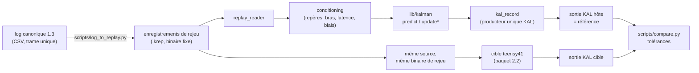

# Référence technique — Étape 2 : Kalman en isolation

> **Rôle du document.** Spécification d'implémentation de l'**Étape 2**, détaillée depuis le
> référentiel technique global [`Reference_Technique_Globale.md`](./Reference_Technique_Globale.md)
> (§4). Elle couvre les paquets `2.1` (validation indépendante du filtre, sur hôte) et `2.2`
> (validation matérielle sur banc autonome, sur cible) et fixe : le noyau du filtre
> (`lib/kalman/`), `FilterConfig.h`, les types et dimensions de filtre, les contrats d'API
> de prédiction et de correction, les blocs d'observation par voie, les invariants numériques,
> le format des références hôte, le banc de rejeu hôte/cible et les écarts assumés entre les
> sources. La structure de planification est définie dans
> [`Planification_Etapes_Paquets_Jalons.md`](./Planification_Etapes_Paquets_Jalons.md) ;
> l'état d'avancement et l'ordre de lecture des documents sont dans
> [`Suivi_Avancement.md`](./Suivi_Avancement.md).

Il s'appuie sur les documents d'ingénierie du dépôt :
[`Formulations_Kalman.pdf`](../../Formulations_Kalman/Formulations_Kalman.pdf) — **référence
théorique unique** : §1.3.5 (synthèse métrologique), §2.1 (repères), §2.2 (Euler, quaternions,
ESKF, passerelles), §2.3 (conditionnement, bras de levier, $R$ dynamique), §2.4 (Situation 1),
§2.5 (Situation 2), §2.6 (Situation 3), §3.1 (invariance et pré-allocation), §3.2 et §3.4
(comparaison et recommandations), annexes A.1 (forme de Joseph), A.2 (symétrisation de
Frobenius) et B (porte $\chi^2$) ; et sur
[`Implementation.pdf`](../../Implementation/Implementation.pdf) — **contraintes d'exécution
embarquée** : §1.2.1 (sélection statique, énumération `FilterType`), §2 (conditionnement et
$R$ expérimental), §3 (géométrie, alignement, $P_0$), §5.1 (fusion asynchrone), §5.3 (DWT,
DTCM/OCRAM), §5.5 (arithmétique `float`, normalisation, symétrisation), §6 (porte $\chi^2$,
watchdog sensoriel, reprise à chaud). Les références complètes figurent au **§8**.

> **Principe directeur : le paquet `2.2` est un sous-ensemble strict du paquet `2.1`.**
> Le banc cible n'ajoute **aucune** ligne de code de filtre : il compile et exécute la même
> source (`lib/kalman/`) avec le même programme de rejeu, sur les mêmes octets d'entrée, et
> compare sa sortie aux références hôte de `2.1`. Toute divergence entre hôte et cible est un
> **écart numérique mesuré**, jamais une seconde implémentation.

> **Frontière d'entrée du filtre (normative).** `lib/kalman/` reçoit des mesures **déjà
> conditionnées** : exprimées dans le repère de navigation $\mathcal{R}_{\text{nav}}$, ramenées
> au centre de masse, avec la convention de pesanteur du §2.0.5 et une horloge fournie par
> l'appelant. Le filtre **n'appelle aucune horloge**, **n'inclut ni `Arduino.h`, ni `Wire`, ni
> `config.h`**, et **ne possède ni pilote, ni matrice d'alignement capteur, ni bras de levier**
> (`Reference_Technique_Globale.md` §10.4, règle 1). Le conditionnement est un rôle de banc
> (§3), transféré aux adaptateurs firmware au paquet `3.1` — jamais dupliqué dans le filtre.

> **Périmètre des types d'estimation.** Les types `FilterState`, `ControlState` et
> `FilterDiagnostics`, ainsi que les payloads `Vals*` de `CapteursState`, sont **figés** par
> l'Étape 1 ([`Reference_Technique_Etape_1_Capteurs.md`](./Reference_Technique_Etape_1_Capteurs.md)
> §7 et Annexe C). Ce document les **implémente** ; il ne les modifie pas (référentiel §4,
> hors périmètre du paquet `2.1`). Toute nécessité de modification est un écart à consigner
> en note de passation, pas une décision d'agent.

> **Identifiants.** Ce document ne crée aucun identifiant de planification : il reprend ceux
> de [`Planification_Etapes_Paquets_Jalons.md`](./Planification_Etapes_Paquets_Jalons.md)
> (paquets `2.1` et `2.2`, points de reprise `C2.1` et `C2.2`, jalon `J3`). Les repères `N0` à
> `N4` et les identifiants `E-2-nn` (écarts) et `V-2-nn` (doutes) sont internes à ce document
> et à ses documents associés : ils ne remplacent ni un point de reprise, ni un jalon, ni un
> identifiant de la planification.

---

> **Terminologie.** *État nominal* : grandeur physique estimée (position, quaternion, …).
> *État d'erreur* : écart infinitésimal $\delta x$ dans l'espace tangent, de dimension
> `FILTER_ERROR_STATE_DIM` ; c'est lui qui porte $P$. *Voie* : source de mesure donnant lieu à
> une correction (UWB, baro, attitude IMU, cadence IMU, accélération IMU, cap). *Rejeu* :
> exécution du filtre sur un jeu de données de `1.3` en temps **logique** (piloté par les
> `t_us` enregistrés), sans horloge murale. *Référence hôte* : sortie du rejeu natif, figée
> dans `bench/test_kalman/reference/`, entrée du paquet `2.2`.

---

<a id="ordre-de-lecture"></a>

## Ordre de lecture et sommaire

> Le document est organisé par contrat, pas par ordre de travail. Le sommaire donne la
> structure d'ensemble ; la table ci-dessous permet de se limiter aux sections utiles au
> point de contrôle considéré.

**Sommaire :**

| Section | Contenu |
| :--- | :--- |
| [§0](#sec-0) | Constat préalable sur l'existant : sources, vérifications, écarts, doutes |
| [§1](#sec-1) | Noyau du filtre `lib/kalman/` : arborescence, `FilterConfig.h`, types, API |
| [§2](#sec-2) | Modèles : conventions, les quatre types de filtre, $Q$, $H$ par voie, garde-fous |
| [§3](#sec-3) | Conditionnement des mesures (banc, transfert au firmware en `3.1`) |
| [§4](#sec-4) | Paquet `2.1` — banc hôte, rejeu, références, tolérances, rapport |
| [§5](#sec-5) | Paquet `2.2` — banc cible autonome, comparaison hôte/cible |
| [§6](#sec-6) | Points de contrôle internes, livrables, risques, définition de « fini » |
| [§7](#sec-7) | Contrats d'interface : ce que l'étape 2 livre et ne livre pas |
| [§8](#sec-8) | Références |
| [Annexe A](#annexe-a) | Squelette `FilterConfig.h` |
| [Annexe B](#annexe-b) | Squelette d'API `kalman_filter.h` |
| [Annexe C](#annexe-c) | Format des références hôte, enregistrement de rejeu et tolérances |

**Ordre de lecture par point de contrôle** (les repères `N0` à `N4` sont internes à la
présente référence ; ils ne remplacent ni les points de reprise `C2.1`/`C2.2`, ni le jalon
`J3`) :

| Point de contrôle | Sections utiles |
| :--- | :--- |
| `N0` (audit, arborescence, configuration) | §0, §1.1 à §1.4, §2.0, Annexe A |
| `N1` (Situation 1 et Situation 2 variante A) | §2.1, §2.3, §2.6, Annexes A et B |
| `N2` (ESKF et Situation 3) | §2.2, §2.4, §2.5, §2.7 |
| `N3` (rejeu, références, tolérances — fin de `2.1`) | §3, §4, Annexe C |
| `N4` (rejeu cible et comparaison — fin de `2.2`) | §5, §6, Annexe C |
| Bilan | §6, §7, §8 |

---

<a id="sec-0"></a>
## 0. Constat préalable sur l'existant

**Hiérarchie des sources.** Cette hiérarchie **spécialise** la ligne « Sources et valeurs
techniques » de la table d'autorité de
[`Planification_Etapes_Paquets_Jalons.md`](./Planification_Etapes_Paquets_Jalons.md) §1 : elle
ne vaut que pour les sources et ne reformule pas la table. Font autorité, dans cet ordre :
(1) `Formulations_Kalman.pdf` pour les formulations et `Implementation.pdf` pour les
contraintes d'exécution, complétés par `Materiel.pdf` et les fiches de
`Materiel/Datasheets/` pour le matériel ; (2) la présente feuille, qui doit être cohérente
avec (1) ou **signaler explicitement l'écart** (§0.3) ; (3) le code de `FromTo Github`, qui
n'est qu'un **précédent non normatif**. L'Étape 1 y ajoute un rang particulier : ses contrats
`§7` et `Annexe C` **lient** l'étape 2 (types figés), tout en restant subordonnés à (1) pour
toute valeur technique.

**Jeux de données.** Les entrées réelles du rejeu sont les jeux produits par le paquet `1.3`,
qui **n'existent pas encore** au moment de la rédaction. Ce document fixe donc le **format
attendu** (§4.3, Annexe C) et marque `À définir` toute valeur qui en dépend (bruits, cadences
réelles, confiance UWB). Aucune valeur de $Q$ ou de $R$ n'est inventée ici.

**Registre des valeurs incertaines.** Les valeurs probables mais non prouvées de l'étape 2
sont proposées au registre [`Suivi_Valeurs_Et_Sources.md`](./Suivi_Valeurs_Et_Sources.md) sous
les repères `V-2-01` (déjà ouvert) à `V-2-15` (§0.4). Les identifiants sont **proposés** : le
registre fait foi pour leur attribution, et une ligne n'existe qu'une fois enregistrée. La
distinction entre **préséance** (quel document fait foi) et **fiabilité** (quel degré de
confiance) est fixée au [`Reference_Technique_Globale.md`](./Reference_Technique_Globale.md)
§2.3.

### 0.1 État de l'existant

| Élément | État | Conséquence pour l'Étape 2 |
| :--- | :--- | :--- |
| `FromTo Github/lib/kalman/` | **À créer** | Créer le noyau pur, `FilterConfig`, types, tests natifs (§1.1, §1.7) |
| `FromTo Github/bench/test_kalman/` | **À créer** | Créer le banc hôte (`2.1`) puis l'environnement cible exécutable (`2.2`) (§4, §5) |
| Jeux de données et parseur `1.3` | **À créer** | Le rejeu dépend d'eux ; format attendu fixé au §4.3 |
| `FilterState` / `ControlState` / `FilterDiagnostics` | Figés (Étape 1 §7, Annexe C) | Implémentés tels quels ; `FilterState` = 17 flottants, indépendant de `FilterType` |
| Énumération `FilterType` (4 valeurs) | Figée (`Implementation` §1.2.1, Étape 1 §7.2.2, référentiel §4) | Aucune valeur ajoutée, aucune renommée |
| Dimensions `n` du référentiel (§4, §9) | `6`, `15`, `15`, `16` | Ce sont les dimensions d'**erreur** ; les dimensions nominales valent `6`, `15`, `16`, `17` (§1.4) |
| Eigen | Dépendance autorisée (référentiel §10.4) ; **version non épinglée** | À épingler avant `N0` (V-2-12) ; jamais recopié dans `lib/kalman` |
| `platform = teensy` | Installé localement en `5.1.0` (`.platformio/platforms/teensy/platform.json`) | Valeur de référence proposée, à aligner sur le `platformio.ini` racine en `3.1` (V-2-12) |
| Ancien `config.h` (`KALMAN_KINEMATIC`, `KALMAN_STATE_DIM`) | Précédent **non normatif** | Même mécanisme de macros surchargeables que `CapteursConfig.h`, avec `#ifndef` (§1.2) |

### 0.2 Vérifications faites sur les sources « fiables à 85 % »

Les points suivants ont été **recalculés ou confrontés** avant d'être retenus. Ils sont
acquis et n'ont plus à être rediscutés par l'agent de `2.1` :

| # | Objet | Vérification | Résultat |
| :--- | :--- | :--- | :--- |
| 1 | Matrice $R_{b\to\text{nav}}(\Omega)$ (`Formulations` §2.2.1) | Produit $R_z(\psi)R_y(\theta)R_x(\phi)$ | Identique terme à terme : séquence intrinsèque $XYZ$ = composition $ZYX$ |
| 2 | $R(q)$ (`Formulations` §2.2.2) | Cas $q=[\cos\frac{\theta}{2},0,\sin\frac{\theta}{2},0]$ | Redonne $R_y(\theta)$ : la formule est cohérente avec le §2.2.1, donc $q$ est **corps → navigation** |
| 3 | Extraction matricielle des angles (`Formulations` §2.3.3) | $\theta=-\arcsin R[2][0]$, $\phi=\mathrm{atan2}(R[2][1],R[2][2])$, $\psi=\mathrm{atan2}(R[1][0],R[0][0])$ | Exacte pour la convention du point 1 |
| 4 | Conversion Euler → quaternion (`Formulations` §2.2.4) | Axes purs $\phi$, $\theta$, $\psi$ | Exacte |
| 5 | Conversion quaternion → Euler (`Formulations` §2.2.4) | Axes purs ; comparaison à $R(q)$ et au point 3 | **Le signe de $\theta$ est faux** (écart E-2-01) |
| 6 | Bloc $Q$ translation (`Formulations` §2.5.3) | Discrétisation du modèle à jerk blanc | Coefficients $dt^5/20$, $dt^4/8$, $dt^3/6$, $dt^3/3$, $dt^2/2$, $dt$ corrects |
| 7 | Seuils $\chi^2$ (annexe B ; `Implementation` §6.1.1) | Comparaison aux quantiles $\chi^2(m)$ | Les deux tables sont **numériquement justes** ; elles diffèrent par le risque choisi (E-2-10) |
| 8 | Dimensions d'état | Situation 1 : $7$ nominal / $6$ erreur (variante B ; la variante A **retenue** vaut $6/6$, §1.4) ; Situation 2 : $16$ / $15$ ; Situation 3 : $17$ / $16$ (`Formulations` §2.4.2, §2.5.2, §2.6.1) | Cohérentes avec `Implementation` §1.2.1 et Étape 1 §7.2.3 ; `FilterState` = $3+3+4+3+3+1=17$ flottants |
| 9 | Forme de Joseph et symétrisation (annexe A.1, A.2) | Théorèmes vérifiés (démonstrations complètes) | Retenues comme invariants de test, pas comme chemin nominal (coût, `Implementation` §5.5.1) |
| 10 | Q dynamique de $R$ UWB/GNSS (`Formulations` §2.3.5) | $\sigma^2_{xy}=\sigma^2_{\text{nom}}/C_k$, $\sigma_z^2=(k_z\sigma_{\text{nom}})^2/C_k$ | Retenu ; $C_k\to0$ ⇒ variance infinie ⇒ mesure ignorée, cohérent avec la porte $\chi^2$ |

### 0.3 Écarts entre sources et décisions retenues

Ces écarts sont **tranchés ici** et opposables : l'agent de `2.1` n'a pas à les réarbitrer.
Ils doivent être reportés dans la note de passation de `C2.1` (planification §7, règle 5).

| # | Point | Sources en présence | Décision retenue | Impact |
| :--- | :--- | :--- | :--- | :--- |
| `E-2-01` | Signe du tangage dans `quatToEuler` | `Formulations` §2.2.4 : $\theta=-\arcsin(2(q_wq_y-q_zq_x))$ ; §2.2.2 et §2.3.3 : $R(q)$ et $\theta=-\arcsin R[2][0]$ | **Retenir** $\theta=+\arcsin(2(q_wq_y-q_zq_x))$, qui est la seule forme compatible avec $R(q)$ du §2.2.2 et avec l'extraction du §2.3.3. Le `-` du §2.2.4 est une erreur de transcription. | bloquant (signe du tangage dans `ControlState.eul`) |
| `E-2-02` | Ordre de l'innovation d'attitude en ESKF | `Formulations` §2.2.3 et §2.5.2 : $\delta q=\hat q^*\otimes q_m$ (erreur **locale**, réinjection $\hat q\leftarrow\hat q\otimes\delta q$) ; `Implementation` §2.1.2 : $\delta q=z_q\otimes\hat q^{-1}$ | **Retenir** $\hat q^*\otimes q_m$. L'erreur d'état ESKF de l'étape 2 est **locale** (repère corps) : c'est elle que réinjecte le reset, et c'est elle que linéarise $R_c$ pour le cap (§2.2.6). La forme de `Implementation` est une erreur globale et exigerait $\hat q\leftarrow\delta q\otimes\hat q$ : les deux formes ne sont pas interchangeables. | bloquant |
| `E-2-03` | Soustraction de la pesanteur | `Formulations` §2.5.4 : $a^b_{\text{corrigé}}=a^b_{\text{body}}-R^T[0,0,g]$ **puis** §2.5.2 : $v\mathrel{+}=(R a^b-g_n)dt$ ; `Implementation` §2.2 et §2.1.2 : $a_{\text{nav}}=R f_b-g_n$ sur la mesure **brute** | **Retenir** `Implementation` §2.2 : l'état `a_b` porte la **force spécifique brute** $f^b$ (pesanteur incluse) et la pesanteur est soustraite **une seule fois**, en repère navigation. Toute pré-soustraction en repère corps est **interdite** (double décompte). Corollaire : la voie IMU consomme `SH2_ACCELEROMETER`, jamais `SH2_LINEAR_ACCELERATION`. | bloquant |
| `E-2-04` | Correction synchrone ou séquentielle | `Formulations` §2.5.4 : vecteur $z\in\mathbb{R}^{13}$ et $H$ $13\times15$ ; `Implementation` §5.1.1 **proscrit** la correction synchrone globale, §5.1.3 retient les mises à jour partielles ; référentiel §4 : fonctions `updateUWB()`, `updateBaro()`, `updateIMU()` | **Retenir** les mises à jour séquentielles par voie. Les matrices $H$ des §2.5.4/§2.6.3 sont **décomposées en blocs de lignes** (§2.6). Équivalence : pour des bruits de mesure mutuellement indépendants ($R$ bloc-diagonale), le traitement séquentiel est mathématiquement égal à la mise à jour conjointe. | majeur (structure du code, seuils de porte) |
| `E-2-05` | Mesure d'attitude issue du CMPS12 | `Formulations` §2.4.2 et §2.5.4 : le triplet CMPS12 est converti en quaternion et donne une innovation d'attitude $m=3$ ; `Implementation` §2.1.3 (Option 3, **configuration de référence**) : seule la mesure scalaire de cap est exploitée | **Retenir** l'Option 3 pour la configuration de référence : `updateHeading()` scalaire ($m=1$). La voie attitude $m=3$ reste disponible **uniquement** en filtre Euler (linéaire) et pour un CMPS12 seul. | majeur |
| `E-2-06` | Biais inertiels | `Formulations` §2.5.5 : aucun biais gyro/acc dans l'état (justifié) ; `Implementation` §3.2 et §3.3 : une routine de 2 s estime le biais gyrométrique initial (*ZUPT*) | **Retenir** l'absence de biais inertiel dans le filtre. Le biais issu du ZUPT est un **offset de conditionnement** appliqué **en amont** (banc, puis adaptateur `3.1`), jamais un état de `lib/kalman`. Seul le biais **barométrique** est un état (Situation 3). | majeur |
| `E-2-07` | Bloc de $P_0$ | `Implementation` §3.3 : $P_0=\mathrm{diag}(\sigma^2_{pos}I_3,\sigma^2_{vel}I_3,\sigma^2_{att}I_3,\sigma^2_{bias,0}I_6)$ ; `Formulations` §2.5.2 : 15 états sans biais | **Retenir** $P_0=\mathrm{diag}(\sigma^2_{p}I_3,\sigma^2_{v}I_3,\sigma^2_{\theta}I_3,\sigma^2_{\omega}I_3,\sigma^2_{a}I_3)$ pour la Situation 2 ; l'indice « `bias` » du §3.3 désigne en réalité les états $\omega$ et $a$ (aucun biais inertiel, cf. E-2-06). Situation 3 : $+\sigma^2_{b}$. | majeur |
| `E-2-08` | Repliement angulaire des innovations Euler | `Formulations` §2.4.1 ne mentionne le repliement que pour $\psi$ | **Étendre** le repliement $\mathrm{atan2}(\sin,\cos)$ aux **trois** angles d'Euler. Coût négligeable, robustesse aux passages $\phi$ ou $\psi$ par $\pm\pi$. | mineur |
| `E-2-09` | Sens de « $n$ » dans le référentiel | Référentiel §4 et §9 : `n = 15`/`16` ; `Formulations` : nominal $16$/$17$ | $n$ du référentiel = dimension d'**erreur**. Les deux conventions sont nommées explicitement dans le code (`FILTER_ERROR_STATE_DIM`, `FILTER_NOMINAL_STATE_DIM`, §1.4). | mineur (documentaire, mais source classique de bug) |
| `E-2-10` | Risque de la porte $\chi^2$ | Annexe B : $95/99/99{,}9\,\%$ ; `Implementation` §6.1.1 : $95/99/99{,}7\,\%$ | **Retenir un seuil unique par voie** issu d'un seul niveau de risque $\alpha$, fixé dans `FilterConfig` (valeur proposée $\alpha=10^{-3}$, V-2-07). Une table unique, générée une fois, remplace les deux tables. | majeur |
| `E-2-11` | Acceptation forcée après rejets | `Formulations` annexe B : rejet pur ; `Implementation` §6.1.2 : après 5 rejets consécutifs, **acceptation forcée** | **Conserver** le mécanisme (continuité documentée) mais **borner** son effet : acceptation avec $R$ **gonflée** d'un facteur `K_GATE_INFLATE` (V-2-07) ; au-delà de `N_REJECT_MAX` acceptations forcées sur la même voie, la voie est déclarée **en défaut** (bit de santé à 0) et ses corrections s'arrêtent (`Implementation` §6.2.1). Évite qu'un capteur réellement biaisé corrompe l'état. | majeur |
| `E-2-12` | Précision de `ControlState` | Étape 1 Annexe C : `FilterState` en `float`, `ControlState` en `double` ; `Implementation` §5.5 : arithmétique `float32` sur cible | **Contrat figé** : ne pas modifier. L'écart de coût (conversion `float`→`double`, mémoire) est **mesuré** au paquet `5.1`, pas corrigé ici. | mineur |
| `E-2-13` | Table d'organisation du paquet `2.2` | Référentiel §4, bloc « Organisation du dépôt » de `2.2` : ligne `src/`, `include/`, `main/` répétée dans la colonne « Inchangé » | Défaut de forme sans conséquence ; la ligne est consolidée au §1.7. | aucun |

### 0.4 Doutes ouverts proposés au registre

> Les lignes `V-2-01` à `V-2-15` sont **enregistrées** au registre
> [`Suivi_Valeurs_Et_Sources.md`](./Suivi_Valeurs_Et_Sources.md) §3 (2026-11-01), qui fait foi
> pour l'attribution, l'emplacement, le statut et l'échéance ; la table ci-dessous en est le
> résumé de synthèse. Tant qu'une valeur de niveau `D` est codée, le code porte
> `// PROVISOIRE V-2-nn`.

| ID | Type de tâche | Valeur par défaut retenue | Provenance · niveau | Impact | Juge de paix · complément | Échéance |
| :--- | :--- | :--- | :--- | :--- | :--- | :--- |
| `V-2-01` | Formulation / modèle | $q=[w,x,y,z]$, Hamilton, $q_{b\to\text{nav}}$ | `KAL:Formulations §2.2.1, §2.2.2, §2.2.3` · **C** | bloquant | test analytique + invariance $R(q)^TR(q)=I$ + référence hôte | `C2.1` |
| `V-2-02` | Constante physique | $g=9{,}80665\ \text{m/s}^2$ | `AGENT` (aucune valeur dans les documents d'ingénierie) · **D** | majeur | mesure $\lVert f\rVert$ au repos sur banc (`MES`) + comparaison à la valeur configurée | `C2.1` |
| `V-2-03` | Bruit / covariance | $Q$, $R$ numériques | `1.3` **non produit** · **D** | bloquant | jeu de données du paquet `1.3` + NIS moyen $\approx m$ | `C2.1` |
| `V-2-04` | Bruit / covariance | $P_0$ par type de filtre (§2.7.4) | `IMPL §3.3` (bloc mal étiqueté, E-2-07) · **C** | majeur | scénario de convergence + référence hôte | `C2.1` |
| `V-2-05` | Garde-fou | $\lvert\theta\rvert\le 60^\circ$ avant rejet de propagation | `AGENT` · **D** | majeur | scénario $\theta\to90^\circ$ sur hôte | `C2.1` |
| `V-2-06` | Garde-fou | `FILTER_DT_MAX_US = 200000` | `AGENT` (ordre de grandeur : $4\times$ période baro, `IMPL §6.2.1`) · **D** | majeur | scénario de trou de données | `C2.1` |
| `V-2-07` | Garde-fou | $\alpha=10^{-3}$, `K_GATE_INFLATE = 100`, `N_REJECT_MAX = 5` | `KAL:annexe B` + `IMPL §6.1.2` · **C** pour $5$, **D** pour le reste | majeur | taux de faux rejets mesuré sur données `1.3` + scénario de biais persistant | `C2.1` |
| `V-2-08` | Garde-fou | `FILTER_TRACE_MAX = 1e5` | `IMPL §6.4.1` · **D** (seuil dépendant des unités) | majeur | mesure de la trace sur données réelles + scénario de divergence | `C2.1` |
| `V-2-09` | Alignement | $R_{\text{imu}\to\text{body}}=I$, $\Delta\psi_{\text{earth}\to\text{nav}}=0$ | `AGENT` (procédure `IMPL §3.3`, valeurs non mesurées) · **D** | majeur | procédure d'alignement au sol + schéma `ELEC` | `C2.2` |
| `V-2-10` | Bruit / covariance | $k_z=1{,}5$, $\sigma_{\text{uwb},xy}=0{,}10\ \text{m}$, $\tau_{\text{uwb}}=30\ \text{ms}$ | `KAL §2.3.1, §2.3.5` + `IMPL §2.4` · **C** | majeur | caractérisation `1.3` + test à vitesse constante | `C2.1` |
| `V-2-11` | Bruit / covariance | loi $C_k\mapsto\sigma^2$ (`KAL §2.3.5`) | `KAL §2.3.5` · **C** (forme), **D** (bornes de $C_k$) | majeur | jeu de données UWB `1.3` (métadonnées de confiance) | `C2.1` |
| `V-2-12` | Reproductibilité | `platform = teensy@5.1.0`, Eigen épinglé | `MES:environnement local` · **B** pour la plateforme, `À définir` pour Eigen · **D** | mineur | `pio pkg list` + build propre reproductible hôte et `teensy41` | `N0` |
| `V-2-13` | Tolérances hôte/cible | table de tolérances (§4.4, Annexe C) | `AGENT` · **D** | majeur | distribution des écarts mesurés sur les références (quantile $99{,}9\,\%$), figée en `2.2` | `C2.2` |
| `V-2-14` | Bruit / covariance | $k_{\text{env}}=2{,}0$ dans $[1{,}5\,;\,3{,}0]$ | `IMPL §2.3` · **C** pour l'intervalle, **D** pour le point | mineur | comparaison des innovations en vol instrumenté (`3.3`) | `C3.3` |
| `V-2-15` | Observabilité | maintien de $b_{\text{baro}}$ sans $Z$ absolu | `KAL §2.6.4` (séparation fréquentielle) · **C** | majeur | scénario sans UWB (Situation 3) sur hôte | `C2.1` |

---

<a id="sec-1"></a>
## 1. Noyau du filtre : `lib/kalman/`

### 1.1 Rôle et frontière

`lib/kalman/` est une **bibliothèque de calcul pur** :

- elle ne contient **aucune** inclusion d'`Arduino.h`, `Wire`, `Serial`, `AirshipState`,
  `config.h` du firmware, ni d'un en-tête de `lib/sensors/` ;
- ses seules dépendances sont le C++ standard, **Eigen** et ses propres en-têtes ;
- elle ne lit **aucune horloge** : `predict()` reçoit `dt` en secondes, les corrections
  reçoivent l'horodatage de la mesure (pour le diagnostic) mais ne l'utilisent pas pour la
  dynamique ;
- elle n'alloue **rien** dynamiquement : toutes les matrices sont à dimension fixe
  (`Eigen::Matrix<float,N,N>`), les objets sont construits statiquement
  (`Implementation` §1.2.1, §5.3) ;
- elle **publie** `FilterState` et une vue `FilterDiagnostics`, et **cache** `dx` et $P$.

**Ce que la bibliothèque ne fait pas** (et qui reste au banc puis au firmware) : lecture de
bus, décodage, conversions d'unités capteur, changement de repère, compensation de bras de
levier, compensation de latence, compensation de biais gyrométrique, filtrage passe-bas
matériel. Ces opérations relèvent du **conditionnement** (§3).

### 1.2 Sélection statique à la compilation

Même mécanisme que `CapteursConfig.h` (Étape 1 §1.2), avec la même règle : **toute macro
surchargeable est sous `#ifndef`**, sinon un `-D` en `build_flags` est silencieusement écrasé
par l'en-tête.

1. **Un axe de compilation : le type de filtre.** `ACTIVE_FILTER` ∈ {`CINEMATIQUE_MINIMAL`,
   `INERTIEL_EULER`, `INERTIEL_ESKF`, `INERTIEL_AVEC_BIAIS`} (`Implementation` §1.2.1).
   Aucun aiguillage à l'exécution : la sélection passe par un **template** et `if constexpr`
   (C++17), le compilateur éliminant tout le code mort des trois autres modèles.
2. **Instanciation.** Le noyau est `template<FilterType T> class FilterImpl`. La façade
   publique est un alias : `using KalmanFilter = FilterImpl<ACTIVE_FILTER>;`. Les
   consommateurs ne voient **jamais** le template ; l'API reste stable quel que soit le type
   actif (§1.5).
3. **Dispatch interne.** Chaque étape de calcul conditionnelle utilise `if constexpr (T ==
   FilterType::…)`. Aucun `switch` à l'exécution, aucun pointeur de fonction, aucune
   allocation conditionnelle.
4. **Conséquence de dimension.** $P$, $F$, $K$, $S$ sont dimensionnés par
   `FILTER_ERROR_STATE_DIM`, donc **instanciés à la taille du modèle actif** : compiler
   `CINEMATIQUE_MINIMAL` n'alloue pas $15\times15$ (`Implementation` §1.2.1, motif 2).
5. **Tests des quatre types.** Les tests natifs instancient explicitement
   `FilterImpl<CINEMATIQUE_MINIMAL>`, `<INERTIEL_EULER>`, `<INERTIEL_ESKF>` et
   `<INERTIEL_AVEC_BIAIS>` : compiler un seul type actif ne doit pas laisser trois modèles
   non testés.

### 1.3 Contenu de `FilterConfig.h`

> `FilterConfig.h` **ne contient que ce dont le filtre a besoin**. Les paramètres de
> conditionnement (matrices d'alignement, bras de levier, latence, offsets de biais) vivent
> dans `bench/test_kalman/include/BenchConfig.h` (§3.1), puis migrent dans les adaptateurs du
> firmware en `3.1`. Mélanger les deux ferait entrer une dépendance capteur dans
> `lib/kalman`.

| Bloc | Contenu | Nature |
| :--- | :--- | :--- |
| 1. Type et dimensions | `FILTER_TYPE`, `ACTIVE_FILTER`, `FILTER_ERROR_STATE_DIM`, `FILTER_NOMINAL_STATE_DIM`, table `errorDim()`/`nominalDim()` en `constexpr` | figé par `Implementation` §1.2.1 |
| 2. Constantes physiques | `FILTER_G` (V-2-02), `FILTER_G_VEC = {0,0,FILTER_G}` | à vérifier |
| 3. Bruit de processus | `sigma_jerk[3]`, `sigma_angacc[3]` (Situations 2/3) ; `sigma_rw_pos[3]`, `sigma_rw_att[3]` (Situation 1) ; `sigma_bias_baro` (Situation 3) | **`1.3`** (V-2-03) |
| 4. Bruit de mesure | `sigma_uwb_xy`, `uwb_kz`, `sigma_att[3]`, `sigma_gyro[3]`, `sigma_acc[3]`, `sigma_baro`, `sigma_heading`, `k_env` | **`1.3`** (V-2-03, V-2-10, V-2-14) |
| 5. État initial | `p0`, `v0`, `q0`, `sigma0_p[3]`, `sigma0_v[3]`, `sigma0_att[3]`, `sigma0_omega[3]`, `sigma0_acc[3]`, `sigma0_b_baro` | V-2-04 |
| 6. Porte et robustesse | `gate_alpha`, table $\gamma(m,\alpha)$ en `constexpr`, `N_REJECT_MAX`, `K_GATE_INFLATE`, `baro_bias_actif` | V-2-07, V-2-15 |
| 7. Garde-fous | `FILTER_DT_MAX_US`, `FILTER_TILT_MAX_RAD`, `FILTER_QNORM_MIN` ($10^{-6}$, `Implementation` §5.5.2), `FILTER_TRACE_MAX` | V-2-05, V-2-06, V-2-08 |
| 8. Arithmétique | `using Scalar = float;` — **aucun `double` dans le noyau** (E-2-12 ne concerne que `ControlState`, construit à la frontière) | figé (`Implementation` §5.5) |
| 9. Options de test | `FILTER_JOSEPH` (forme de Joseph au lieu de la forme compacte + symétrisation), `FILTER_CHECK_INVARIANTS` (contrôles NaN/trace actifs) | banc et tests uniquement |

**Structure.** Un unique `struct FilterConfig` (`constexpr`) regroupe les blocs 2 à 7 ;
les blocs 1, 8 et 9 sont des constantes de compilation. Le squelette complet est en
**Annexe A**.

### 1.4 Types, dimensions et index

**Table des dimensions.** `n` du référentiel = dimension d'erreur (E-2-09).

| `FilterType` | Situation (`Formulations`) | Attitude | $n$ (erreur) | Nominal | `FilterState` |
| :--- | :--- | :--- | :--- | :--- | :--- |
| `CINEMATIQUE_MINIMAL` | §2.4.1, variante A | Euler | `6` | `6` | 17 flottants (champs non estimés marqués invalides) |
| `INERTIEL_EULER` | §2.5.1, variante A | Euler | `15` | `15` | idem |
| `INERTIEL_ESKF` | §2.5.2, variante B | quaternion d'erreur | `15` | `16` | idem |
| `INERTIEL_AVEC_BIAIS` | §2.6.1, variante B | quaternion d'erreur | `16` | `17` | idem |

**Contrat de stabilité de `FilterState`** (Étape 1 §7.2.1 et §7.4.1). `FilterState` a une
**disposition fixe** quel que soit `FilterType` : c'est ce qui garantit l'absence de violation
d'ODR entre unités de compilation et permet à `makeControlState()` d'être compilé une fois.
Un `static_assert` vérifie que `sizeof(FilterState)` est **identique pour les quatre types**.

**Cartographie des index d'erreur** (normative ; toute matrice $F$, $H$, $Q$ et tout reset
s'y conforment) :

| Bloc | `CINEMATIQUE_MINIMAL` | `INERTIEL_EULER` | `INERTIEL_ESKF` | `INERTIEL_AVEC_BIAIS` |
| :--- | :--- | :--- | :--- | :--- |
| $\delta p$ | `0..2` | `0..2` | `0..2` | `0..2` |
| $\delta v$ | — | `3..5` | `3..5` | `3..5` |
| attitude | $\delta\phi,\delta\theta,\delta\psi$ : `3..5` | `6..8` | $\delta\theta$ : `6..8` | $\delta\theta$ : `6..8` |
| $\delta\omega$ | — | `9..11` | `9..11` | `9..11` |
| $\delta a^b$ | — | `12..14` | `12..14` | `12..14` |
| $\delta b_{\text{baro}}$ | — | — | — | `15` |

**Ordre des blocs.** L'ordre ci-dessus est celui des vecteurs d'état de
`Formulations` §2.5.1, §2.5.2 et §2.6.1, **à une différence près** : le quaternion (4
composantes) est remplacé par $\delta\theta$ (3 composantes) et n'occupe donc aucune place
dans $\delta x$. Cette correspondance est vérifiée par un test natif : la matrice $H$
reconstituée par concaténation des blocs du §2.6 doit reproduire exactement $H_{k+1}$ du
`Formulations` §2.5.4 (Situation 2) et §2.6.3 (Situation 3), ligne par ligne.

### 1.5 API publique

L'API est **stable** et documentée (référentiel §4, critère de sortie). Elle ne expose ni
Eigen à l'appelant pour les entrées, ni `dx`, ni $P$.

| Fonction | Signature (résumée) | Effet |
| :--- | :--- | :--- |
| Construction | `KalmanFilter(const FilterConfig&)` | fixe la configuration, initialise l'état nominal et $P_0$ |
| Initialisation | `void reset(const FilterState&, const CovarianceInit&)` | réinitialise nominal et $P$ (alignement au sol, reprise à chaud) |
| Prédiction | `void predict(float dt)` | propage nominal et $P$ ; **seul** point d'avancement du temps |
| Correction UWB | `void updateUWB(const Vec3& p_nav, float confidence, uint32_t t_us)` | voie $m=3$, $R$ dynamique (§2.6.3) |
| Correction baro | `void updateBaro(float z_baro, uint32_t t_us)` | voie $m=1$ sur $Z$ (et $b_{\text{baro}}$ en Situation 3) |
| Correction cap | `void updateHeading(float psi_nav, uint32_t t_us)` | voie $m=1$ sur $\psi$ (CMPS12, Option 3) |
| Correction IMU | `void updateIMU(const ImuMeasure&, uint32_t t_us)` | voie(s) attitude ($m=3$), cadence ($m=3$), accélération ($m=3$), chacune portée séparément (§2.6.4) |
| État | `const FilterState& state() const` | état nominal publié |
| Diagnostic | `void fillDiagnostics(FilterDiagnostics&) const` | pointeurs vers $P$ et la dernière innovation (log `KAL`, DEV) |
| Compteurs | `FilterCounters counters() const` | rejets, acceptations forcées, trous `dt`, `NaN` évités, voies déclarées en défaut |

**Contrat de non-régression.** `updateIMU()` n'applique que les voies **admises par le type
actif** (une seule en cinématique) ; les mesures non consommées incrémentent un compteur de
diagnostic, elles ne provoquent ni erreur ni exception. Ce point est testé pour les quatre
types.

### 1.6 Invariants numériques et garde-fous

Règles **opposables**, appliquées dans l'ordre indiqué, à chaque pas :

1. **Horodatage et `dt`.**
   - `dt` est calculé par l'appelant en arithmétique **modulo $2^{32}$** sur `t_us` : `int32_t d =
     (int32_t)(t_now - t_prev);` puis `dt = d * 1e-6f`. Un `dt` négatif est impossible par
     construction ; un `dt` nul saute la propagation.
   - `dt > FILTER_DT_MAX_US` ⇒ **propagation sautée**, compteur `gaps++`, aucun reset de $P$.
     Politique : un trou de données n'est pas une panne ; il ne doit pas injecter un pas de
     temps gigantesque dans les intégrateurs (V-2-06).
2. **Normalisation du quaternion.** Après **chaque** propagation (§2.2.2) **et** après chaque
   réinjection d'erreur (§2.2.3), `q ← q/‖q‖` ; si `‖q‖ < FILTER_QNORM_MIN` ($10^{-6}$),
   `q ← [1,0,0,0]` et compteur `q_reset++` (`Implementation` §5.5.2).
3. **Symétrisation de $P$.** Après **chaque** correction : `P ← ½(P + Pᵀ)`
   (`Implementation` §5.5.2). La forme de Joseph complète n'est **pas** le chemin nominal
   (coût ×3, `Implementation` §5.5.1) ; elle est compilée sous `FILTER_JOSEPH` et utilisée
   par les tests pour **prouver** $P\succeq0$ (annexe A.1).
4. **Contrôle de validité.** Si `FILTER_CHECK_INVARIANTS` : `!isnan`, `!isinf` sur tout
   l'état et sur `trace(P)` ; `trace(P) < FILTER_TRACE_MAX` (V-2-08). En cas d'échec, la
   politique de **reprise à chaud** est celle de `Implementation` §6.4.3, **mais** elle est
   appliquée par l'appelant : `lib/kalman` expose `reset()` et ne décide pas de redémarrer.
5. **Garde-fou de singularité Euler.** En `INERTIEL_EULER`, si `|θ̂| > FILTER_TILT_MAX_RAD`
   (V-2-05), la propagation d'attitude du pas est **refusée** : $F$ est ramené à l'identité
   sur le bloc attitude, compteur `euler_guard++`, et le pas est signalé. Motif : $R_c$ divise
   par $\cos\theta$ (`Formulations` §2.2.1) ; au-delà, l'intégration n'est plus fiable.
6. **Covariance jamais négative sur la diagonale.** Après symétrisation, tout terme diagonal
   négatif est **ramené à zéro** et compté ; ce n'est pas une correction physique, c'est un
   détecteur d'anomalie (une valeur non nulle répétée doit faire échouer le test de
   positivité).

### 1.7 Emplacement, arborescence et environnements

Cette sous-section **transfère** les blocs « Organisation du dépôt » des paquets `2.1` et
`2.2` du [`Reference_Technique_Globale.md`](./Reference_Technique_Globale.md) §4
(checklist §2.1.1, point 3), en consolidant la ligne dupliquée relevée en E-2-13.

**Paquet `2.1` :**

| Créé | Modifié | Inchangé |
| :--- | :--- | :--- |
| `lib/kalman/` : noyau pur, `FilterConfig`, types d'état, API de prédiction et de correction, tests natifs | `README.md` pour la procédure de rejeu hôte | `src/`, `include/`, `main/` du firmware |
| `bench/test_kalman/` : `platformio.ini` (environnement natif + environnement cible en **compilation seule**), programme de rejeu piloté par le `tMicros` des jeux `1.3` | `.gitignore` pour les jeux volumineux et les sorties générées | `platformio.ini` racine |
| `bench/test_kalman/README.md` : procédure de rejeu hôte | | `commun/` |
| `bench/test_kalman/reference/` : références hôte (format et précision figés) et tolérances | | |
| Rapport de validation du filtre | | |

**Paquet `2.2` :**

| Créé | Modifié | Inchangé |
| :--- | :--- | :--- |
| Environnement cible **exécutable** de `bench/test_kalman/` (même source, sélection par macro) | `bench/test_kalman/platformio.ini` : ajout de l'environnement cible exécutable | `lib/kalman/` : source unique, **aucune copie** |
| `bench/test_kalman/scripts/` : comparaison hôte/cible aux `reference/` avec les tolérances de `2.1` | `bench/test_kalman/README.md` : rejeu sur cible et interprétation des écarts | `src/`, `include/`, `main/` du firmware |
| Rapport de validation matérielle (comparaison hôte/cible) | | `platformio.ini` racine, `commun/` |

**Arborescence effectivement créée** (les fichiers marqués `+` sont créés par `2.1`, ceux
marqués `++` par `2.2`) :

```text
FromTo Github/
├── lib/kalman/
│   ├── library.json              +   nom, version, dépendance Eigen épinglée
│   ├── include/
│   │   ├── FilterConfig.h        +   Annexe A
│   │   ├── FilterQuantities.h    +   recopié à l'identique depuis l'Étape 1 (Annexe C)
│   │   ├── FilterState.h         +   contrat figé, annexe C de l'Étape 1
│   │   ├── FilterDiagnostics.h   +   idem
│   │   ├── ControlState.h        +   idem
│   │   ├── ControlStateAdapter.h +   idem
│   │   └── kalman_filter.h       +   API publique, Annexe B
│   ├── src/
│   │   ├── kalman_filter.tpp     +   FilterImpl<T> : predict, updates, reset
│   │   ├── filter_math.h         +   quaternion, R(q), Euler, quatToEuler (corrigé), skew
│   │   └── filter_math.cpp       +   fonctions pures, testables isolément
│   └── test/
│       ├── test_math.cpp         +   conversions, R(q), repliements
│       ├── test_predict.cpp      +   scénarios analytiques des quatre types
│       ├── test_update.cpp       +   blocs H, porte, séquentialité
│       └── test_invariants.cpp   +   symétrie, positivité, norme, NaN, déterminisme
└── bench/test_kalman/
    ├── platformio.ini            +   [env:native] + [env:teensy41_compile]
    │                             ++  [env:teensy41_bench]
    ├── include/BenchConfig.h     +   conditionnement, chemins, paramètres de rejeu
    ├── src/
    │   ├── main.cpp              +   programme de rejeu (hôte et cible, même source)
    │   ├── replay_reader.cpp     +   lecture des enregistrements (Annexe C)
    │   ├── conditioning.cpp      +   repères, bras de levier, latence, biais
    │   ├── kal_record.cpp        +   producteur unique des lignes `KAL`
    │   └── bench_io.cpp          ++  squelette SD (cible) et fichiers (hôte)
    ├── reference/                +   références hôte + tolérances (Annexe C)
    ├── scripts/                  ++  conversion `1.3` → enregistrements, comparaison
    └── README.md                 +   procédures hôte → ++ section cible
```

**Environnements PlatformIO.**

| Environnement | Rôle | Paquet | Remarque |
| :--- | :--- | :--- | :--- |
| `[env:native]` | rejeu sur hôte, tests unitaires, production des références | `2.1` | `platform = native`, `-std=gnu++17`, `-O2` |
| `[env:teensy41_compile]` | **compilation seule** : preuve de portabilité, sans exécution | `2.1` | `board = teensy41` ; `KAL_BENCH_MODE=COMPILE_CHECK` : `setup()` n'imprime qu'une bannière de build |
| `[env:teensy41_bench]` | **exécution** du rejeu sur cible | `2.2` | même source, même `main.cpp` ; `KAL_BENCH_MODE=REPLAY_SD` |

Le `platformio.ini` racine doit **exclure** `bench/` de la compilation firmware
(référentiel §10.6, point 1 : `src_dir = .`). Les versions de `platform` et de la dépendance
Eigen sont **épinglées** (référentiel §10.6, point 7 ; V-2-12).

---

<a id="sec-2"></a>
## 2. Modèles

### 2.0 Conventions (normatives)

#### 2.0.1 Repères

| Repère | Définition | Usage |
| :--- | :--- | :--- |
| $\mathcal{R}_b$ | corps, lié à la structure | vitesses angulaires, accélérations, quaternion de sortie |
| $\mathcal{R}_{\text{nav}}$ | navigation : $\mathcal{R}_{\text{uwb}}$ en intérieur, $\mathcal{R}_{\text{enu}}$ en extérieur | position, vitesse, attitude estimées |
| $\mathcal{R}_{\text{earth}}$ | terrestre local, Nord magnétique | mesures de cap brutes (CMPS12), **recalées avant le filtre** |
| $\mathcal{R}_{\text{imu}}$ | axes physiques du module inertiel | mesures brutes IMU, **réalignées avant le filtre** |

Les mesures entrantes dans `lib/kalman` sont **toutes** exprimées dans
$\mathcal{R}_{\text{nav}}$ ou $\mathcal{R}_b$ selon la voie du §2.6 ; aucune ne porte
$\mathcal{R}_{\text{earth}}$ ni $\mathcal{R}_{\text{imu}}$ (frontière du §1.1).

#### 2.0.2 Angles d'Euler

Séquence $XYZ$ intrinsèque, angles de Cardan $(\phi,\theta,\psi)$ = (roulis, tangage, lacet)
en radians. $R_{b\to\text{nav}}(\Omega)$ est celle de `Formulations` §2.2.1 ; elle est
**vérifiée** (table du §0.2, point 1). La matrice cinématique est

$$R_c(\Omega)=\begin{bmatrix}1 & \sin\phi\tan\theta & \cos\phi\tan\theta\\ 0 & \cos\phi & -\sin\phi\\ 0 & \sin\phi/\cos\theta & \cos\phi/\cos\theta\end{bmatrix},\qquad \dot\Omega = R_c(\Omega)\,\omega.$$

#### 2.0.3 Quaternions

$q=[q_w,q_x,q_y,q_z]$, **scalaire en premier**, produit de Hamilton, $q_{b\to\text{nav}}$
(`FilterState::q_wb`). La matrice de rotation associée est

$$R(q)=(q_w^2-\lVert q_v\rVert^2)I_3+2q_vq_v^T+2q_w[q_v\times],\qquad [a\times]=\begin{bmatrix}0&-a_z&a_y\\ a_z&0&-a_x\\ -a_y&a_x&0\end{bmatrix}.$$

Vérifiée au §0.2 (point 2) : la convention est bien **corps → navigation**. Un quaternion et
son opposé représentent la même attitude : toute comparaison (test, script de comparaison)
doit accepter $q$ et $-q$ (§4.4).

#### 2.0.4 Passerelles Euler ↔ quaternion

- **Euler → quaternion** : formule du `Formulations` §2.2.4, **exacte** (vérifiée §0.2,
  point 4). Utilisée uniquement dans le conditionnement (CMPS12, §3.3), jamais dans le noyau.
- **Quaternion → Euler** : `quatToEuler()` du noyau, avec la **correction E-2-01** :

$$\phi=\mathrm{atan2}\!\big(2(q_wq_x+q_yq_z),\,1-2(q_x^2+q_y^2)\big),\quad
\theta=+\arcsin\!\big(2(q_wq_y-q_zq_x)\big),\quad
\psi=\mathrm{atan2}\!\big(2(q_wq_z+q_xq_y),\,1-2(q_y^2+q_z^2)\big).$$

Le signe de $\theta$ est **celui de cette équation**, pas celui du PDF. Trois tests
l'encadrent : (a) axes purs ; (b) cohérence avec l'extraction matricielle du `Formulations`
§2.3.3 ; (c) aller-retour Euler → quaternion → Euler sur une grille de $10^5$ triplets avec
$|\theta|\le 60^\circ$, écart $\le 10^{-6}$ rad.

#### 2.0.5 Pesanteur et force spécifique

`g` est **positif** et $\mathcal{R}_{\text{nav}}$ a son axe $Z$ **vers le haut** :
$\mathbf g_n=[0,0,g]^T$, soustrait dans la propagation. La voie IMU fournit la **force
spécifique brute** $f^b$ (pesanteur incluse, `SH2_ACCELEROMETER`) ; l'état `a_b` porte
$f^b$. Conséquences opposables :

- aucune soustraction de pesanteur n'est faite en repère corps (E-2-03) ;
- au repos, l'invariant attendu est $\hat a_b \approx R(\hat q)^T\mathbf g_n$ et
  $\lVert\hat a_b\rVert\approx g$ — c'est un **test** (§4.5) ;
- la voie `LIN` (`SH2_LINEAR_ACCELERATION`) est **ignorée** par le noyau ; elle est loguée
  (`type=LIN`) pour la caractérisation de `1.3` seulement.

#### 2.0.6 Horodatage et pas de temps

Toutes les grandeurs temporelles sont en `uint32_t` de microsecondes, issues de `micros()` sur
le nœud unique (Étape 1 §1.3.1). Le rejeu reconstruit `dt` par différence modulo $2^{32}$
(§1.6, règle 1). Aucune autre source de temps n'est admise dans le noyau.

### 2.1 `CINEMATIQUE_MINIMAL` — Situation 1, variante A (`Formulations` §2.4.1)

**Modèle.** État $[X,Y,Z,\phi,\theta,\psi]$ ; $F=I_6$ ; position et attitude supposées
stationnaires entre deux corrections ; $Q=dt\cdot\mathrm{diag}(\sigma^2_{p},\sigma^2_{att})$.

**Prédiction.** Aucune : `predict(dt)` ne fait que $P\leftarrow P+Q(dt)$. Le filtre est donc
**purement correcteur** : sans mesure, l'état ne bouge pas et l'incertitude croît. C'est
voulu, et c'est ce qui rend ce type utilisable comme **référence de mise en service**
(`Formulations` §3.4.1) sans gyromètre ni accéléromètre dans la boucle.

**Voies admises.** `updateUWB` ($m=3$), `updateBaro` ($m=1$), `updateHeading` ($m=1$),
attitude IMU ($m=3$, angles d'Euler). Les voies cadence et accélération sont **inactives**
(aucun état correspondant) : `updateIMU()` ne consomme que l'attitude.

**Repliement.** Les **trois** innovations d'angles sont repliées (E-2-08).

**Latence UWB.** Ce type n'a **pas** d'état de vitesse : la compensation $z\leftarrow
z+\hat v\tau$ (`Implementation` §2.4) est **impossible**. `BenchConfig` force
$\tau_{\text{uwb}}=0$ pour ce type ; le traînage résiduel est un biais assumé de la Situation
1, borné par la vitesse d'essai et documenté dans le rapport.

### 2.2 `INERTIEL_EULER` — Situation 2, variante A (`Formulations` §2.5.1)

**État nominal** (15) : $[X,Y,Z,V_x,V_y,V_z,\phi,\theta,\psi,p,q,r,a^b_x,a^b_y,a^b_z]$.

**Prédiction.**

$$p\leftarrow p+v\,dt,\qquad v\leftarrow v+\big(R(\Omega)\,a^b-\mathbf g_n\big)dt,\qquad \Omega\leftarrow\Omega+R_c(\Omega)\,\omega\,dt,\qquad \omega,\ a^b\ \text{constants}.$$

**Jacobienne.** Celle du `Formulations` §2.5.1, blocs $M(\Omega)$ et $J_{\partial\Omega}(\Omega)$
inclus. Elle comporte les divisions par $\cos^2\theta$ : d'où le garde-fou du §1.6, règle 5.

**Voies admises.** UWB, baro, attitude $m=3$ (Euler, repliée), cadence $m=3$ (linéaire,
colonnes `9..11`), accélération $m=3$ (linéaire, colonnes `12..14`), cap $m=1$ (colonne `8`).

**Usage.** Ce type est le **témoin de comparaison** de l'ESKF : il doit produire des
trajectoires compatibles (à la tolérance de modèle près) sur les mêmes jeux de données. Il
n'est **pas** la configuration de vol (référentiel §9 : ESKF en `3.x`).

### 2.3 `INERTIEL_ESKF` — Situation 2, variante B (`Formulations` §2.5.2)

**État nominal** (16) : $[X,Y,Z,V_x,V_y,V_z,q_w,q_x,q_y,q_z,p,q,r,a^b_x,a^b_y,a^b_z]$ ;
**état d'erreur** (15) : $[\delta p,\delta v,\delta\theta,\delta\omega,\delta a^b]$.

**Prédiction nominale.**

$$p\leftarrow p+v\,dt,\qquad v\leftarrow v+\big(R(q)\,a^b-\mathbf g_n\big)dt,\qquad q\leftarrow q\otimes\Delta q(\omega\,dt),\qquad \omega,\ a^b\ \text{constants},$$

puis **normalisation** immédiate. $\Delta q$ est calculé par l'approximation du premier ordre

$$\Delta q(\omega\,dt)\approx\Big[1,\ \tfrac12\omega\,dt\Big]^T .$$

**Justification quantitative de l'approximation** (à conserver dans le commentaire du code) :
avec $\lVert\omega\rVert\le0{,}5\ \text{rad/s}$ et $dt\le10\ \text{ms}$,
$\lVert\omega\rVert dt\le5\cdot10^{-3}$ ; l'erreur relative de l'approximation est
$O\big((\lVert\omega\rVert dt)^2/24\big)\approx10^{-6}$, du même ordre que la résolution de
`float` — donc **non limitante** devant l'arithmétique 32 bits. La forme exacte
($\cos,\sin$) n'apporte rien et coûte deux transcendentales par pas.

**Jacobienne d'erreur.** Celle du `Formulations` §2.5.2 : bloc de couplage
$-R(\hat q)[\hat a^b\times]dt$ et bloc $-[\omega\times]dt$ ; **aucune trigonométrie**.

**Réinjection (reset).** Après $K$ et $\delta\hat x=K y$ :

$$p\leftarrow p+\delta\hat p,\quad v\leftarrow v+\delta\hat v,\quad q\leftarrow q\otimes\Big[1,\tfrac12\delta\hat\theta\Big]^T\ (\text{puis normalisation}),\quad \omega\leftarrow\omega+\delta\hat\omega,\quad a^b\leftarrow a^b+\delta\hat a^b,\quad \delta\hat x\leftarrow0.$$

**L'erreur est locale** : $q=q\otimes\delta q$. C'est cette convention qui rend E-2-02
opposable : l'innovation doit être $\hat q^*\otimes q_m$ et **non** $q_m\otimes\hat q^{-1}$.

**Voies admises.** UWB, baro, attitude $m=3$ (quaternion), cadence $m=3$, accélération
$m=3$, cap $m=1$.

### 2.4 `INERTIEL_AVEC_BIAIS` — Situation 3, variante B (`Formulations` §2.6)

**État nominal** (17) : l'ESKF + $b_{\text{baro}}$ ; **état d'erreur** (16) :
$[\delta p,\delta v,\delta\theta,\delta\omega,\delta a^b,\delta b_{\text{baro}}]$.

**Convention de signe du biais (normative).** $b_{\text{baro}}$ est un biais **additif de la
mesure** :

$$z_{\text{baro}}=Z+b_{\text{baro}}+v_{\text{baro}}.$$

La ligne d'observation du baro porte donc `1` **en colonne 2 ($Z$)** et `1` **en colonne 15
($b_{\text{baro}}$)**, et l'innovation vaut $y=z_{\text{baro}}-\hat Z-\hat b_{\text{baro}}$.
L'erreur de signe sur ce terme est un mode de divergence silencieux : elle est couverte par un
test dédié (biais constant injecté de $+5$ m, convergence de $\hat b$ vers $+5$ m).

**Prédiction.** Identique à `2.3` avec $b_{\text{baro}}$ **constant** ; $Q$ augmentée du bloc
$\sigma_b^2\,dt$ ; $F$ augmentée de `1` en $(15,15)$.

**Observabilité (V-2-15).** Le couple $(Z,b_{\text{baro}})$ n'est observable que par la
**séparation fréquentielle** : baro pour la dynamique rapide, position absolue $Z$ pour la
dérive lente (`Formulations` §2.6.4). Règle d'implémentation :

- $\hat b_{\text{baro}}$ n'est mis à jour par une correction baro que si au moins une
  observation de $Z$ **absolue** a été appliquée depuis le dernier `reset()` (drapeau
  `has_abs_z`) ;
- sinon, la variance de $\delta b$ est **maintenue** (elle ne croît pas) et le biais est gelé ;
  ce gel est compté et signalé au diagnostic ;
- un `reset()` remet `has_abs_z = false` et $\hat b_{\text{baro}}=0$ (tare au sol).

**Voies admises.** Comme `2.3` ; la voie baro porte les deux colonnes.

### 2.5 Bruits de processus $Q$

| Type | Bloc $Q(dt)$ | Source |
| :--- | :--- | :--- |
| `CINEMATIQUE_MINIMAL` | $dt\cdot\mathrm{diag}(\sigma_p^2,\sigma_{att}^2)$ | `Formulations` §2.4.1 |
| `INERTIEL_EULER`, `INERTIEL_ESKF` | Bloc $9\times9$ (pos, vel, acc) à partir de $\sigma_{\dot a}^2$ ; bloc $6\times6$ (att, gyro) à partir de $\sigma_{\dot\Omega}^2$ | `Formulations` §2.5.3 |
| `INERTIEL_AVEC_BIAIS` | Idem + $\sigma_b^2\,dt$ sur la dernière diagonale | `Formulations` §2.6.2 |

Coefficients exacts (vérifiés §0.2, point 6) : $dt^5/20$, $dt^4/8$, $dt^3/6$, $dt^3/3$,
$dt^2/2$, $dt$. $Q$ est **recalculée à chaque `dt`** ; les blocs invariants ($R$ nominal, $H$)
sont pré-calculés une fois (`Formulations` §3.1).

**Valeurs.** Aucune valeur numérique n'est fixée ici : elles viennent du rapport de
caractérisation de `1.3` et de la métrologie de `Formulations` §1.3.5 (V-2-03). Le code porte
`PROVISOIRE V-2-03` tant qu'elles ne sont pas établies.

### 2.6 Blocs d'observation par voie (décomposition de $H$)

La correction synchrone est proscrite (E-2-04). Chaque voie est une mise à jour séquentielle
avec son propre bloc $H$, sa propre $R$ et son propre seuil. La concaténation des blocs
reconstitue la matrice du `Formulations` (§2.4.1 pour la Situation 1, §2.5.4 pour la
Situation 2, §2.6.3 pour la Situation 3) — c'est un test (§4.5).

#### 2.6.1 `updateUWB` — position absolue, $m=3$

$H=[I_3\ 0\ \dots]$, colonnes `0..2`, tous types. Innovation $y=p_{\text{uwb}}-\hat p$,
sans repliement.

Variance **dynamique** (`Formulations` §2.3.5, V-2-10, V-2-11) :

$$R_{xx}=R_{yy}=\frac{\sigma^2_{\text{uwb},xy}}{C_k},\qquad R_{zz}=\frac{(k_z\,\sigma_{\text{uwb},xy})^2}{C_k},\qquad C_k\in\,]0,1].$$

$C_k$ est fourni **avec** la mesure (champ de la voie, conditionné depuis les métadonnées du
log `1.3`). Une mesure sans confiance exploitable est **rejetée** (compteur), pas devinée.
$C_k\to0$ ⇒ $R\to\infty$ ⇒ mesure ignorée naturellement.

#### 2.6.2 `updateBaro` — altitude, $m=1$

| Type | $H$ (1 ligne) | Innovation |
| :--- | :--- | :--- |
| `CINEMATIQUE_MINIMAL`, `INERTIEL_EULER`, `INERTIEL_ESKF` | `1` en colonne `2` | $z_{\text{baro}}-\hat Z$ |
| `INERTIEL_AVEC_BIAIS` | `1` en colonne `2` **et** `1` en colonne `15` | $z_{\text{baro}}-\hat Z-\hat b_{\text{baro}}$ |

$R=\sigma^2_{\text{baro}}\cdot k_{\text{env}}$. L'inflation liée à la poussée moteur
(`Implementation` §4.2 : $R_{\text{baro}}(u)=R_{\text{baro},0}+k_{\text{prop}}\sum|u_i|^2$)
n'est **pas** appliquée en `2.1`/`2.2` : les jeux de données de `1.3` ne contiennent pas la
consigne de gaz. Elle est portée comme entrée optionnelle de l'API, inactive par défaut, et
relève de `3.3`.

#### 2.6.3 `updateHeading` — cap, $m=1$

Configuration de référence (Option 3, E-2-05) : seule la mesure scalaire de cap du CMPS12 est
exploitée. Le cap entrant est **déjà** dans $\mathcal{R}_{\text{nav}}$
($\psi_{\text{nav}}=\psi_{\text{cmps}}-\Delta\psi_{\text{earth}\to\text{nav}}$, §3.3).

| Type | $H$ (1 ligne) | Innovation |
| :--- | :--- | :--- |
| `CINEMATIQUE_MINIMAL`, `INERTIEL_EULER` | `1` en colonne `5` / `8` (angle $\psi$) | repliée par $\mathrm{atan2}$ |
| `INERTIEL_ESKF`, `INERTIEL_AVEC_BIAIS` | $\big[0,\ \sin\hat\phi/\cos\hat\theta,\ \cos\hat\phi/\cos\hat\theta\big]$ sur les colonnes `6..8` | $y=\mathrm{wrap}(\psi_m-\hat\psi)$ |

**Justification du bloc ESKF.** L'erreur $\delta\theta$ est **locale** ; la variation des
angles d'Euler qui lui correspond est $\delta\Omega=R_c(\Omega)\,\delta\theta$
($\dot\Omega=R_c\,\omega$). La troisième ligne de $R_c$ donne exactement
$\partial\psi/\partial\delta\theta=[0,\ \sin\phi/\cos\theta,\ \cos\phi/\cos\theta]$. La forme
est donc **linéarisée de façon cohérente avec E-2-02**, sans passer par un quaternion mesuré.
Le facteur $1/\cos\theta$ est borné par le garde-fou §1.6, règle 5 (et par la physique :
$|\theta|\le25^\circ$ en vol, `Formulations` §3.3).

#### 2.6.4 `updateIMU` — attitude, cadence, accélération

`updateIMU()` applique **jusqu'à trois corrections indépendantes**, chacune portant son propre
seuil $\chi^2$ :

| Sous-voie | $m$ | $H$ | Innovation | Types |
| :--- | :--- | :--- | :--- | :--- |
| attitude | `3` | `I_3` colonnes `3..5` (cinématique) ou `6..8` (inertiels) | Euler replié / $2(\hat q^*\otimes q_m)_v$ | tous (cinématique : attitude seule) |
| cadence | `3` | `I_3` colonnes `9..11` | $\omega_m-\hat\omega$ | `INERTIEL_*` |
| accélération | `3` | `I_3` colonnes `12..14` | $f^b_m-\hat a^b$ | `INERTIEL_*` |

**Équivalence séquentielle.** Les trois bruits sont indépendants et $R$ est bloc-diagonale ;
traiter les trois blocs séquentiellement est **exactement** équivalent à la mise à jour
conjointe $m=9$, et permet de rejeter une accélération aberrante sans perdre une attitude
valide. Les seuils sont donc ceux de $m=3$ (`Formulations` annexe B), pas ceux de $m=9$.

**Sous-voie attitude en ESKF.** Le quaternion mesuré $q_m$ est **déjà** dans
$\mathcal{R}_{\text{nav}}$ (§3.3). L'innovation est $\delta q_m=\hat q^*\otimes q_m$ (E-2-02),
et $y=2\,\delta q_{m,v}$, sans trigonométrie ni repliement de cap (`Formulations` §2.5.2).
Si $q_m$ est dégénéré ($\lVert q_m\rVert<10^{-6}$), la sous-voie est rejetée.

### 2.7 Porte de validation, robustesse et reprise

#### 2.7.1 Porte $\chi^2$ par voie (`Formulations` annexe B, `Implementation` §6.1)

Pour chaque voie et chaque échantillon :

$$d_M^2=y^T S^{-1} y,\qquad S=H P H^T+R,\qquad d_M^2\sim\chi^2(m).$$

- $d_M^2\le\gamma(m,\alpha)$ : correction appliquée ; compteur de rejets remis à zéro.
- $d_M^2>\gamma$ : correction **sautée** pour cette voie (`N_reject++`), $P$ inchangée.
- `N_reject >= N_REJECT_MAX` : **acceptation forcée** avec $R$ multipliée par
  `K_GATE_INFLATE` (E-2-11) ; au-delà de `N_REJECT_MAX` acceptations forcées consécutives, la
  voie est déclarée **en défaut** (bit de santé à 0) et ses corrections s'arrêtent jusqu'à un
  `reset()` ou un retour explicite à l'état sain décidé par l'appelant.

**Table des seuils.** Une **seule** table, générée une fois pour le niveau de risque retenu
(E-2-10, V-2-07) et écrite en `constexpr` (`Implementation` §6.1.1) ; aucune intégrale de
probabilité n'est calculée en vol. Les valeurs de `Formulations` annexe B et du §6.1.1 sont
**numériquement justes** et peuvent servir de contrôle croisé au test natif.

**Implémentation.** $m=1$ : une division. $m=3$ : Cholesky $3\times3$ puis résolution. Aucune
inversion générale n'est nécessaire.

#### 2.7.2 Surveillance temporelle

Le vieillissement d'une mesure est porté par `SensorCell` (Étape 1 Annexe C) côté acquisition ;
dans le noyau, chaque voie compte son silence depuis la dernière mesure **valide** reçue. Un
silence supérieur à `4 ×` la période nominale de la source (`Implementation` §6.2.1) n'a
**aucun effet** sur l'appel des corrections : c'est l'appelant qui cesse d'appeler. Le filtre,
lui, laisse $P$ croître — c'est le comportement correct (`Implementation` §6.2.1, point 3).

#### 2.7.3 Reprise à chaud

`lib/kalman` **expose** `reset()` (§1.5) et **ne décide pas** du redémarrage : la politique
(« pas de reset matériel en vol », `Implementation` §6.4.2 et §6.4.3) appartient au firmware.
Le banc de `2.2` **teste** la reprise sur des scénarios de rupture (série d'entrées
provoquant `NaN` ou dépassement de trace), mais il l'exerce par un appel explicite à
`reset()`, exactement comme le fera le firmware.

#### 2.7.4 Initialisation et $P_0$

| Bloc | Dimension | Source | Valeur |
| :--- | :--- | :--- | :--- |
| $\sigma^2_{0,p}$ | 3 | précision nominale du capteur de position actif (`Implementation` §3.3) | `1.3` / V-2-04 |
| $\sigma^2_{0,v}$ | 3 | $10^{-4}\ \text{m}^2/\text{s}^2$ (vitesse au sol quasi nulle) | `Implementation` §3.3, **C** |
| $\sigma^2_{0,\theta}$ | 3 | précision d'attitude après alignement | V-2-04 ; borné par la procédure `Implementation` §3.3 |
| $\sigma^2_{0,\omega}$ | 3 | bruit gyro après ZUPT | V-2-04 |
| $\sigma^2_{0,a}$ | 3 | bruit accéléromètre | `Formulations` §1.3.5 |
| $\sigma^2_{0,b}$ | 1 | Situation 3 seulement | V-2-04 |

**Bloc « bias » de `Implementation` §3.3.** Il ne s'agit **pas** de biais inertiels (E-2-06,
E-2-07) : les six valeurs désignent les états $\omega$ puis $a$. Le code les nomme
`sigma0_omega` et `sigma0_acc` ; aucun `sigma0_bias_*` n'existe.

**Alignement initial.** La procédure du `Implementation` §3.3 (immobilité, nivellement par
gravité, cap, tare baro) est un **conditionnement**, pas un calcul du noyau : elle produit un
`FilterState` initial et un jeu de variances, que l'appelant passe à `reset()`. Le noyau
vérifie seulement la cohérence du quaternion fourni (norme) et la positivité des variances.

---

<a id="sec-3"></a>
## 3. Conditionnement des mesures (banc, puis adaptateur firmware)

> Le conditionnement applique `Formulations` §2.3 et `Implementation` §2, §3, §4. Il est
> **hors** du noyau et reste **une seule implémentation** : écrite au paquet `2.1` dans
> `bench/test_kalman/src/conditioning.cpp`, reprise telle quelle par l'environnement cible de
> `2.2`, puis transférée dans les adaptateurs `src/Capteurs/` en `3.1` — jamais recopiée.

### 3.1 Paramètres (`BenchConfig.h`)

| Paramètre | Sens | Valeur par défaut | Statut |
| :--- | :--- | :--- | :--- |
| `Q_IMU_BODY` | quaternion d'alignement mécanique IMU → corps | identité | V-2-09 |
| `Q_EARTH_NAV` | quaternion de recalage Nord magnétique → $\mathcal{R}_{\text{nav}}$ | identité | V-2-09 |
| `R_POS_B`, `R_BARO_B`, `R_IMU_B` | bras de levier | `0` (implantation nominale, `Implementation` §3.1.1) | `À définir` (mesure) |
| `TAU_UWB` | latence UWB | `30 ms` | V-2-10 |
| `GYRO_BIAS` | offset de biais gyro issu du ZUPT | `0` | V-2-04 |
| `IIR_CUTOFF_HZ` | coupure du passe-bas matériel | `40 Hz` (`Implementation` §4.1) | appliqué **en amont**, par le pilote |
| chemins de rejeu | fichier d'enregistrements | `test/fixtures/<jeu>.krep` ou chemin externe documenté | — |

### 3.2 Chaîne de conditionnement

1. **Décodage et unités** — déjà fait au paquet `1.1`/`1.2` ; le conditionnement ne redécode
   rien, il consomme les grandeurs SI du log canonique.
2. **Réalignement IMU → corps** : $\omega_b=R_{\text{imu}\to\text{body}}\,\omega_{\text{imu}}$,
   $f_b=R_{\text{imu}\to\text{body}}\,f_{\text{imu}}$ (`Formulations` §2.5.4).
3. **Réalignement attitude terre → navigation** :
   $q_{b\to\text{nav}}=q_{\text{earth}\to\text{nav}}\otimes q_{\text{imu}\to\text{earth}}\otimes q_{\text{imu}\to\text{body}}^*$
   (`Formulations` §2.3.3). Pour un CMPS12, même chaîne après conversion Euler → quaternion,
   puis extraction du **seul** cap dans $\mathcal{R}_{\text{nav}}$.
4. **Bras de levier** : $p_{\text{cor}}=p_{\text{brut}}-R(q)\,\mathbf r^b_{\text{pos}}$,
   $Z_{\text{baro,cor}}=Z_{\text{baro,brut}}-[0\,0\,1]R(q)\mathbf r^b_{\text{baro}}$
   (`Formulations` §2.3.4). En implantation nominale ($\lVert r\rVert\le15$ cm), les bras
   valent zéro : l'erreur d'omission est de l'ordre du bruit (`Implementation` §3.1.1).
5. **Compensation de latence** : $z_{\text{pos}}\leftarrow z_{\text{pos}}+\hat v\,\tau$
   (`Implementation` §2.4). Inactive en `CINEMATIQUE_MINIMAL` (§2.1).
6. **Biais gyrométrique** : $\omega\leftarrow\omega-\hat b_\omega$ (offset du ZUPT, E-2-06).
7. **Pesanteur** : **aucune** action ici (E-2-03) ; $f_b$ reste brut.
8. **Horodatage** : la mesure conserve son `t_us` d'arrivée ; le rejeu s'en sert pour `dt`.

### 3.3 Ce qui n'est pas conditionné

- **Aucune compensation de bras de levier inertiel** ($\dot\omega\times r$,
  $\omega\times(\omega\times r)$) en implantation nominale (`Implementation` §3.1.1). Elle
  n'est activée que si `R_IMU_B` est non nul, et devient obligatoire si
  $\lVert r\rVert>0{,}5$ m.
- **Aucune fusion interne du BNO085** : le filtre consomme les rapports natifs (quaternion,
  gyro calibré, accéléromètre brut), pas un état de fusion propriétaire.
- **Aucun filtrage passe-bas logiciel** : le filtre est le filtre. Un passe-bas redondant
  décalerait la phase et fausserait l'innovation.

---

<a id="sec-4"></a>
## 4. Paquet `2.1` — validation indépendante du filtre (hôte)

### 4.1 Objectif et périmètre

Objectif et critères d'acceptation : [`Reference_Technique_Globale.md`](./Reference_Technique_Globale.md)
§4, paquet `2.1` — non redéfinis ici. Ce document fixe les **moyens** : noyau (§1), modèles
(§2), conditionnement (§3), banc (§4), références (§4.4).

**Entrées.** Jeux de données et protocoles du paquet `1.3` ; `Formulations_Kalman.pdf`
(Situations 1 à 3) ; contrats d'interface figés par l'Étape 1 (§7 et Annexe C) ; Eigen épinglé.
**Doutes ouverts dont dépend `2.1` :** `V-2-03` (bruits), `V-2-10`, `V-2-11` (UWB), `V-1-10`
(cadence réelle du baro) — reportés au registre (référentiel §2.3.7).

**Hors périmètre.** Toute dépendance Arduino/firmware/pilote dans `lib/kalman/` ; l'exécution
sur cible (paquet `2.2`) ; l'intégration au firmware (`3.1`) ; la modification des contrats
`CapteursState`/`Vals*` et des types d'estimation figés.

### 4.2 Architecture du banc



**Point clé de déterminisme.** Hôte et cible lisent **les mêmes octets** (fichier `.krep`) et
exécutent **le même code de rejeu** ; l'horloge murale n'intervient nulle part. La seule
différence est l'arithmétique de la cible (FPU simple précision, `-O2`, éventuelle
contraction FMA) : c'est précisément ce que le paquet `2.2` mesure.

### 4.3 Enregistrements de rejeu et format de référence

**Conversion unique.** `scripts/log_to_replay.py` lit le log canonique de `1.3` avec
**l'analyseur unique du paquet `1.3`** (Étape 1 §1.3.1) et écrit un fichier d'enregistrements
binaires à taille fixe (Annexe C). Motifs : (a) un seul analyseur, donc une seule sémantique ;
(b) la cible n'embarque **aucun** analyseur CSV, donc aucune duplication de parseur ;
(c) la taille et le déterminisme sont maîtrisés.

**Producteur unique de la sortie `KAL`.** Le banc écrit les lignes `KAL` dans la **trame
canonique** (même en-tête versionné, mêmes métadonnées `#`, même règle « une ligne par
événement », cellules non applicables vides). Le producteur est `kal_record.cpp` au paquet
`2.1` ; il **définit** la branche `KAL` de `formatRecord()` (Étape 1 §1.3.1). À `3.1`, cette
branche est **portée** dans `log_capteurs.h` sans seconde implémentation : la liste de
colonnes de l'Annexe C est le contrat, pas une variante.

**Référence hôte.** `bench/test_kalman/reference/<jeu>.<type>.kal.csv` : sortie du rejeu natif,
**figée** et versionnée. Les petits jeux sont dans `test/fixtures/` ; les volumineux restent
hors dépôt (planification §7, règle 7) et sont référencés par un chemin unique dans le
`README.md`.

### 4.4 Comparaison et tolérances

**Comparaison.** `scripts/compare.py` apparie les lignes par `(type, seq)` et compare colonne
par colonne. Règles :

1. **Quaternions** : comparer $\min(\lVert q-q_{\text{ref}}\rVert,\lVert q+q_{\text{ref}}\rVert)$
   — $q$ et $-q$ sont la même attitude.
2. **Tolérance par colonne** : `|x - x_ref| ≤ atol + rtol·|x_ref|`, valeurs lues dans
   `reference/tolerances.csv`.
3. **Colonnes entières** (`seq`, `flags`, `valid`) : **égalité stricte**.
4. **Invariants** contrôlés **sur les deux sorties** : $\lvert\lVert q\rVert-1\rvert\le10^{-6}$,
   symétrie relative de $P$, absence de `NaN`/`Inf`, décroissance de `trace(P)` à chaque
   correction.

**Valeurs de tolérance — procédure, pas choix arbitraire.** Les tolérances initiales
(Annexe C) sont **provisoires** (V-2-13). Elles sont **figées** en fin de `2.1` par une
mesure : rejeu natif répété (doit être **bit à bit** reproductible, tolérance nulle) puis
distribution des écarts. En `2.2`, la tolérance hôte/cible est fixée au **quantile
$99{,}9\,\%$** des écarts mesurés sur les jeux de référence, arrondi au-dessus, et justifiée
dans le rapport de validation matérielle. Aucune tolérance n'est choisie « à l'œil ».

### 4.5 Tests et scénarios (opposables)

| # | Test | Critère |
| :--- | :--- | :--- |
| `T1` | Conversions et rotations | $R(q)^TR(q)=I$, $\det R=1$, Euler→quat→Euler, `quatToEuler` recalculé (E-2-01), sur $10^5$ cas |
| `T2` | Repos | $\hat a_b\approx R(\hat q)^T\mathbf g$, $\lVert\hat a_b\rVert\approx g$, $p$, $v$, $q$ constants à $10^{-6}$ près |
| `T3` | Chute libre / accélération constante | $p(t)=p_0+v_0t+\tfrac12at^2$ à la tolérance d'intégration |
| `T4` | Rotation constante | $q(t)=q_0\otimes[1,\tfrac12\omega t]$ ; écart à la solution exacte $\le10^{-5}$ rad sur 1 s |
| `T5` | $H$ reconstituée | Concaténation des blocs du §2.6 = $H$ de `Formulations` §2.5.4 et §2.6.3, ligne par ligne |
| `T6` | Équivalence séquentielle | Trois mises à jour $m=3$ indépendantes ≡ une mise à jour conjointe $m=9$ (écart $\le10^{-6}$ relatif) |
| `T7` | Porte $\chi^2$ | Taux de faux rejets conforme à $\alpha$ sur innovations synthétiques gaussiennes ; rejet d'un outlier injecté à $10\sigma$ |
| `T8` | Acceptation forcée | Après `N_REJECT_MAX` rejets, acceptation avec $R$ gonflée ; puis voie déclarée en défaut |
| `T9` | Biais baro (Sit. 3) | Biais injecté $+5$ m ⇒ $\hat b\to+5$ m ; sans $Z$ absolu, biais **gelé** (V-2-15) |
| `T10` | Repliements | Innovations à $\pm\pi$ (lacet et roulis) sans divergence (E-2-08) |
| `T11` | Singularité Euler | $\lvert\theta\rvert>60^\circ$ ⇒ propagation d'attitude refusée, compteur incrémenté |
| `T12` | Trous de données | `dt > FILTER_DT_MAX_US` ⇒ propagation sautée, $P$ non réinitialisée |
| `T13` | Rebouclage `t_us` | Passage de $2^{32}$ µs sans `dt` négatif |
| `T14` | Positivité de $P$ | Sous `FILTER_JOSEPH`, $\lambda_{\min}(P)\ge-10^{-6}$ sur $10^6$ pas ; forme compacte + symétrisation : écart de trace $\le10^{-3}$ relatif |
| `T15` | Déterminisme | Deux exécutions du même rejeu : **identiques bit à bit** |
| `T16` | Quatre types | Chaque `FilterImpl<T>` compile et passe `T1`–`T15` ; `sizeof(FilterState)` identique pour les quatre |
| `T17` | Rejeu de bout en bout | Les jeux `1.3` se rejouent, sans `NaN`, avec `trace(P)` bornée |
| `T18` | Cohérence inter-modèles | `CINEMATIQUE_MINIMAL` vs `INERTIEL_ESKF` sur un même jeu : écart de position expliqué et documenté (pas d'égalité exigée) |

### 4.6 Livrables du paquet `2.1`

Ceux du référentiel §4, complétés par ce document : `lib/kalman/` complet, `FilterConfig.h`,
tests natifs `lib/kalman/test/`, banc hôte `bench/test_kalman/`, `reference/` et tolérances
figées, rapport de validation, API documentée, **et le présent document de référence**
(créé le 2026-11-01, avec l'annexe non normative de l'étape, §6.4 item 2).

---

<a id="sec-5"></a>
## 5. Paquet `2.2` — validation matérielle sur banc autonome

### 5.1 Objectif et périmètre

Objectif et critères : [`Reference_Technique_Globale.md`](./Reference_Technique_Globale.md)
§4, paquet `2.2`. Ce document fixe les moyens.

**Entrées.** `lib/kalman` validée sur hôte (`2.1`) et ses références ; jeux de données `1.3` ;
programme de rejeu et enregistrements binaires du §4.3.
**Doutes ouverts dont dépend `2.2` :** `V-2-13` (tolérances), `V-2-12` (épinglage des
versions), `V-2-09` (alignement, si mesuré sur cible).

**Hors périmètre.** Copie du code de la bibliothèque dans le banc ; intégration au firmware ;
capteurs réels et modes dégradés (relevant de `3.3`) ; modification de l'API publique.

### 5.2 Principe

1. **Même source.** `bench/test_kalman/src/main.cpp` est compilé pour `[env:teensy41_bench]`
   avec `KAL_BENCH_MODE=REPLAY_SD`. Aucun `#ifdef` ne change l'algorithme : seules changent la
   source des octets (SD au lieu d'un fichier) et la destination (SD ou série au lieu d'un
   fichier).
2. **Temps logique.** Le rejeu est piloté par les `t_us` des enregistrements ; aucun
   `IntervalTimer`, aucun `micros()` dans la boucle de rejeu. Le déterminisme ne dépend donc
   pas de la charge de la cible.
3. **Entrées identiques.** Le fichier `.krep` embarqué sur la SD est **celui** qui a produit
   les références hôte (même empreinte, consignée dans le rapport).
4. **Invariants revérifiés sur cible.** `T2`, `T9`, `T11`–`T15` sont rejoués sur la cible ;
   `T14` est exécuté sous `FILTER_JOSEPH` **et** sous le chemin nominal.
5. **Mesure du temps.** En plus de la comparaison, le banc cible mesure `predict` et chaque
   `update*` au `ARM_DWT_CYCCNT` (`Implementation` §5.3) et publie ces durées **à titre
   indicatif** : le budget temps est un livrable du paquet `5.1`, pas un critère de `2.2`.

### 5.3 Comparaison hôte/cible

`scripts/compare.py --host <référence> --target <sortie cible>` applique le §4.4 avec
`reference/tolerances.csv`. Le rapport de validation matérielle doit contenir :

- l'empreinte du `.krep` et la configuration de compilation des deux environnements ;
- le **tableau des écarts maximaux** par groupe de colonnes (position, vitesse, quaternion,
  cadence, accélération, biais, trace de $P$), avec les tolérances appliquées ;
- l'**explication** de chaque écart significatif (contraction FMA, ordre des opérations,
  arrondi `float`, différence d'initialisation) — un écart non expliqué **bloque** `C2.2` ;
- les résultats de `T2`, `T9`, `T11`–`T15` sur cible ;
- la mention explicite que seules des **données rejouées** ont été utilisées.

### 5.4 Livrables du paquet `2.2`

Ceux du référentiel §4 : projet autonome cible, scripts de rejeu déterministe, comparaison
hôte/cible documentée, rapport de validation matérielle. Aucun fichier de `lib/kalman/` n'est
modifié par `2.2` : une correction du noyau découverte en `2.2` **rouvre** `2.1` (nouvelle
référence hôte), elle ne se fait pas en silence.

---

<a id="sec-6"></a>
## 6. Points de contrôle, livrables, risques

### 6.1 Points de contrôle internes (indicatif)

| Point | Contenu | Sortie |
| :--- | :--- | :--- |
| `N0` | Audit documentaire et des écarts `E-2-xx` ; arborescence ; `FilterConfig.h` ; `static_assert` de dimensions ; Eigen et `platform` épinglés | Projets compilent (hôte + compilation cible) |
| `N1` | Noyau `CINEMATIQUE_MINIMAL` et `INERTIEL_EULER` ; tests `T1`–`T5`, `T10`, `T11` | Modèles Euler validés |
| `N2` | `INERTIEL_ESKF` et `INERTIEL_AVEC_BIAIS` ; `T6`–`T9`, `T12`–`T16` | ESKF et Situation 3 validés |
| `N3` | Rejeu des jeux `1.3` ; références hôte ; tolérances figées ; rapport de validation | **Fin de `2.1` — `C2.1`** |
| `N4` | Rejeu cible ; comparaison hôte/cible ; invariants sur cible ; rapport matériel | **Fin de `2.2` — `C2.2`, jalon `J3`** |

### 6.2 Risques et parades

| Risque | Parade |
| :--- | :--- |
| Signe du tangage inversé (`quatToEuler`) | E-2-01 tranché ; test `T1` dédié ; avertissement dans l'en-tête de `filter_math.h` |
| Double soustraction de la pesanteur | E-2-03 ; voie IMU sur `ACC` brut uniquement ; test `T2` ($\lVert\hat a_b\rVert\approx g$) |
| Innovation d'attitude dans le mauvais repère (ESKF) | E-2-02 ; test analytique `T4` + comparaison ESKF/Euler `T18` |
| Dimension d'erreur confondue avec la dimension nominale | E-2-09 ; noms explicites ; `static_assert` sur `FILTER_ERROR_STATE_DIM` par type |
| $P$ perd sa symétrie ou sa positivité | Symétrisation systématique ; `T14` sous `FILTER_JOSEPH` ; compteur de diagonales négatives |
| Divergence par quaternion dénormalisé | Normalisation après propagation **et** après reset ; seuil $10^{-6}$ ; `T14` |
| Un capteur biaisé corrompt l'état après acceptation forcée | E-2-11 : $R$ gonflée, puis voie déclarée en défaut ; `T8` |
| Seuil `trace(P)` dépendant des unités | V-2-08 ; seuil mesuré, pas deviné ; test de divergence dédié |
| Bloc `P_0` mal étiqueté (biais) | E-2-07 ; noms `sigma0_omega`/`sigma0_acc` ; aucun état de biais inertiel |
| Biais gyro estimé mais non modélisé | E-2-06 : ZUPT en amont ; aucun état de biais gyro dans le noyau |
| Paire $(Z,b_{\text{baro}})$ non observable sans $Z$ absolu | §2.4 ; gel du biais ; `T9` |
| Latence UWB non compensée en `CINEMATIQUE_MINIMAL` | §2.1 ; $\tau=0$ explicite ; biais documenté |
| Écart hôte/cible non expliqué | §5.3 : un écart non expliqué bloque `C2.2` |
| Duplication du code de filtre dans le banc | `lib/kalman` importé, jamais copié ; vérification par `git status` dans la note de passation |
| Trous de données interprétés comme des pas de temps | §1.6, règle 1 ; `T12` |
| Fuite d'une dépendance Arduino dans `lib/kalman` | Vérification par build `[env:native]` + recherche d'`Arduino.h` dans `lib/kalman/` |

### 6.3 Définition de « fini » par paquet

| Critère | Paquet | Points |
| :--- | :--- | :--- |
| Le filtre se compile et s'exécute sur hôte | `2.1` | `N0`–`N3` |
| Le filtre se compile pour `teensy41` (sans exécution) | `2.1` | `N0` |
| Les tests `T1`–`T18` passent sur hôte | `2.1` | `N1`–`N3` |
| Les invariants numériques sont vérifiés (`T14`, `T15`, `T17`) | `2.1` | `N2`, `N3` |
| Les jeux de données et les simulations sont rejouables (empreinte consignée) | `2.1` | `N3` |
| L'API publique est stable et documentée | `2.1` | `N3` |
| Le filtre ne dépend ni d'Arduino, ni du firmware, ni d'un pilote | `2.1` | `N0`,`N3` |
| Les écarts `E-2-01` à `E-2-13` sont consignés en note de passation | `2.1` | `N3` |
| Le projet autonome se construit pour la cible | `2.2` | `N4` |
| Le rejeu déterministe s'exécute sur la cible | `2.2` | `N4` |
| Les résultats sont conformes aux références hôte de `2.1`, aux tolérances figées | `2.2` | `N4` |
| Les invariants numériques sont vérifiés sur cible (`T2`, `T9`, `T11`–`T15`) | `2.2` | `N4` |
| Aucun code de `lib/kalman` n'est dupliqué dans le banc (source unique, même binaire de rejeu) | `2.2` | `N4` |
| La validation n'utilise que des **données rejouées** : capteurs réels, modes dégradés et firmware restent en `3.3` | `2.2` | `N4` |
| Chaque écart hôte/cible significatif est expliqué dans le rapport matériel | `2.2` | `N4` |

### 6.4 Checklist de création du document d'étape — état de propagation

La checklist de [`Reference_Technique_Globale.md`](./Reference_Technique_Globale.md) §2.1.1
porte cinq actions ; les items 1 à 4 sont exécutés le **2026-11-01** :

| # | Action | État |
| :--- | :--- | :--- |
| 1 | Rédiger `Reference_Technique_Etape_2_Kalman.md` (en-tête normalisé + ordre de lecture) | **fait** (ce fichier) |
| 2 | Créer `Annexes/Annexe_Variantes_Et_Historique_Etape_2.md` | **fait** — variantes écartées (§6.5 ci-dessous), écarts `E-2-nn`, journal des décisions |
| 3 | Réduire le §4 du référentiel à l'objectif et au renvoi, en y transférant les blocs « Organisation du dépôt » | **fait** — les blocs des paquets `2.1` et `2.2` sont transférés au §1.7 ; les objectifs, périmètres, livrables et critères de paquet restent au référentiel (table d'autorité de la planification §1) |
| 4 | Porter le statut **Rédigé** au tableau §2.1 et inscrire le document dans la carte des documents de `Suivi_Avancement.md` §3 | **fait** |
| 5 | Consigner la création dans la note de passation | **à faire à `C2.1`** (le paquet `2.1` n'est pas exécuté) |

S'y ajoute l'**enregistrement des doutes** `V-2-02` à `V-2-15` au registre (§0.4) :
**fait** le 2026-11-01. Tant qu'une valeur de niveau `D` est codée, le code porte
`PROVISOIRE V-2-nn` — la porte de sortie du registre §6 s'applique.

### 6.5 Variantes écartées de l'étape 2

> Table de synthèse ; la justification complète et le journal des décisions sont dans
> [`Annexe_Variantes_Et_Historique_Etape_2.md`](./Annexes/Annexe_Variantes_Et_Historique_Etape_2.md)
> (§1 à §4).

| Variante | Motif d'écart | Renvoi |
| :--- | :--- | :--- |
| Situation 1, variante B (ESKF nominal 7 / erreur 6) | Non retenue : le référentiel §4 et `Implementation` §1.2.1 ne listent que quatre types, et `CINEMATIQUE_MINIMAL` y est explicitement la variante Euler (`Formulations` §2.4.3 la recommande pour les deux capteurs) | §1.4, §2.1 |
| Situation 3, variante A (Euler, 16 états) | Non retenue : le référentiel §4 et `Implementation` §1.2.1 ne conservent que la variante B pour la Situation 3 | §2.4 |
| Fusion des biais gyro/acc dans l'état (21 états) | Écartée par `Formulations` §2.5.5 (coût temps réel, auto-calibration des modules) ; le biais gyro reste un offset de conditionnement | E-2-06 |
| Correction synchrone globale $z\in\mathbb{R}^{13}$ | Proscrite par `Implementation` §5.1.1 (réinjection de la prédiction, blocage sur le capteur le plus lent) | E-2-04 |
| Mesure de cap vectorielle par quaternion complet du CMPS12 | Écartée en configuration de référence (Option 3) ; conservée comme repli en filtre Euler | E-2-05 |
| Recalage du biais baro par simple moyenne glissante | Écartée : non observable sans $Z$ absolu, et incompatible avec la porte $\chi^2$ ; l'estimation passe par l'état de la Situation 3 | §2.4 |
| Forme de Joseph comme chemin nominal | Écartée pour le coût (×3, `Implementation` §5.5.1) ; conservée comme **oracle de test** sous `FILTER_JOSEPH` | §1.6 |
| Mesure de temps par `micros()` dans le noyau | Écartée : rendrait le rejeu non déterministe et coupleraient la bibliothèque à une horloge | §1.1, §5.2 |

---

<a id="sec-7"></a>
## 7. Contrats d'interface : ce que l'étape 2 livre et ne livre pas

### 7.1 Types livrés

| Type | Origine | Livré par l'étape 2 |
| :--- | :--- | :--- |
| `FilterState` | Étape 1 §7.2.1, Annexe C (**figé**) | **implémenté** tel quel ; 17 flottants ; identique pour les quatre types |
| `ControlState` | Étape 1 §7.3.1, Annexe C (**figé**) | **implémenté** tel quel, construit par `makeControlState(const FilterState&)` |
| `FilterDiagnostics` | Étape 1 §7.4.2, Annexe C (**figé**) | **implémenté** ; vue compilée seulement pour le log `KAL` / DEV |
| `FilterQuantities.h` | Étape 1 Annexe C (**figé**) | recopié **à l'identique** (même masque, mêmes valeurs) |
| `FilterConfig`, `FilterType`, dimensions | Ce document §1.3, §1.4 | **créés** |
| `KalmanFilter`, compteurs | Ce document §1.5 | **créés** |

**Aucun autre type n'est ajouté** à la couche estimation. En particulier, le noyau **n'expose
pas** un second état de sortie « enrichi » : tout ce qui n'est pas dans `FilterState` est
diagnostic, et un diagnostic n'est pas une interface de commande.

### 7.2 Journalisation `KAL`

Les colonnes `KAL` sont **figées ici** (Étape 1 §7.4.2 renvoyait cette fixation à `2.1`). Elles
sont exprimées dans la trame canonique (un seul en-tête versionné, un seul analyseur) ; la
**liste et la précision** sont en Annexe C. Règles :

- une ligne `KAL` par pas de prédiction effectif, plus une ligne par correction appliquée ;
- `valid` porte le masque `FilterQuantity` de l'état publié ;
- `seq` est un compteur **propre au filtre**, strictement croissant, qui permet d'apparier
  hôte et cible sans dépendre de l'horodatage ;
- `CAP_LOG_KALMAN` ne décide que de l'**émission**, jamais du contenu (Étape 1 §7.4).

### 7.3 Frontière avec l'étape 3

L'étape 2 **prépare** et ne réalise pas : le câblage acquisition → filtre → asservissement,
les capteurs réels, les modes dégradés, le budget temps. Ce qu'elle garantit à `3.1`/`3.3` :

- une API stable (`predict`, `updateUWB`, `updateBaro`, `updateHeading`, `updateIMU`, `state`,
  `reset`) ;
- des références hôte et des tolérances, qui deviennent l'oracle de non-régression de `3.3` ;
- une bibliothèque sans dépendance matérielle, importable sans copie ;
- un format de lignes `KAL` déjà éprouvé, à porter dans `formatRecord()` sans seconde
  spécification.

---

<a id="sec-8"></a>
## 8. Références

Chemins relatifs à ce fichier. La hiérarchie des sources du §0 s'applique — elle-même
spécialisation de la table d'autorité de
[`Planification_Etapes_Paquets_Jalons.md`](./Planification_Etapes_Paquets_Jalons.md) §1 :
documents d'ingénierie, présente feuille, puis précédents de code (non normatifs).

| Sujet | Référence | À citer pour |
| :--- | :--- | :--- |
| Repères, Euler, quaternions, ESKF, passerelles | `../../Formulations_Kalman/Formulations_Kalman.pdf` §2.1, §2.2.1, §2.2.2, §2.2.3, §2.2.4 | conventions, $R(q)$, reset, conversions (E-2-01) |
| Conditionnement des mesures | `Formulations_Kalman.pdf` §2.3.2 à §2.3.5 | projection, alignement, bras de levier, $R$ dynamique |
| Situation 1 | `Formulations_Kalman.pdf` §2.4.1, §2.4.2, §2.4.3 | `CINEMATIQUE_MINIMAL`, repliement, recommandation |
| Situation 2 | `Formulations_Kalman.pdf` §2.5.1 à §2.5.6 | `INERTIEL_EULER`, `INERTIEL_ESKF`, $Q$, $H$, $R$ |
| Situation 3 | `Formulations_Kalman.pdf` §2.6.1 à §2.6.5 | `INERTIEL_AVEC_BIAIS`, observabilité $(Z,b)$ |
| Stabilité numérique | `Formulations_Kalman.pdf` annexe A.1 (Joseph), A.2 (Frobenius) | $P\succeq0$, symétrisation (invariants) |
| Porte de validation | `Formulations_Kalman.pdf` annexe B | $d_M^2\sim\chi^2(m)$, seuils $\gamma(m,\alpha)$ (E-2-10) |
| Sélection statique, `FilterType` | `../../Implementation/Implementation.pdf` §1.2.1 | quatre types, templates, `if constexpr` |
| Conditionnement, $R$ expérimental, latence | `Implementation.pdf` §2.1.2, §2.2, §2.3, §2.4 | force spécifique brute, ZUPT, $k_{\text{env}}$, $\tau$ |
| Géométrie, alignement, $P_0$ | `Implementation.pdf` §3.1.1, §3.1.2, §3.3 | bras de levier, invariants, initialisation (E-2-07) |
| Passe-bas, inflation baro | `Implementation.pdf` §4.1, §4.2 | coupure 40 Hz, $R_{\text{baro}}(u)$ |
| Fusion asynchrone, DWT, mémoire | `Implementation.pdf` §5.1.1, §5.1.3, §5.3 | correction séquentielle (E-2-04), `dt`, DTCM |
| Arithmétique, normalisation, symétrisation | `Implementation.pdf` §5.5.1, §5.5.2 | `float32`, $10^{-6}$, $P\leftarrow\frac12(P+P^T)$ |
| Porte $\chi^2$, watchdog, reprise | `Implementation.pdf` §6.1.1, §6.1.2, §6.2.1, §6.4.1, §6.4.3 | seuils, acceptation forcée (E-2-11), `trace(P)` |
| Types d'estimation figés | [`Reference_Technique_Etape_1_Capteurs.md`](./Reference_Technique_Etape_1_Capteurs.md) §7, Annexe C | `FilterState`, `ControlState`, `FilterDiagnostics` |
| Trame canonique, `t_us`, `seq`, parité | `Reference_Technique_Etape_1_Capteurs.md` §1.3.1, §1.3.2 | format des sorties `KAL`, rejet de lignes entières |
| Organisation du dépôt | [`Reference_Technique_Globale.md`](./Reference_Technique_Globale.md) §10, §4 | `lib/kalman/`, `bench/test_kalman/`, règles de dépendance |
| Doutes et valeurs | [`Suivi_Valeurs_Et_Sources.md`](./Suivi_Valeurs_Et_Sources.md) | `V-2-01` à `V-2-15` |
| Environnement local | `.platformio/platforms/teensy/platform.json` (version `5.1.0`) | épinglage de `platform` (V-2-12) |

**Précédents non normatifs.** `../FromTo Github/lib/kalman/`, `bench/test_kalman/` et
l'ancien `config.h` (`KALMAN_KINEMATIC`, `KALMAN_STATE_DIM`) ne servent qu'à repérer des
idées ; ils ne créent aucune exigence et le répertoire est **en cours de modification** par
un autre agent : il n'a **pas** été utilisé comme source.

---

<a id="annexe-a"></a>
## Annexe A — Squelette `FilterConfig.h`

```cpp
// ============================================================
// FilterConfig.h — configuration du filtre pur (lib/kalman).
//
// Hiérarchie des sources (§0) : Formulations_Kalman.pdf (formulations) et
// Implementation.pdf (contraintes d'exécution) font foi. Le code de FromTo Github
// n'est qu'un précédent : il ne crée aucune exigence.
//
// Aucune dépendance Arduino. Aucune horloge. Aucune allocation dynamique.
// Le conditionnement (repères, bras de levier, latence, biais) n'est PAS ici :
// il vit dans bench/test_kalman/include/BenchConfig.h (§3.1).
//
// FILTER_TYPE est surchargeable par build_flags (-D FILTER_TYPE=...). Sans #ifndef,
// un -D serait écrasé par ce fichier et le projet compilerait silencieusement le
// mauvais modèle (même règle que CapteursConfig.h, étape 1 §1.2).
// ============================================================
#pragma once
#include <cstdint>
#include <cmath>

// ---------- 1. Type et dimensions ----------
enum class FilterType : uint8_t {
    CINEMATIQUE_MINIMAL,   // Situation 1, variante A (Euler)   : erreur 6,  nominal 6
    INERTIEL_EULER,        // Situation 2, variante A (Euler)   : erreur 15, nominal 15
    INERTIEL_ESKF,         // Situation 2, variante B (ESKF)    : erreur 15, nominal 16
    INERTIEL_AVEC_BIAIS    // Situation 3, variante B (biais)   : erreur 16, nominal 17
};

#ifndef FILTER_TYPE
#define FILTER_TYPE FilterType::INERTIEL_ESKF
#endif
constexpr FilterType ACTIVE_FILTER = FILTER_TYPE;

constexpr int errorDim(FilterType t) {
    return t == FilterType::CINEMATIQUE_MINIMAL ? 6
         : t == FilterType::INERTIEL_EULER      ? 15
         : t == FilterType::INERTIEL_ESKF       ? 15
                                                : 16;
}
constexpr int nominalDim(FilterType t) {
    return t == FilterType::CINEMATIQUE_MINIMAL ? 6
         : t == FilterType::INERTIEL_EULER      ? 15
         : t == FilterType::INERTIEL_ESKF       ? 16
                                                : 17;
}

constexpr int FILTER_ERROR_STATE_DIM   = errorDim(ACTIVE_FILTER);
constexpr int FILTER_NOMINAL_STATE_DIM = nominalDim(ACTIVE_FILTER);

// Le quaternion (4) est remplacé par delta-theta (3) dans l'espace d'erreur :
// nominal = erreur + 1 dès que l'attitude est quaternionique.
static_assert(FILTER_NOMINAL_STATE_DIM == FILTER_ERROR_STATE_DIM ||
              FILTER_NOMINAL_STATE_DIM == FILTER_ERROR_STATE_DIM + 1,
              "dimension nominale incoherente avec la dimension d'erreur");

// ---------- 2. Constantes physiques ----------
constexpr float FILTER_G = 9.80665f;             // PROVISOIRE V-2-02 (aucune valeur dans les docs)
constexpr float FILTER_G_VEC[3] = {0.0f, 0.0f, FILTER_G};   // Z vers le haut, g > 0

// ---------- 3. Garde-fous (§1.6) ----------
constexpr uint32_t FILTER_DT_MAX_US   = 200000u;  // PROVISOIRE V-2-06
constexpr float    FILTER_TILT_MAX_RAD = 1.0471976f; // 60 deg, PROVISOIRE V-2-05
constexpr float    FILTER_QNORM_MIN    = 1e-6f;   // Implementation §5.5.2
constexpr float    FILTER_TRACE_MAX    = 1e5f;    // PROVISOIRE V-2-08

// ---------- 4. Options de compilation ----------
#ifndef FILTER_JOSEPH
#define FILTER_JOSEPH 0            // 1 = forme de Joseph (tests, oracle de positivite)
#endif
#ifndef FILTER_CHECK_INVARIANTS
#define FILTER_CHECK_INVARIANTS 0  // 1 = controles NaN/Inf/trace a chaud
#endif
using Scalar = float;              // aucun double dans le noyau (Implementation §5.5)

// ---------- 5. Configuration ----------
struct FilterConfig {
    // -- 5.1 Bruit de processus (paquet 1.3 : PROVISOIRE V-2-03) --
    float sigma_jerk[3]        = {1.0f, 1.0f, 1.0f};   // m/s^3  (Situations 2/3)
    float sigma_angacc[3]      = {1.0f, 1.0f, 1.0f};   // rad/s^2 (Situations 2/3)
    float sigma_rw_pos[3]      = {0.01f, 0.01f, 0.01f};// m/sqrt(s) (Situation 1)
    float sigma_rw_att[3]      = {0.01f, 0.01f, 0.01f};// rad/sqrt(s) (Situation 1)
    float sigma_bias_baro      = 0.01f;                // m/sqrt(s) (Situation 3)

    // -- 5.2 Bruit de mesure (paquet 1.3 : PROVISOIRE V-2-03) --
    float    sigma_uwb_xy = 0.10f;   // m      PROVISOIRE V-2-10
    float    uwb_kz       = 1.5f;    // facteur vertical PROVISOIRE V-2-10
    float    sigma_att[3] = {0.02f, 0.02f, 0.05f}; // rad  (roulis, tangage, lacet)
    float    sigma_gyro[3]= {0.01f, 0.01f, 0.01f}; // rad/s
    float    sigma_acc[3] = {0.10f, 0.10f, 0.10f}; // m/s^2
    float    sigma_baro   = 0.30f;   // m
    float    sigma_heading= 0.10f;   // rad
    float    k_env        = 2.0f;    // facteur de securite [1.5, 3.0] PROVISOIRE V-2-14

    // -- 5.3 Etat initial (PROVISOIRE V-2-04) --
    float p0[3]  = {0.0f, 0.0f, 0.0f};        // m
    float v0[3]  = {0.0f, 0.0f, 0.0f};        // m/s
    float q0[4]  = {1.0f, 0.0f, 0.0f, 0.0f};  // [w,x,y,z]
    float sigma0_p[3]     = {0.5f, 0.5f, 0.5f};
    float sigma0_v[3]     = {0.01f, 0.01f, 0.01f};  // 1e-4 m^2/s^2 (Implementation §3.3)
    float sigma0_att[3]   = {0.05f, 0.05f, 0.20f};
    float sigma0_omega[3] = {0.02f, 0.02f, 0.02f};
    float sigma0_acc[3]   = {0.20f, 0.20f, 0.20f};
    float sigma0_b_baro   = 1.0f;             // m (Situation 3)

    // -- 5.4 Porte et robustesse (PROVISOIRE V-2-07) --
    float    gate_alpha   = 1e-3f;
    uint8_t  n_reject_max = 5;      // Implementation §6.1.2
    float    k_gate_inflate = 100.0f;
    bool     baro_bias_actif = false; // Situation 3 : exige has_abs_z (V-2-15)
};

// Table gamma(m, alpha) : UNE seule table, generee une fois, ecrite en constexpr
// (Implementation §6.1.1). Valeurs de controle croise avec Formulations annexe B.
struct Chi2Gate { uint8_t m; float gamma; };
constexpr Chi2Gate GATE_TABLE[] = {
    {1, 10.8276f}, {2, 13.8155f}, {3, 16.2662f}, {6, 22.4577f},
    // alpha = 1e-3 ; recouper avec Formulations annexe B (colonne 99,9 %).
};
static_assert(sizeof(GATE_TABLE) / sizeof(GATE_TABLE[0]) == 4, "table de porte incomplete");

inline constexpr float gateGamma(uint8_t m) {
    for (auto g : GATE_TABLE) if (g.m == m) return g.gamma;
    return 0.0f;   // 0 => porte desactivee : ne doit jamais arriver sur une voie admise
}
```

---

<a id="annexe-b"></a>
## Annexe B — Squelette d'API `kalman_filter.h`

```cpp
// kalman_filter.h — API publique de lib/kalman. Stable (referentiel §4).
// Aucune dependance Arduino, aucune horloge, aucune allocation dynamique.
#pragma once
#include <cstdint>
#include "FilterConfig.h"
#include "FilterState.h"
#include "FilterDiagnostics.h"
#include "ControlState.h"

namespace kalman {

// Entree brute d'une voie IMU, deja conditionnee (§3) : reperes R_nav / R_b,
// unites SI, quaternion [w,x,y,z], force specifique BRUTE (pesanteur incluse).
struct ImuMeasure {
    float   q_nav[4];      // attitude corps -> navigation
    float   omega_b[3];    // rad/s, repere corps
    float   f_b[3];        // m/s^2, force specifique brute, repere corps
    uint8_t available;     // masque : 1 = attitude, 2 = cadence, 4 = acceleration
};

struct UwbMeasure {
    float p_nav[3];        // m, centre de masse, R_nav
    float confidence;      // C_k in ]0,1]
};

struct FilterCounters {
    uint32_t updates[5];   // par voie : uwb, baro, cap, attitude, cadence+acc
    uint32_t rejected[5];
    uint32_t forced[5];
    uint16_t fault_mask;   // bit i = voie i declaree en defaut
    uint32_t gaps;         // dt > FILTER_DT_MAX_US
    uint32_t q_reset;      // quaternion degenere reinitialise
    uint32_t euler_guard;  // propagation d'attitude refusee
    uint32_t neg_diag;     // diagonale de P ramenee a zero
};

// Implementation template : selection statique du modele (Implementation §1.2.1).
template <FilterType T>
class FilterImpl {
public:
    explicit FilterImpl(const FilterConfig& cfg);

    void reset(const FilterState& s0, const float sigma0[/*voir §2.7.4*/]);

    // Seul point d'avancement du temps. dt en secondes, > 0, deja borne.
    void predict(float dt);

    // Corrections sequentielles, chacune avec sa porte chi2 (§2.6, §2.7.1).
    void updateUWB(const UwbMeasure& m, uint32_t t_us);
    void updateBaro(float z_baro, uint32_t t_us);
    void updateHeading(float psi_nav, uint32_t t_us);
    void updateIMU(const ImuMeasure& m, uint32_t t_us);

    const FilterState&  state() const;
    void                fillDiagnostics(FilterDiagnostics& out) const;
    const FilterCounters& counters() const;

private:
    // dx et P restent prives (etape 1 §7.2). Aucun accesseur public.
};

} // namespace kalman

// Facade publique : le consommateur ne voit jamais le template.
using KalmanFilter = kalman::FilterImpl<ACTIVE_FILTER>;
```

---

<a id="annexe-c"></a>
## Annexe C — Format des références hôte, enregistrement de rejeu et tolérances

### C.1 Enregistrement de rejeu (`.krep`)

Fichier binaire, **petit-boutiste**, produit une seule fois par
`scripts/log_to_replay.py` à partir du log canonique de `1.3`.

**En-tête (32 octets) :**

| Offset | Type | Contenu |
| :--- | :--- | :--- |
| 0 | `char[4]` | magie `KREP` |
| 4 | `uint16` | version de format (`1`) |
| 6 | `uint16` | `record_size` (`32`) |
| 8 | `uint32` | nombre d'enregistrements |
| 12 | `uint32` | `t0_us` (premier `t_us`) |
| 16 | `char[16]` | empreinte courte du log source (16 premiers caractères du SHA-256) |

**Enregistrement (32 octets, aligné) :**

| Offset | Type | Contenu |
| :--- | :--- | :--- |
| 0 | `uint32` | `t_us` (`micros()` d'origine, **brut**, rebouclage inclus) |
| 4 | `uint8` | `kind` (tableau ci-dessous) |
| 5 | `uint8` | `id` (instance, Étape 1 §1.2.1 ; `0` si sans objet) |
| 6 | `uint16` | `flags` (réservé, `0`) |
| 8 | `float[6]` | `d[0..5]` selon `kind` |

| `kind` | Nom | `d[]` | Voie |
| :--- | :--- | :--- | :--- |
| `1` | `ATT` | `q_nav[4]` | attitude |
| `2` | `RATE` | `omega_b[3]` | cadence |
| `3` | `ACC` | `f_b[3]` | accélération (force spécifique brute) |
| `4` | `BARO` | `z_baro`, `T` | baro |
| `5` | `HEADING` | `psi_nav` | cap |
| `6` | `UWB` | `p_nav[3]`, `C_k` | position absolue |
| `7` | `MARK` | `label` | borne de scénario (hors filtre) |

**Règles.** Un seul flux, trié par `t_us` **croissant** (tri stable : à `t_us` égal, l'ordre du
log est conservé). Aucune donnée non `kind` n'est acceptée. Un `kind` inconnu rend le fichier
invalide (échec explicite, pas d'ignorance silencieuse). Les fichiers volumineux restent hors
dépôt ; les petits jeux de test vont dans `test/fixtures/` (`Reference_Technique_Globale.md`
§10.5).

### C.2 Lignes `KAL` (trame canonique)

Même en-tête versionné, mêmes métadonnées `#`, `\n` seul, ASCII sans BOM, une ligne par
événement, cellules non applicables **vides** (Étape 1 §1.3.1). Colonnes **figées** (l'ordre
exact est celui de l'en-tête produit par `formatRecord()`, défini une fois pour toutes) :

| Colonne | Type | Précision | Contenu |
| :--- | :--- | :--- | :--- |
| `type` | texte | — | `KAL` |
| `t_us` | `uint32` | entier | horodatage de l'événement |
| `seq` | `uint32` | entier | compteur du filtre, strictement croissant |
| `id` | `uint8` | entier | `0` (le filtre n'est pas une instance capteur) |
| `ev` | texte | — | `P` (prédiction), `U` (UWB), `B` (baro), `H` (cap), `I` (IMU), `R` (reset) |
| `px,py,pz` | float | `%.6f` | position, m, `R_nav` |
| `vx,vy,vz` | float | `%.6f` | vitesse, m/s |
| `qw,qx,qy,qz` | float | `%.7f` | quaternion corps → navigation |
| `wx,wy,wz` | float | `%.6f` | cadence corps, rad/s |
| `ax,ay,az` | float | `%.6f` | force spécifique corps, m/s² |
| `bbaro` | float | `%.6f` | biais baro, m (vide hors Situation 3) |
| `valid` | `uint16` | entier | masque `FilterQuantity` |
| `traceP` | float | `%.4f` | `trace(P)` |
| `dm2` | float | `%.4f` | dernière distance de Mahalanobis (vide sur `P`) |
| `flags` | `uint16` | entier | bit 0 rejet, bit 1 acceptation forcée, bit 2 voie en défaut, bit 3 garde Euler, bit 4 trou `dt` |

**Justification des précisions.** `%.6f` sur des positions de l'ordre du mètre offre
$10^{-6}$ m, en dessous de la résolution `float` ($\approx6\cdot10^{-8}$ relatif, soit
$\approx10^{-7}$ m à 1 m) sans saturer le lien ; le quaternion en `%.7f` conserve la
normalisation à $10^{-7}$ près après relecture. Un format plus court rendrait la comparaison
hôte/cible aveugle aux écarts de $10^{-7}$ ; un format plus long produirait des chiffres qui
n'existent pas en `float`.

### C.3 `reference/tolerances.csv`

```text
# tolerances de comparaison hote/cible — Reference_Technique_Etape_2_Kalman.md §4.4
# groupe ; colonnes ; atol ; rtol ; regle
position   ; px,py,pz             ; 1e-5 ; 1e-5 ; abs+rel
velocity   ; vx,vy,vz             ; 1e-5 ; 1e-5 ; abs+rel
quaternion ; qw,qx,qy,qz          ; 1e-6 ; 1e-5 ; abs+rel, signe q/-q accepte
rate       ; wx,wy,wz             ; 1e-5 ; 1e-4 ; abs+rel
accel      ; ax,ay,az             ; 1e-5 ; 1e-4 ; abs+rel
baro_bias  ; bbaro                ; 1e-5 ; 1e-5 ; abs+rel
covariance ; traceP               ; 0    ; 1e-3 ; rel
gate       ; dm2                  ; 1e-4 ; 1e-4 ; abs+rel
integer    ; seq,id,valid,flags,ev; 0    ; 0    ; egalite stricte
```

**Statut.** Ces valeurs sont **provisoires** (V-2-13). En fin de `2.1` : le rejeu natif doit
être **reproductible bit à bit** (tolérance nulle) ; les valeurs ci-dessus ne servent qu'à la
comparaison hôte/cible de `2.2` et sont **refixées** au quantile $99{,}9\,\%$ des écarts
mesurés (§4.4). Une tolérance qui n'est ni mesurée ni justifiée dans le rapport de validation
matérielle n'est pas recevable à `C2.2`.

### C.4 Traçabilité d'un jeu de référence

Chaque jeu de référence porte, dans `bench/test_kalman/reference/README.md` :
le nom du log `1.3` source, l'empreinte SHA-256 du `.krep`, la commande exacte de production
(`pio test -e native …`, `pio run -e native -t exec …`), la version de `platform`, la version
d'Eigen, le type de filtre actif et l'empreinte des tolérances appliquées. Sans ces six
éléments, une référence n'est pas rejouable et le critère « jeux rejouables » n'est pas
satisfait.
