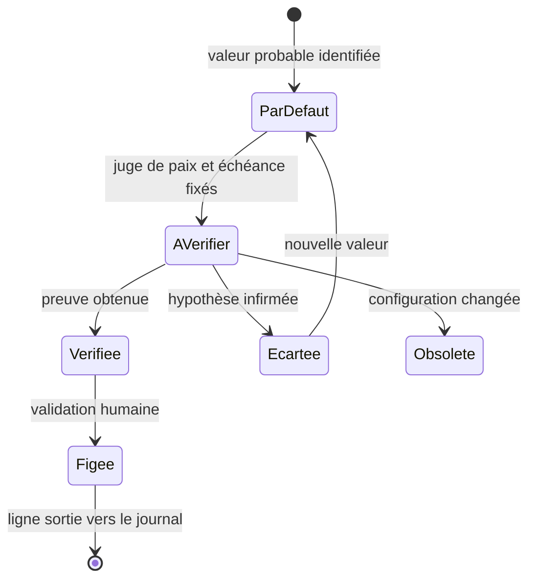

# Suivi des valeurs et des sources — pont entre valeurs par défaut et valeurs réelles

> **Rôle du document.** Registre d'**état** des valeurs techniques dont la fiabilité n'est
> pas encore établie. Il sert de **pont** entre la valeur par défaut la plus fiable
> disponible (document, code, proposition d'agent) et la valeur réellement vérifiée. Il ne
> retient **que les valeurs où un doute persiste** : une valeur établie quitte ce registre.
>
> **Non normatif pour les valeurs.** Les règles — échelle de fiabilité, second axe d'impact,
> juge de paix par type de tâche, portes de sortie — sont **normatives** dans
> [`Reference_Technique_Globale.md`](./Reference_Technique_Globale.md) §2.3. Ce fichier
> n'énonce aucune règle nouvelle et **ne peut pas contredire un document d'étape** : en cas
> d'écart, le document d'étape fait foi et le registre est corrigé.
>
> **Ce fichier n'est jamais une source de vérité pour coder.** La valeur utilisée par le
> code est celle du document d'étape et de `CapteursConfig.h` ; le registre ne dit que
> *pourquoi elle n'est pas sûre*, *comment le savoir* et *quand*.
>
> **Identifiants internes.** Les repères `V-<étape>-<numéro>` sont internes à ce registre ;
> ils ne remplacent ni un paquet, ni un point de reprise, ni un jalon. Ils ont le même
> statut que les repères `M0a` à `M4` du document d'étape 1 : aucun identifiant de
> planification n'est créé ni redéfini ici.
>
> **Ordre de lecture.** Après le document de référence de l'étape concernée, **avant de
> coder une valeur provisoire** (voir [`Suivi_Avancement.md`](./Suivi_Avancement.md) §2).

---

## 1. Principe

Deux questions sont séparées :

1. **Quelle valeur je code aujourd'hui ?** → le document d'étape et `CapteursConfig.h`.
2. **Pourquoi n'est-elle pas sûre, et comment la trancher ?** → ce registre.

| Ce fichier **est** | Ce fichier **n'est pas** |
|---|---|
| un état daté des doutes ouverts | une spécification |
| la trace de la valeur par défaut retenue et de sa provenance | une seconde table de configuration |
| la procédure de clôture de chaque doute (juge de paix, échéance) | un journal d'idées ou de variantes (→ `Annexe_*`) |
| l'historique des valeurs qui ont changé et de leur preuve | un support de programmation direct |

Le registre distingue deux situations que le marqueur `À définir` confond aujourd'hui :

- **`À définir`** : aucune valeur connue — il n'y a rien à coder, seulement une décision à
  prendre (broches RGB, bouton de session) ; si le doute est suivi, le repère `V-nn` s'y
  ajoute ;
- **`V-nn`** : une valeur probable existe et peut être codée provisoirement, mais elle n'est
  pas prouvée (adresse I2C, registre BMP581, port UWB).

---

## 2. Conventions

### 2.1 Identifiants

- Format : `V-<étape>-<numéro sur deux chiffres>` — `V-1-01`, `V-2-01`.
- Un identifiant est **attribué une fois et jamais réutilisé**, même après clôture.
- Un doute qui change d'étape **garde son identifiant** : c'est l'étape de création qui le
  préfixe ; le rattachement courant se lit dans l'emplacement et l'échéance.

### 2.2 Marqueurs dans les documents et le code

| Emplacement | Marqueur | Sens |
|---|---|---|
| Tableau d'un document d'étape | `V-1-03` en fin de cellule | cette valeur est enregistrée au registre |
| Code (`CapteursConfig.h`) | `// PROVISOIRE V-1-03` | valeur non prouvée, à ne pas figer telle quelle |
| Document d'étape | `À définir` | aucune valeur connue ; complété par un `V-nn` si le doute est suivi |

Le marqueur `V-nn` **remplace** `à vérifier` / `à confirmer` dans les tableaux de valeurs et
s'**ajoute** à `À définir` : ces mentions libres ne sont plus employées seules.

### 2.3 Provenance

Format `TYPE:référence`, toujours accompagné de la précision qui permet de retrouver le
passage :

| Type | Format | Exemple |
|---|---|---|
| `DS` | document constructeur, section/page, révision | `DS:BST-BMP581 §3.4 p.12, rév. 1.0` |
| `KAL` | formulation théorique, section, équation | `KAL:Formulations_Kalman §2.2.4 éq. 31` |
| `ELEC` | schéma ou routage | `ELEC:Elec/Schéma électrique capteurs.pdf` |
| `CODE` | précédent de code, chemin et commit | `CODE:FromTo Github/src/Capteurs/imu.h@a1b2c3d` |
| `WEB` | page officielle et date de consultation | `WEB:…@2026-10-30` |
| `MES` | mesure sur banc, protocole et date | `MES:scanI2C module seul, 2026-11-02` |
| `AGENT` | proposition sans référence | `AGENT` |

Une provenance `WEB` sans date, `CODE` sans commit ou `DS` sans révision est incomplète :
elle ne permet pas de dater le niveau de fiabilité.

### 2.4 Statuts

| Statut | Sens | Qui peut le poser |
|---|---|---|
| `par défaut` | valeur la plus fiable retenue, non vérifiée | agent |
| `à vérifier` | juge de paix identifié et échéance fixée | agent |
| `vérifiée` | preuve obtenue, conforme au juge de paix | agent |
| `figée` | valeur normative, propagée partout | **humain uniquement** |
| `écartée` | hypothèse infirmée par une preuve | agent |
| `obsolète` | ne s'applique plus (matériel, configuration) | agent, confirmé par l'humain si la valeur était `figée` |

Une valeur `figée` **sort du registre actif** : elle rejoint le journal (§4) puis le
document d'étape, le code et la note de passation.

---

## 3. Registre des doutes ouverts

> **Amorçage.** Les lignes ci-dessous reprennent les marqueurs `À définir` / `à vérifier`
> déjà présents dans [`Reference_Technique_Etape_1_Capteurs.md`](./Reference_Technique_Etape_1_Capteurs.md)
> (§0, §1.3 bloc 4, §1.7.1, §3.4, Annexe A) et §7. Les niveaux, impacts et échéances sont
> des **propositions** : les corriger ne demande aucune modification du document d'étape.
> Une ligne ouverte ne signifie pas que le doute est confirmé ; elle signifie qu'il n'est
> pas clos.

| ID | Type de tâche | Valeur par défaut retenue | Emplacement | Provenance · niveau | Impact | Juge de paix · complément | Échéance | Statut |
|---|---|---|---|---|---|---|---|---|
| `V-1-01` | Adresse / bus I2C | BNO085 à `0x4A` (`ADR` = 0, défaut Adafruit) | `CFG_IMU[]`, bloc 5 | `DS:Adafruit_9-DOF… + SH-2` · **B**, 95 % | bloquant | `scanI2C` module seul + schéma `ELEC` (strapping `ADR`) · alternative `0x4B` | `M0b` | `à vérifier` |
| `V-1-02` | Adresse / bus I2C | BMP581 à `0x47` (module DFRobot) | `CFG_ALTI[]`, bloc 6 | `DS:DFRobot_SEN0667 + BST-BMP581` · **C**, 80 % (variantes `0x46`/`0x47` selon `SDO`) | bloquant | `scanI2C` module seul + schéma `ELEC` (`SDO`) + fiche du module | `M0b` | `à vérifier` |
| `V-1-03` | Paramètres capteur (registres) | `OSR_CONFIG` à `0x38` | doc étape §3.4 | `DS:BST-BMP581` · **D**, 60 % | bloquant | relecture ciblée de la carte des registres (passage identifié) | `M0a` | `à vérifier` |
| `V-1-04` | Paramètres capteur (registres) | filtre IIR : champ dans `DSP_CONFIG` (`0x30`) ou registre dédié | doc étape §3.4 | `DS:BST-BMP581` · **D**, 50 % | bloquant | même relecture + test écriture/lecture sur banc | `M0a` | `à vérifier` |
| `V-1-05` | Brochage / port série | `H_INTN` et `INT` non routées (`-1`) | bloc 4, §1.7.1 | `ELEC:schéma capteurs (à lire)` vs `DS:Materiel §5.4` (contradiction interne au document) · **D**, 60 % | majeur | schéma `ELEC` + test de continuité · §2.4 et §3.4 du même document disent l'inverse du §5.4 | `M0a` | `à vérifier` |
| `V-1-06` | Brochage / port série | UWB sur `Serial5` | bloc 4, §1.7.1 | `CODE:FromTo Github/uwb.h` (60 %) vs `DS:Materiel §5.4` (`Serial1`) · **D**, 60 % | majeur | test réel sur banc + schéma `ELEC` | `M0b` | `à vérifier` |
| `V-1-07` | Brochage / port série | trame canonique sur `Serial8`, broches non définies | bloc 4, §1.7.1 | `AGENT` · **D**, 40 % | majeur | schéma `ELEC` + recherche d'UART libres sur la carte Teensy | `M0b` | `par défaut` |
| `V-1-08` | Brochage / port série | sortie RGB sur 41/39/40, réservée | bloc 4, §1.3.3 | `DS:Materiel §5.4` (LED 13 seule) · **D**, 40 % | mineur | schéma `ELEC` · fonction réservée, non implémentée | `M0a` | `par défaut` |
| `V-1-09` | Session / entrées | `CAP_SESSION_BOUTON_PIN = -1` | bloc 13 | `AGENT` · **D**, 30 % | mineur | décision matérielle + schéma `ELEC` · équivalent DEV disponible | `M4` | `par défaut` |
| `V-1-10` | Paramètres capteur (ODR) | `BMP581_ODR_CODE = 0xFF` (sentinelle) | bloc 6, Annexe A | `DS:table ODR non recopiée` · **D**, 50 % | bloquant | table ODR → Hz de la fiche + mesure de cadence réelle (paquet `1.3`) | `M2` | `par défaut` |
| `V-1-11` | Paramètres capteur (registres) | carte des registres BMP581 : `CHIP_ID` 0x01/0x50, `STATUS` 0x27, données 0x20–0x25, `CMD` 0x7E | doc étape §3.4 | `DS:BST-BMP581` · **D**, 60 % (table à valider en bloc) | bloquant | relecture ciblée de la fiche + lecture réelle des registres sur banc | `M0a` | `à vérifier` |
| `V-2-01` | Formulation / modèle Kalman | quaternion scalaire en premier, passage corps → terre | étape 1 §7 (contrat) | `KAL:Formulations_Kalman §2.2.1 et §2.2.4` · **C**, 80 % | bloquant | test analytique + invariants numériques + référence hôte (`bench/test_kalman/reference/`) | `C2.1` | `à vérifier` |

### 3.1 Lecture d'une ligne

- **Valeur par défaut retenue** : ce qui est codé aujourd'hui. Elle n'est pas un engagement.
- **Provenance · niveau** : l'ordre de grandeur de la confiance et **pourquoi** ce n'est pas
  `A`. Le niveau, pas le pourcentage, commande les portes du §6.
- **Juge de paix** : la procédure qui **clôt** le doute. Le « complément » qui la suit est
  une piste exploratoire, pas une preuve.
- **Échéance** : le point de reprise interne (`M0a`, `M0b`, `M2`, `M4`) ou de paquet
  (`C…`) avant lequel le doute doit être clos.

### 3.2 Règle de non-régression

Une ligne ne peut pas être supprimée sans rejoindre le journal (§4). Un doute qui « disparaît »
sans valeur réelle ni preuve n'est pas clos : il est perdu.

---

## 4. Journal des doutes clos

> Alimenté à la clôture. Conserve le **pourquoi du changement**, pas seulement le changement :
> c'est ce qui manque quand une adresse passe de `0x47` à `0x4A` sans explication.

| ID | Valeur réelle | Preuve | Date | Niveau après | Écart et conséquence | Propagation (doc · code · passation) |
|---|---|---|---|---|---|---|
| — | — | — | — | — | — | — |

La propagation se fait **dans le même commit** : tableau du document d'étape, code
(`CapteursConfig.h`), note de passation, puis suppression de la ligne active. Le journal
garde une ligne de synthèse ; l'annexe de l'étape garde la décision.

---

## 5. Cycle de vie et gouvernance



| Transition | Condition | Autorité |
|---|---|---|
| création → `par défaut` | valeur probable, provenance écrite | agent |
| `par défaut` → `à vérifier` | juge de paix et échéance renseignés | agent |
| `à vérifier` → `vérifiée` | preuve conforme au juge de paix du type de tâche | agent |
| `vérifiée` → `figée` | propagation effectuée, revue de la valeur | **humain** |
| `vérifiée` / `à vérifier` → `écartée` | preuve d'infirmation | agent |
| `figée` → `obsolète` | changement de matériel ou de configuration | humain (confirmation) |

**Indépendance de la preuve.** Une source ne peut pas confirmer sa propre valeur : une
adresse issue d'un sketch ne peut pas être validée par ce sketch, une formulation reprise
d'un PDF ne peut pas être validée par une relecture du même passage. Le juge de paix doit
être d'une **autre nature** que la source (mesure pour un document, test pour une
formulation).

**Autorité de l'humain.** `figée` est la seule transition réservée à l'humain ; toutes les
autres sont ouvertes à l'agent, à condition que la preuve soit consignée. Un agent ne peut
pas clore un doute par simple confiance dans une source.

---

## 6. Portes de sortie

1. Un paquet ne peut être déclaré `terminé` avec un doute **bloquant** ouvert sur son
   périmètre.
2. Un jalon ne peut être déclaré avec un doute **majeur** ouvert sur son périmètre.
3. Une valeur de niveau `D` ne peut être codée que si le code porte `PROVISOIRE V-nn` et que
   la ligne existe au §3.
4. Une valeur `figée` exige la propagation dans le même commit (document d'étape, code,
   note de passation, journal).
5. Le registre ne fait pas autorité : en cas d'écart avec un document d'étape, le document
   d'étape fait foi et la ligne est corrigée.
6. Un doute ouvert dont dépend un paquet suivant est reporté dans les **Entrées** de ce
   paquet, sous la forme « doutes ouverts : `V-…` ».

---

## 7. Fiche de doute (doutes bloquants et majeurs)

Pour un doute `bloquant` ou `majeur` dont le juge de paix n'est pas une simple lecture, la
ligne du §3 est complétée par ce bloc, ajouté sous le tableau :

```text
V-x-nn — <intitulé court>
Question     : <ce qui n'est pas su, en une phrase>
Hypothèses   : H1 <...> ; H2 <...>
Discriminant : <test ou mesure qui sépare H1 de H2>
Résultat     : <à remplir>
Décision     : <valeur retenue, niveau, date, autorité>
Propagation  : <doc §, fichier code, note de passation>
```

La fiche disparaît avec la ligne : sa synthèse rejoint le journal (§4).

---

## 8. Tenue à jour

| Moment | Action |
|---|---|
| début de session | lire le registre après le document d'étape, avant de coder une valeur `V-nn` |
| ouverture d'un doute | créer la ligne, renseigner provenance, niveau, impact, juge de paix, échéance |
| obtention d'une preuve | passer `vérifiée`, renseigner la fiche §7 si nécessaire |
| clôture | validation humaine → `figée`, propagation même commit, ligne vers le journal |
| fin de paquet | vérifier qu'aucun doute bloquant n'est ouvert sur le périmètre (porte §6) |
| fin de session | reporter les doutes non clos dans la note de passation |

Le registre est enregistré dans la carte des documents de
[`Suivi_Avancement.md`](./Suivi_Avancement.md) §3. Son historique de décisions
documentaires est consigné dans
[`Annexe_Variantes_Et_Historique_Globale.md`](./Annexes/Annexe_Variantes_Et_Historique_Globale.md).
